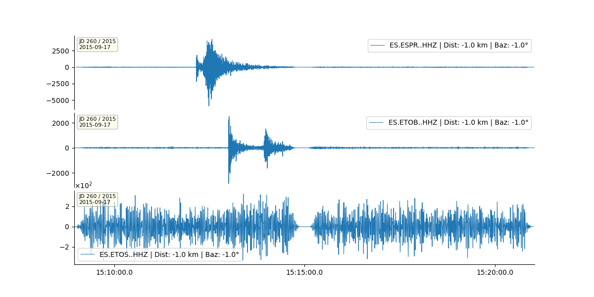
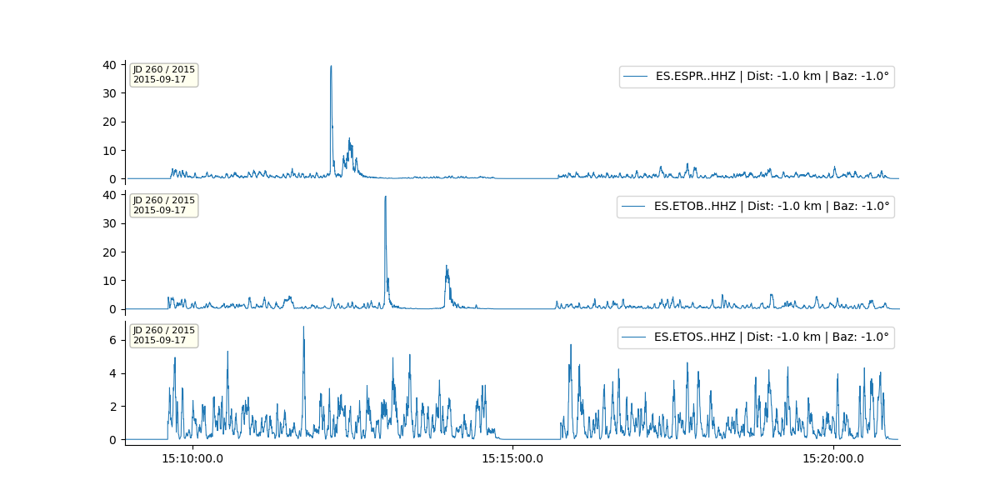
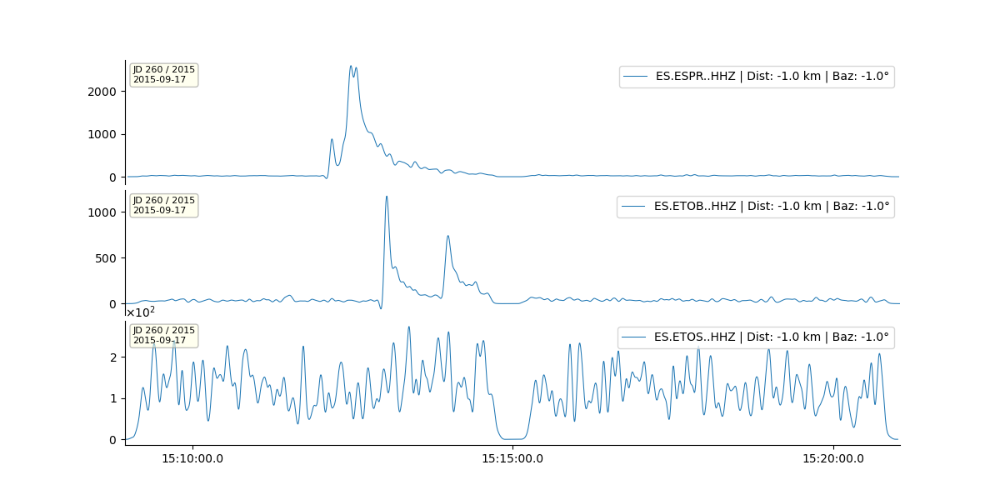
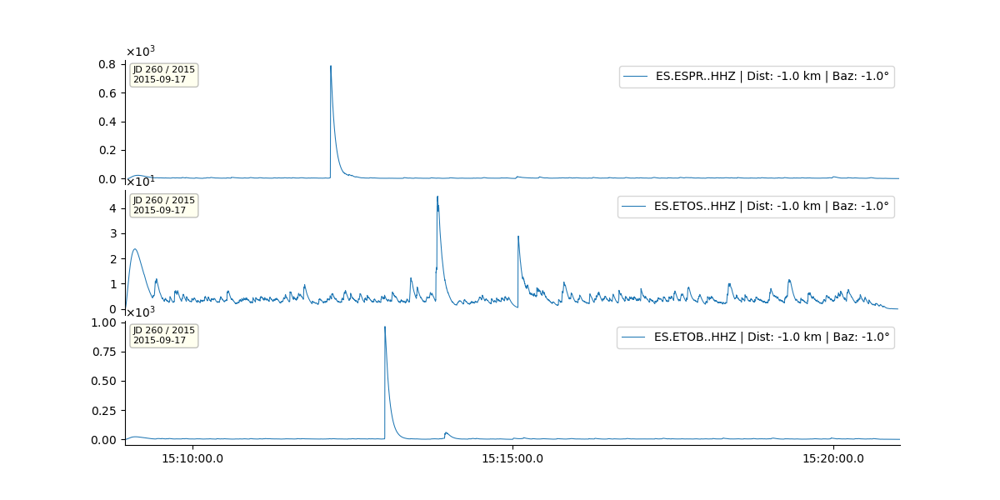
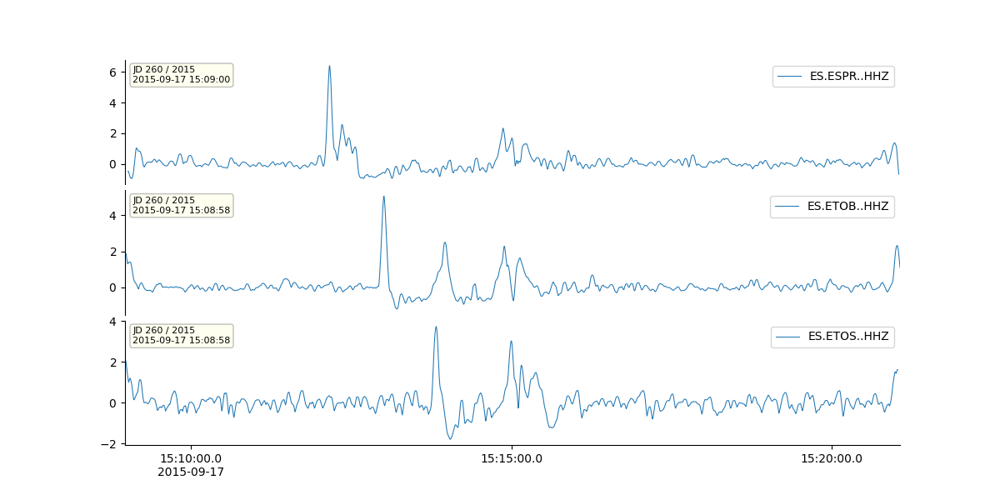

# Characteristic Functions in SurfQuake

A **characteristic function** (CF) transforms a seismogram into a curve that **rises when a seismic arrival starts**. Raw waveforms are difficult to scan automatically: the amplitude of the background noise changes, arrivals can be emergent, and the onset is hidden in the oscillation of the wave. A good CF is flat and low in the noise, and jumps at the onset, so a simple threshold can detect it. CFs are the core of automatic **event detection** (coincidence triggers), **phase picking** and **array processing**.

Each CF responds to a different property of the signal:

| CF | Reacts to | Strengths | Weaknesses |
|----|-----------|-----------|------------|
| **SNR** (STA/LTA) | An increase of **energy** | Simple, fast, the classic detector | Late or missed for emergent signals; sensitive to noise bursts |
| **Envelope** | **Amplitude** | Simple, robust, smooth | Only amplitude: misses arrivals that change the frequency content but not the amplitude |
| **Spectral entropy** | Concentration of energy in **few frequencies** | Detects narrowband signals (tremor, LP events, later phases in a coda) | Low time resolution (window based) |
| **Kurtosis** | **Impulsiveness** (non-Gaussian samples) | Sharp, precise onsets in noisy data | Does not help emergent signals; sensitive to spikes |
| **CWT** | Energy, spectral contrast, entropy, centroid or kurtosis **in many frequency bands at once** | Combines several CFs from one wavelet transform; robust in low SNR | More parameters to choose |

All CFs are **stream methods**: *n* traces in, *n* CF traces out, with the same ids and the same time axis as the input. They replace the waveforms, so they are usually the **last step** of the workflow. Plot them, write them (`-o`), or use them in your own [scripts](scripts.md).

!!! tip "Pre-processing"
    Every CF works better on clean data. Merge the segments, remove the mean, taper and **filter** in the band where your events have energy before computing the CF. The template `surfquake make_config -c ch_functions` contains this pre-processing and a commented block for every CF.

```yaml
Analysis:
  process_1:
    name: 'concat'
  process_2:
    name: 'rmean'
    method: 'linear'
  process_3:
    name: 'taper'
    method: 'cosine'
    max_percentage: 0.05
  process_4:
    name: 'filter'
    type: 'bandpass'
    fmin: 0.5
    fmax: 8.0
    corners: 4
    zerophase: True
  process_5:
    name: 'snr'          # <- the characteristic function: replace this block
    method: 'classic'
    sign_win: 1
    noise_win: 40
```

In the examples below only the CF step is shown: add it after the pre-processing steps, with the next free number (`process_5` here). Each `process_N` key must be unique: a repeated key silently replaces the earlier step.

---

## 1. Signal-to-Noise Ratio (STA/LTA)

The **STA/LTA** ratio compares the average energy in a short window (Short-Term Average, the "signal") with the average energy in a long window (Long-Term Average, the "noise"). In the noise both averages are similar and the ratio stays near 1; when an arrival enters the short window, the STA grows much faster than the LTA and the ratio jumps. It is the classic detector of seismology (Allen, 1978).

For a trace $x_n$ with STA and LTA windows of $N_s$ and $N_l$ samples:

$$\mathrm{STA}_n = \frac{1}{N_s}\sum_{k=n-N_s+1}^{n} x_k^2, \qquad \mathrm{LTA}_n = \frac{1}{N_l}\sum_{k=n-N_l+1}^{n} x_k^2, \qquad \mathrm{CF}_n = \frac{\mathrm{STA}_n}{\mathrm{LTA}_n}$$

The recursive version updates both averages with exponential decay, $\mathrm{STA}_n = \tfrac{1}{N_s}x_n^2 + \left(1-\tfrac{1}{N_s}\right)\mathrm{STA}_{n-1}$ (and likewise the LTA with $N_l$).

### Methods

| `method` | Description |
|----------|-------------|
| `classic` | Classic STA/LTA: both averages over sliding windows that end at the current sample. |
| `recursive` | Recursive STA/LTA: the averages are updated with exponential decay. Faster and smoother. |
| `z_detect` | Z-detector: the STA expressed in standard deviations from its mean over the trace. Uses only `sign_win`. |

### Parameters

| Parameter | Description |
|-----------|-------------|
| `sign_win` | STA window, in seconds. About 1–2 periods of the dominant frequency of the arrivals: short windows react faster but are noisier. |
| `noise_win` | LTA window, in seconds. Typically 10–40 times `sign_win`. Ignored by `z_detect`. |

### Config Example

```yaml
  process_5:
    name: 'snr'
    method: 'classic'
    sign_win: 1
    noise_win: 40
```

### References

- Allen, Rex V. "Automatic earthquake recognition and timing from single traces." *Bulletin of the Seismological Society of America* 68.5 (1978): 1521-1532.
- Withers, Mitchell, et al. "A comparison of select trigger algorithms for automated global seismic phase and event detection." *Bulletin of the Seismological Society of America* 88.1 (1998): 95-106.

---

## 2. Envelope

The **envelope** is the instantaneous amplitude of the signal. It is computed from the **analytic signal** $x(t) + i\,\mathcal{H}[x(t)]$, where $\mathcal{H}$ is the Hilbert transform: the envelope is its modulus,

$$E(t) = \sqrt{x(t)^2 + \mathcal{H}[x](t)^2}$$

 It follows the amplitude of the wave without its oscillation, so an arrival appears as a smooth bump instead of a wave train. It is simple and robust, but it only reacts to amplitude.

### Methods

| `method` | Description |
|----------|-------------|
| `FULL` | Raw envelope. |
| `SMOOTH` | Envelope followed by a low-pass filter at `corner_freq`. Recommended for triggering and for long records. |

### Parameters

| Parameter | Description |
|-----------|-------------|
| `method` | `FULL` or `SMOOTH`. |
| `corner_freq` | `SMOOTH` only: low-pass corner in Hz, written as a float (`0.15`, not `1`). Lower values give smoother envelopes and less time resolution. |

### Config Example

```yaml
  process_5:
    name: 'envelope'
    method: 'SMOOTH'
    corner_freq: 0.15
```

### Reference

- Kanasewich, Ernest R. *Time Sequence Analysis in Geophysics*. 3rd ed., University of Alberta Press, 1981.

---

## 3. Spectral Entropy

The **spectral entropy** measures how spread the energy is over frequencies. In each sliding window, the power spectrum is normalised so it sums to 1, like a probability distribution $p_k$, and its Shannon entropy is computed and divided by its maximum value:

$$H = -\frac{1}{\log_2 N}\sum_{k=1}^{N} p_k \log_2 p_k \qquad (0 \le H \le 1)$$

- **High entropy** (close to 1): the energy is spread over all frequencies, as in broadband noise.
- **Low entropy**: the energy is concentrated in a few frequencies, as in a seismic arrival, tremor or a long-period event.

So, unlike the other CFs, the entropy **drops** at an arrival. It is useful for narrowband signals and for arrivals that change the frequency content more than the amplitude.

### Parameters

| Parameter | Description |
|-----------|-------------|
| `win` | Window length in seconds. It must contain several periods of the lowest frequency of interest. Longer windows give a more stable entropy but less time resolution. |
| `overlap` | Overlap between windows, in **percent** (default 50). |

### Config Example

```yaml
  process_5:
    name: 'entropy'
    win: 5.0
    overlap: 50
```

!!! tip
    For a CF that **rises** at arrivals and is whitened against the background noise, use `cwt_cf` with `cf_type: 'entropy'` (section 5).

### References

- Shannon, Claude E. "A mathematical theory of communication." *The Bell System Technical Journal* 27.3 (1948): 379-423.
- da Silva, Sérgio Luiz E. F., and Gilberto Corso. "Microseismic event detection in noisy environments with instantaneous spectral Shannon entropy." *Physical Review E* 106.1 (2022): 014133.

---

## 4. Kurtosis

The **kurtosis** is the fourth-order statistical moment of the signal, normalised by the variance. Gaussian noise has a fixed kurtosis, while an impulsive arrival produces a few samples much larger than the rest and the kurtosis rises sharply. It is therefore very sensitive to the **onset** of impulsive arrivals, even in noisy data, and gives precise onset times.

In a window of samples with mean $\mu$ and standard deviation $\sigma$:

$$K = \frac{\frac{1}{N}\sum_k (x_k-\mu)^4}{\sigma^4}$$

which is 3 for Gaussian noise and grows when a few samples are much larger than the rest.

SurfQuake follows a **multi-band** approach: the trace is filtered in 20 logarithmically spaced frequency bands between `fmin` and `fmax`, a recursive kurtosis CF is computed in each band, and the bands are combined. An arrival that is impulsive in any band raises the CF.

### Parameters

| Parameter | Description |
|-----------|-------------|
| `CF_decay_win` | Memory of the recursive estimator, in seconds. Shorter windows (e.g. 2 s) give sharper responses but noisier CFs; longer windows give smoother and slower CFs. |
| `fmin`, `fmax` | Frequency band of the filter bank, in Hz (`fmax` is capped at 0.98 × Nyquist). |

### Config Example

```yaml
  process_5:
    name: 'kurtosis'
    CF_decay_win: 4.0
    fmin: 0.5
    fmax: 8.0
```

!!! note
    Kurtosis does not help emergent signals, and it reacts to spikes: remove them first (`remove_spikes`). To combine kurtosis with other CFs computed from the same wavelet transform, use `cwt_cf` with `cf_type: 'kurtosis'` (section 5).

### Reference

- Poiata, Natalia, et al. "Multi-band array detection and location of seismic sources recorded by dense seismic networks." *Geophysical Journal International* 205.3 (2016): 1548-1573.

---

## 5. CWT Characteristic Functions

The **Continuous Wavelet Transform** decomposes each trace into many narrow frequency bands, with a time resolution adapted to each frequency (see [Time-Frequency Analysis](spectral_analysis_documentation.md)). The result, the **scalogram**, shows how the energy of the trace is distributed in time and frequency. `cwt_cf` builds characteristic functions from the scalogram: since every band is analysed at the same time, the CF reacts to arrivals that are clear only in some frequencies, which makes it robust in low signal-to-noise conditions. The original CWT characteristic function was designed to turn the incoherent traces of a large, sparse array into coherent impulse functions suitable for beamforming (Cabieces et al., 2020).

SurfQuake computes the bank of wavelet atoms **once** and convolves every trace with it, so it is efficient for many traces and long records. From the same scalogram it can compute several CFs in a single pass and combine them.

### Mathematical description

**Scalogram.** Each trace $x(t)$ is convolved with a bank of $N_f$ wavelet atoms $\psi_j$ centred at the frequencies $f_j$ (logarithmically spaced between `fmin` and `fmax`, `voices_per_octave` per octave). The complex coefficients and the power scalogram are

$$W(f_j, t) = (x * \psi_j)(t), \qquad P(f_j, t) = \lvert W(f_j, t)\rvert^2$$

**`power`.** The mean over frequencies of the time derivative of the log power (Cabieces et al., 2020):

$$\mathrm{CF}(t) = \frac{1}{N_f}\sum_{j=1}^{N_f}\frac{\partial}{\partial t}\log_{10} P(f_j, t)$$

It is large when the power rises suddenly in many frequencies at the same time, which is what an onset does.

**Whitening and windows.** The other spectral CFs compare a **signal window** after $t$ with a **background window** before $t$. First, each frequency is divided by its own background level, so all frequencies weigh the same (whitening):

$$\tilde P(f_j, t) = \frac{P(f_j, t)}{\operatorname{median}_t P(f_j, t)}$$

Then, with $T_a$ = `win_after`, $T_b$ = `win_before` and $g$ = `gap`, the mean power in the two windows is

$$A^{+}(f_j, t) = \big\langle \tilde P(f_j, \tau) \big\rangle_{\tau \in [t,\, t+T_a]}, \qquad A^{-}(f_j, t) = \big\langle \tilde P(f_j, \tau) \big\rangle_{\tau \in [t-g-T_b,\, t-g]}$$

and the log ratio of the window amplitudes is

$$D(f_j, t) = \tfrac{1}{2}\log_{10} A^{+}(f_j, t) - \tfrac{1}{2}\log_{10} A^{-}(f_j, t)$$

**`power_win`.** The mean spectral ratio, a multi-band STA/LTA in the log domain (Gibbons et al., 2008):

$$\mathrm{CF}(t) = \frac{1}{N_f}\sum_j D(f_j, t)$$

**`power_mod`.** The ratio weighted by the energy above the background, so only frequencies with real signal energy contribute; the signed square root brings the result back to log-amplitude units:

$$S(t) = \frac{1}{N_f}\sum_j D(f_j, t)\,\max\!\left(\tfrac{1}{2}\log_{10} A^{+}(f_j, t),\, 0\right), \qquad \mathrm{CF}(t) = \operatorname{sign}(S)\sqrt{\lvert S\rvert}$$

**`centroid`.** The energy centroid in log-frequency (octaves) of each window, and its shift:

$$c^{\pm}(t) = \frac{\sum_j A^{\pm}(f_j, t)\,\log_2 f_j}{\sum_j A^{\pm}(f_j, t)}, \qquad \mathrm{CF}(t) = c^{+}(t) - c^{-}(t)$$

Positive when the energy moves to higher frequencies.

**`entropy`.** The normalised spectral entropy of each window, and its drop:

$$p_j^{\pm} = \frac{A^{\pm}(f_j, t)}{\sum_k A^{\pm}(f_k, t)}, \qquad H^{\pm}(t) = -\frac{1}{\ln N_f}\sum_j p_j^{\pm}\ln p_j^{\pm}, \qquad \mathrm{CF}(t) = H^{-}(t) - H^{+}(t)$$

Positive when the energy concentrates in fewer frequencies after $t$ than before. With `direction: 'down'` the sign of the `centroid` and `entropy` CFs is reversed, and with `'both'` their absolute value is taken.

**`kurtosis`.** The real part of each row of the scalogram, $x_j(t) = \operatorname{Re} W(f_j, t)$, is a band-passed version of the trace. In a trailing window of length $T_k$ = `win_kurt`, the excess kurtosis of each band is averaged over the bands and compressed:

$$K_j(t) = \frac{m_4\big(x_j;\,[t-T_k,\, t]\big)}{m_2\big(x_j;\,[t-T_k,\, t]\big)^2} - 3, \qquad \bar K(t) = \frac{1}{N_f}\sum_j K_j(t), \qquad \mathrm{CF}(t) = \operatorname{sign}(\bar K)\,\ln\!\big(1 + \lvert\bar K\rvert\big)$$

where $m_2$ and $m_4$ are the second and fourth central moments. It is about 0 for Gaussian noise and positive when the signal becomes impulsive.

Finally, every CF is smoothed with a low-pass filter at `lowpass_freq`.

### CF types

| `cf_type` | Idea | Reacts to |
|-----------|------|-----------|
| `power` | Mean over frequencies of the time derivative of the log power. The original CF (Cabieces et al., 2020). | A jump in energy: impulsive onsets, typically P. |
| `power_win` | Windowed spectral ratio: mean over frequencies of $\log(A_{after}/A_{before})$, a multi-band STA/LTA in the log domain (Gibbons et al., 2008). | Energy contrast. |
| `power_mod` | As `power_win`, weighted by the energy above the background (Gibbons et al., 2008). | High contrast **and** high energy: strong, impulsive arrivals. |
| `entropy` | Drop of the spectral entropy of the whitened scalogram. | Energy concentrating in a narrow band, even if the total energy barely changes: later phases inside a coda (typically S), narrowband signals (tremor, LP events). |
| `centroid` | Shift of the energy centroid in log-frequency (octaves). | A signal spectrally different from the noise, e.g. a local event above the microseism band. |
| `kurtosis` | Multi-band excess kurtosis of the band-passed signals in a trailing window. | Impulsive signals: weak sharp onsets, precise timing. Not emergent signals; sensitive to spikes. |

!!! tip "Which one?"
    In our tests `power_mod` found the P waves (broadband, impulsive) and `entropy` found the S waves inside the P coda, which the energy CFs missed; `kurtosis` added weak impulsive onsets and sharper picks. Combining them with `combine: 'stouffer'` gave the best detections: `cf_type: 'power_mod,entropy,kurtosis'`.

### Required parameters

| Parameter | Description |
|-----------|-------------|
| `fmin`, `fmax` | Analysis band in Hz. Keep it inside the band of the pre-processing filter. |
| `cycles` | Number of cycles of the wavelet. Larger = better frequency resolution, worse time resolution. 6 is recommended for `cm`. |
| `voices_per_octave` | Frequency sampling: 8 = coarse, 16 = standard, 32 = fine. |
| `wavelet_type` | `cm` = Complex Morlet (recommended), `mh` = Mexican Hat (real wavelet, `power` CF only), `pa` = Paul. |

### Optional parameters

| Parameter | Default | Description |
|-----------|---------|-------------|
| `cf_type` | `power` | One type, or several separated by commas. With several types they are combined into **one** CF per trace. |
| `lowpass_freq` | 0.15 | Low-pass corner applied to the CF (Hz). Lower = smoother CF, less time resolution. The window-based CFs are already smoothed by their windows: use 0.5–1.0 for them. |
| `win_before` | 10.0 | `power_win`, `power_mod`, `entropy`, `centroid`: background window before each sample (s). |
| `win_after` | 2.0 | Same CFs: signal window after each sample (s). Use at least ~2 periods of `fmin` (`fmin` = 0.5 Hz → ≥ 4 s); `win_before` ~5–10 × `win_after`. |
| `gap` | 0.5 | The background window ends `gap` s before each sample, so the start of an emergent arrival does not enter the background (Gibbons et al., 2008). 0 = no gap. |
| `direction` | `up` | `entropy` and `centroid`: `up` = increase, `down` = opposite sign, `both` = absolute value. |
| `win_kurt` | 3.0 | `kurtosis`: trailing window (s), 1–5 s, at least a few periods of `fmin`. Shorter = sharper and noisier. |

### Combining several CFs

When `cf_type` has several types, each CF is standardised and they are merged into one CF per trace:

| Parameter | Default | Description |
|-----------|---------|-------------|
| `combine` | `max` | `max`: fires if **any** CF fires (more detections, more false alarms). `mean`: fires only if the CFs **agree** (conservative). `stouffer`: sum divided by the square root of the sum of their correlations: rewards agreement and does not count correlated CFs twice (**recommended**). `gmean`: between `mean` and `max`, controlled by `p`. |
| `p` | 3.0 | `gmean` power: 1 = mean, large = max. |
| `tolerance` | 0.0 | Running maximum of each CF over ± `tolerance` s before combining, so peaks slightly offset in time add up. 0.3–0.5 s recommended; the trigger can move up to this amount earlier. |
| `norm` | `mad` | Standardisation of each CF. `mad`: $(x - \text{median}) / (1.4826 \cdot \text{MAD})$. `tail`: the `tail_quantile` is mapped to its Gaussian value (0.99 → 2.33 σ), so the same threshold gives a similar false-alarm rate for every CF (**recommended**). |
| `tail_quantile` | 0.99 | Quantile used by `norm: 'tail'`. It must be above the fraction of time occupied by events: 0.95 for ~1 h windows containing an event, 0.99–0.999 for full days. |
| `final_norm` | `False` | Standardise the combined CF again, so thresholds mean the same for every `combine` rule. |

In formulas, each CF $x_i(t)$ is first standardised:

$$z_i(t) = \frac{x_i(t) - \operatorname{median}(x_i)}{s_i}, \qquad s_i = \begin{cases} 1.4826\,\operatorname{median}\lvert x_i - \operatorname{median}(x_i)\rvert & \texttt{norm: 'mad'} \\[4pt] \dfrac{Q_q(x_i) - \operatorname{median}(x_i)}{\Phi^{-1}(q)} & \texttt{norm: 'tail'} \end{cases}$$

where $Q_q$ is the `tail_quantile` $q$ of the CF and $\Phi^{-1}$ the inverse of the standard normal distribution. Then, for $M$ CFs:

| `combine` | Combined CF |
|-----------|-------------|
| `max` | $\max_i z_i(t)$ |
| `mean` | $\frac{1}{M}\sum_i z_i(t)$ |
| `stouffer` | $\dfrac{\sum_i z_i(t)}{\sqrt{\sum_{i,k} R_{ik}}}$, with $R$ the correlation matrix of the $z_i$. For independent CFs the denominator is $\sqrt{M}$ (Stouffer's method); for correlated CFs it is larger, so they are not counted twice. |
| `gmean` | $\left(\frac{1}{M}\sum_i \max(z_i(t), 0)^p\right)^{1/p}$ |

**Output units**: a single `cf_type` gives the raw CF (not normalised). Several types give a CF in **σ units**, so thresholds like 4–5 σ apply. Calibrate them on a quiet day: with `combine: 'max'` the background is higher than for a single CF.

### Config Example

```yaml
  process_5:
    name: 'cwt_cf'
    cycles: 6
    fmin: 0.5
    fmax: 8.0
    voices_per_octave: 16
    wavelet_type: 'cm'
    cf_type: 'power_mod,entropy,kurtosis'
    lowpass_freq: 0.5
    win_before: 20.0
    win_after: 4.0
    gap: 0.5
    direction: 'up'
    win_kurt: 4.0
    combine: 'stouffer'
    tolerance: 0.5
    norm: 'tail'
    tail_quantile: 0.99
    final_norm: True
```

A single, simple CF:

```yaml
  process_5:
    name: 'cwt_cf'
    cycles: 6
    fmin: 0.5
    fmax: 8.0
    voices_per_octave: 16
    wavelet_type: 'cm'
    cf_type: 'power'
```

### References

- Cabieces, Roberto, et al. "Slowness vector estimation over large-aperture sparse arrays with the Continuous Wavelet Transform (CWT): application to Ocean Bottom Seismometers." *Geophysical Journal International* 223.3 (2020): 1919-1934.
- Gibbons, Steven J., Frode Ringdal, and Tormod Kværna. "Detection and characterization of seismic phases using continuous spectral estimation on incoherent and partially coherent arrays." *Geophysical Journal International* 172.1 (2008): 405-421.

---

## Applications

| CF | Typical use |
|----|-------------|
| **SNR** | Event detection, coincidence triggers, first-arrival picking. |
| **Envelope** | Energy bursts, surface waves, coda analysis, tremor. |
| **Spectral Entropy** | Narrowband signals, tremor and LP events, discrimination of signal vs noise. |
| **Kurtosis** | Precise onsets of impulsive phases in noisy signals. |
| **CWT** | Robust detection in low SNR, P and S in the same CF, array processing with sparse arrays. |

The CF traces can be plotted, written to disk (`-o`), used by the coincidence trigger, or analysed in your own [scripts](scripts.md).

---

## Output

Each CF replaces the trace data with the calculated function, keeping the trace ids and the time axis. In the following example, all CFs were computed on the same filtered seismograms.

1. **Filtered seismograms**: bandpass 0.5–8.0 Hz.



2. **SNR**: classic STA/LTA, 1 s / 40 s.



3. **Envelope**: smoothed with a 0.15 Hz low-pass filter.



4. **Kurtosis**: 0.5–8.0 Hz, `CF_decay_win` 4.0 s.



5. **CWT**: `power_mod`, `entropy` and `kurtosis` between 0.5 and 8.0 Hz, combined with `stouffer`.


