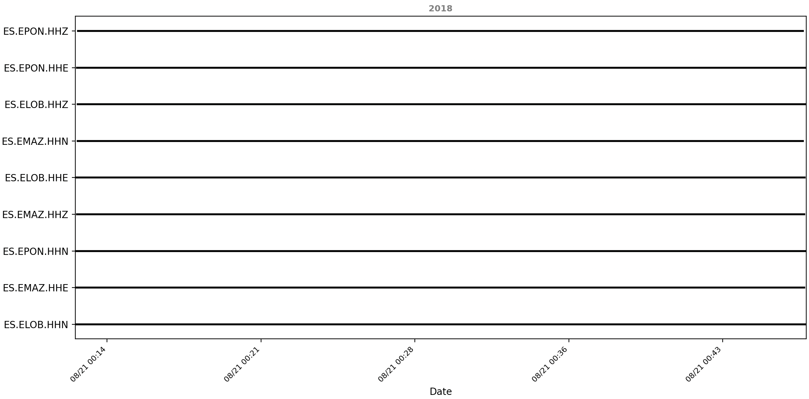

# Explore Data Availability

Before any analysis, it is really worth exploring the **availability** of your data: which stations and channels you have, which time span they cover, and where the gaps are. A few minutes here can save hours later: a missing component makes a rotation fail, a gap creates artefacts after filtering, and a station with a different time span can silently drop out of a stack or a beamforming.

`surfquake explore` scans your files and draws one horizontal line per file over a time axis:

- **Black line**: the time span with data.
- **Red line**: a **gap** inside the file (missing samples).
- **No line**: no file covers that time (for example, a missing day).

Only the headers of the files are read, not the samples, and several files are read in parallel, so it is fast even for large archives. For big datasets the progress is shown on screen.

---

## Command Line

```bash
surfquake explore -h
```

You can explore a set of files, or a project:

```bash
surfquake explore -w [path to your files, e.g. './data/*']
surfquake explore -p [path to your project file, e.g. './project.pkl']
```

| Argument | Description |
|----------|-------------|
| `-w`, `--wave_files` | Glob pattern or path to the waveform files. |
| `-p`, `--project_file_path` | A saved surfquake [project](project.md). |
| `-n`, `--net` | Network filter (with `-p`), e.g. `ES,IU`. |
| `-s`, `--station` | Station filter (with `-p`), e.g. `EALB,EMAZ`. |
| `-ch`, `--channel` | Channel filter (with `-p`), e.g. `HHZ`. |
| `--min_date`, `--max_date` | Time window (with `-p`), format `YYYY-MM-DD HH:MM:SS`. |

Either `-w` or `-p` must be set.

!!! tip "Wildcards"
    Wildcards select files by their **file name**, not by their header. With the usual naming `NET.STA.LOC.CHA.D.YEAR.DAY`:

    - `'./data/*'`: all files (non-seismic files are skipped).
    - `'./data/*Z*'`: all vertical components.
    - `'./data/*EALB*'`: only station EALB.
    - `'./data/*.2022.03*'`: days 030 to 039 of 2022.

    Quote the pattern (`'./data/*'`), so that surfquake, and not your terminal, expands it.

---

## Example

In this example, I simply navigate to the folder where I have placed three stations with three channels each, so nine files, and run the command:

```bash
surfquake explore -w "./*"
```



---

## What to look for

| What you see | What it means | What to do |
|--------------|---------------|------------|
| Red segments | Gaps inside the files. | Short gaps: `fill_gaps` or `concat` before processing. Long gaps: avoid analysing those windows. |
| One component shorter than the others | The three components of a station do not cover the same time. | `rotate` cuts them to the common window automatically; for other analyses, cut them with `cut_stream`. |
| A station starting later or ending earlier | Different time span. | For stream methods (stacking, beamforming), cut all traces to a common window. |
| A missing line | A channel or a day is missing. | Check your download, or exclude that station. |

ℹ️ All the files of the same channel are drawn on the same row (`NET.STA.CHANNEL`), so consecutive daily files appear as one continuous line, and the location code is not shown.

---

## Next steps

Once you know what you have, look at the details of each file with `surfquake info`: sampling rate, number of samples, picks... See [Trace Header](trace_header_documentation.md).

```bash
surfquake info -w './data/*' -c 3
```
