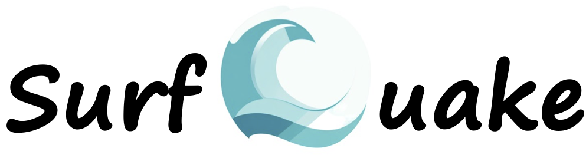

#  **Welcome to** 

Surfquake has been designed to processing seismic traces and to streamline the workflow of estimating seismic source parameters. 
The signal processing toolbox is extended with a lage variety of numerical methods while the comprehensive set of workflow toolboxes automates the determination of arrival times, event locations, event magnitudes , attenuation, and moment tensor inversion. The software is programmed in *Python 3* and offers the users the possibility of three programming levels for flexibility and customization.

- The **Core Library**  allows users to integrate the core of surfQuake into their preexisting scripts, giving advanced users full control.

- The **Command Line Interface**  gives users access to an upper layer that simplifies the use of the core, enabling task execution through simple commands.

- The **Graphical User Interface (GUI)**: Now SurfQuake user-friendly interface is fully included in [Integrated Seismic Program](https://projectisp.github.io/ISP_tutorial.github.io/){: target="_blank" rel="noopener noreferrer" }, making it accessible to users who prefer visual interaction. 

---

##  **Cite surfQuake** 

- [*Seismological Research Letters paper*](https://pubs.geoscienceworld.org/ssa/srl/article-abstract/doi/10.1785/0220240186/654285/surfQuake-A-New-Python-Toolbox-for-the-Workflow?redirectedFrom=fulltext)

---

##  **Case of Study and Supporting Materials** 
First: [Case of study](https://github.com/rcabdia/test_surfquake), contains a full example of using surfQuake with core Library Python scripts, Core Library bash script and expected results. Of course you can try to run the example using the GUI.

Second: [Earth Velocity models examples](https://github.com/rcabdia/ProjectISP_3Dmodels). Event Location format and MTI format.

---

##  **Keeping Updated** 
<!DOCTYPE html>
<html lang="en">
<head>
    <meta charset="UTF-8">
    <meta name="viewport" content="width=device-width, initial-scale=1.0">
    <title>Links Grid</title>
    
</head>
<body>
    

        <a href="https://github.com/rcabdia/SurfQuakeCore"
           target="_blank" rel="noopener noreferrer" class="link-item">
            
            Open-source code
        </a>

        <a href="https://twitter.com/ProgramSeismic"
           target="_blank" rel="noopener noreferrer" class="link-item">
            
            Twitter
        </a>

        <a href="https://github.com/ProjectISP/ISP/issues"
           target="_blank" rel="noopener noreferrer" class="link-item">
            
            Questions and Issues
        </a>
    

</body>
</html>

---

##  **ToolBoxes** 

  <section class="sq-category sq-category--start" aria-label="Getting Started">
    <h3>Getting Started</h3>
    

      <a class="sq-link" href="https://projectisp.github.io/surfquaketutorial.github.io/seismic_data_files/">Seismic Files</a>
      <a class="sq-link" href="https://projectisp.github.io/surfquaketutorial.github.io/metadata/">Metadata</a>
      <a class="sq-link" href="https://projectisp.github.io/surfquaketutorial.github.io/project/">Project</a>
    

  </section>
  <section class="sq-category sq-category--tutorial" aria-label="Tutorial Book">
    <h3>Tutorial Book</h3>
    

      <a class="sq-link" href="https://projectisp.github.io/surfquaketutorial.github.io/tutorials/tutorial1/">Basic Signal Processing</a>
      <a class="sq-link" href="https://projectisp.github.io/surfquaketutorial.github.io/tutorials/tutorial2/">Time-Frequency Analysis</a>
    

  </section>
  <section class="sq-category sq-category--signal" aria-label="Signal Processing">
    <h3>Signal Processing</h3>
    

      <a class="sq-link" href="https://projectisp.github.io/surfquaketutorial.github.io/processing_overview/">Overview</a>
      <a class="sq-link" href="https://projectisp.github.io/surfquaketutorial.github.io/examples/">Examples</a>
      <a class="sq-link" href="https://projectisp.github.io/surfquaketutorial.github.io/trace_header_documentation/">Trace Header</a>
      <a class="sq-link" href="https://projectisp.github.io/surfquaketutorial.github.io/explore_data/">Data Availability</a>
      <a class="sq-link" href="https://projectisp.github.io/surfquaketutorial.github.io/scripts/">My Scripts</a>
      <a class="sq-link" href="https://projectisp.github.io/surfquaketutorial.github.io/processing_config/">Processing Traces</a>
      <a class="sq-link" href="https://projectisp.github.io/surfquaketutorial.github.io/processing_stream_config/">Processing Stream</a>
      <a class="sq-link" href="https://projectisp.github.io/surfquaketutorial.github.io/beamforming_documentation/">Beamforming</a>
      <a class="sq-link" href="https://projectisp.github.io/surfquaketutorial.github.io/particle_motion_documentation/">Particle Motion</a>
      <a class="sq-link" href="https://projectisp.github.io/surfquaketutorial.github.io/spectral_analysis_documentation/">Time-Frequency Analysis</a>
      <a class="sq-link" href="https://projectisp.github.io/surfquaketutorial.github.io/characteristic_functions_documentation/">Characteristic Functions</a>
      <a class="sq-link" href="https://projectisp.github.io/surfquaketutorial.github.io/plotting_interaction_documentation/">Plotting Interaction</a>
      <a class="sq-link" href="https://projectisp.github.io/surfquaketutorial.github.io/bash_script/">Bash Script Interaction</a>
    

  </section>
  <section class="sq-category sq-category--event" aria-label="Event Analysis">
    <h3>Event Analysis</h3>
    

      <a class="sq-link" href="https://projectisp.github.io/surfquaketutorial.github.io/picker/">Phase Picker</a>
      

        <h4>Event Associator</h4>
        

          <a class="sq-link" href="https://projectisp.github.io/surfquaketutorial.github.io/associate/">Clustering Associate</a>
          <a class="sq-link" href="https://projectisp.github.io/surfquaketutorial.github.io/coincidence/">Coincidence Trigger</a>
        

      

      <a class="sq-link" href="https://projectisp.github.io/surfquaketutorial.github.io/locate/">Event Location</a>
      <a class="sq-link" href="https://projectisp.github.io/surfquaketutorial.github.io/source/">Source Parameters</a>
      

        <h4>Focal Mechanism</h4>
        

          <a class="sq-link" href="https://projectisp.github.io/surfquaketutorial.github.io/focmec/">First Motion Polarity</a>
          <a class="sq-link" href="https://projectisp.github.io/surfquaketutorial.github.io/mti/">Moment Tensor Inversion</a>
        

      

    

  </section>
  <section class="sq-category sq-category--noise" aria-label="Noise Processing">
    <h3>Noise Processing</h3>
    

      

        <h4>PPSD</h4>
        

          <a class="sq-link" href="https://projectisp.github.io/surfquaketutorial.github.io/ppsd_DB/">Database</a>
          <a class="sq-link" href="https://projectisp.github.io/surfquaketutorial.github.io/ppsd_plot/">Plotting &amp; Statistics</a>
        

      

      <a class="sq-link" href="https://projectisp.github.io/surfquaketutorial.github.io/ambient_noise/">Ambient Noise Processing</a>
      <a class="sq-link" href="https://projectisp.github.io/surfquaketutorial.github.io/dispersion_curves_processing/">Dispersion Curves Processing</a>
    

  </section>
  <section class="sq-category sq-category--utils" aria-label="Utilities">
    <h3>Utilities</h3>
    

      <a class="sq-link" href="https://projectisp.github.io/surfquaketutorial.github.io/create_metadata/">Create Metadata</a>
      <a class="sq-link" href="https://projectisp.github.io/surfquaketutorial.github.io/manage_catalog/">Manage Catalog</a>
      <a class="sq-link" href="https://projectisp.github.io/surfquaketutorial.github.io/build_mti/">Build MTI Config</a>
    

  </section>

---

##  **Cite surfQuake** 

Cabieces, R., Junqueira, T. C., Harris, K., Relinque, J., Satriano, C. & Vackář, J. (2025). surfQuake: A new Python toolbox for the workflow process of seismic sources. Seismological Research Letters, 96(5), 3231-3243.