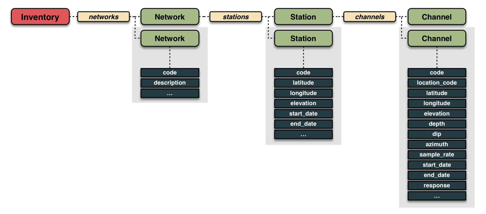

# <span style="color:darkcyan;">**Metadata**</span>

Seismic recordings become scientifically useful only when we know **where, when, and how they were recorded**. This contextual information is called **seismic metadata**. Whereas waveform files contain the recorded time series, metadata describe the seismic network, the stations, the sensors and acquisition channels, and (when provided) their **instrument responses**.

In **SurfQuake / Integrated Seismic Program (ISP)**, metadata allow the software to associate seismic traces with their acquisition configuration and station information. They are essential for tasks such as mapping stations, identifying the channels available at a given time, determining source–receiver geometry, and converting raw recordings into physical ground-motion units.

!!! info "Waveforms and metadata are complementary"
    A MiniSEED file typically stores samples and basic trace identifiers (network, station, location, channel, and start time), along with sampling information. It does **not** normally contain the complete station coordinates or the sensor's response. These details are provided separately by metadata files.

## Metadata formats supported in the workflow

SurfQuake / ISP uses station metadata provided as **FDSN StationXML** (`.xml`) or **SEED dataless** files. Both can describe station and channel attributes and instrument responses, although their structure and tooling differ.

SurfQuake has a specific [tool to create metadata](https://projectisp.github.io/surfquaketutorial.github.io/utils/){: target="_blank" rel="noopener noreferrer" }. You can also find example of [STATIONXML file here](https://github.com/rcabdia/test_surfquake/tree/main/Andorra/inputs/metadata){: target="_blank" rel="noopener noreferrer" } and [RESP files](https://github.com/rcabdia/test_surfquake/tree/main/Andorra/inputs/create_metadata){: target="_blank" rel="noopener noreferrer" }


**StationXML is a good default for new projects**, because it is widely supported in ObsPy and other modern seismic tools. Dataless SEED remains useful when working with older networks and archives.

For additional background, see the [ObsPy tutorial on creating StationXML](https://docs.obspy.org/tutorial/code_snippets/stationxml_file_from_scratch.html).


## How seismic metadata are organized

The commonly used [FDSN StationXML](https://www.fdsn.org/xml/station/) format organizes information hierarchically:



*Figure: An ObsPy `Inventory` contains networks, each network contains stations, and each station contains channels. Each level has its own attributes.*

| Level | Description | Examples of information |
| --- | --- | --- |
| **Inventory** | A collection of network metadata. | Networks, provenance, creation date. |
| **Network** | A group of seismic stations identified by a network code. | Network code, description, active time span. |
| **Station** | A seismic site within a network. | Station code, latitude, longitude, elevation, operational dates. |
| **Channel** | A particular data stream produced by a sensor/acquisition system. | Channel and location codes, position, depth, azimuth, dip, sampling rate, operating dates, response. |

A station may contain several channels, including different components (for example, vertical and two horizontal components), different sensors, or different acquisition epochs. The metadata can also contain **multiple epochs for the same channel** if its installation, calibration, or other properties changed over time.

### Identifying a channel: NET.STA.LOC.CHA

A seismic channel is commonly identified by four codes:

```text
Network.Station.Location.Channel
   XX  .  ABC .   00   . BHZ
```

- **Network (`XX`)**: the seismic network identifier.
- **Station (`ABC`)**: the station identifier within that network.
- **Location (`00`)**: distinguishes separate sensors or data streams at the same station; it can also be empty.
- **Channel (`BHZ`)**: describes the recorded stream using the FDSN channel naming convention. For example, `BHZ` commonly denotes a broadband-class, high-gain seismometer vertical component, but the exact instrument and sample rate must be checked in the metadata.

The combination **NET.STA.LOC.CHA plus the recording time** is important: identifiers alone may not uniquely identify a historical instrument configuration.

## What information matters most?

### Station position and channel orientation

A station's **latitude**, **longitude**, and **elevation** locate the observation site. A channel can additionally specify its own coordinates, **depth** relative to the station reference, and orientation:

- **Azimuth**: horizontal direction of the positive sensitivity axis, measured clockwise from north.
- **Dip**: inclination of that axis from horizontal; in StationXML, a vertical channel pointing upward commonly has a dip of **−90°**.

These properties are important for station maps, source–receiver distances, rotating horizontal components into radial and transverse directions, and comparing observations at different sites.

### Sampling rate and operating period

The **sampling rate** (samples per second, Hz) controls temporal resolution. For a sampling rate \(f_s\), the sample interval is

\[
\Delta t = \frac{1}{f_s}.
\]

The theoretical Nyquist frequency is \(f_N=f_s/2\). However, the usable frequency band also depends on the sensor response and acquisition filters.

The channel's **start date** and **end date** specify when a particular metadata configuration was valid. When processing historical waveforms, use the metadata epoch corresponding to the trace time. An absent end date can indicate an open-ended epoch; it does not by itself guarantee that the station is currently operating.

### Instrument response and physical units

A sensor and digitizer modify the input ground motion before it is stored as digital samples. Their frequency-dependent behavior is represented by an **instrument response**. In simplified form,

\[
D(f) = H(f)\,U(f),
\]

where \(U(f)\) is the Fourier transform of the physical input (for example, ground velocity), \(H(f)\) is the instrument transfer function, and \(D(f)\) is the measured output (commonly in digital counts). The input/output units and the response stages must be read from the actual metadata.

To estimate ground motion, software removes (deconvolves) the instrument response, using suitable stabilization and frequency limits. Depending on the requested output and the sensor, the result may be expressed as **displacement (m)**, **velocity (m/s)**, or **acceleration (m/s²)**.

!!! warning "Do not equate counts with ground motion"
    Digital counts are not automatically physical ground-motion units. A complete and correct instrument response is normally required for reliable amplitude calibration. Response removal can amplify noise outside the instrument's useful passband, so pre-filtering or water-level regularization may be necessary.

A complete response may comprise several stages, such as sensor poles and zeros, analog or digital filters, gains, and digitizer sensitivity. **Overall sensitivity alone is generally insufficient to reproduce the full frequency-dependent response**.


## How SurfQuake / ISP associates waveforms and metadata

A useful design principle in ISP is to maintain **one metadata collection covering all stations and channels used in a processing project**, rather than embedding station information in each MiniSEED waveform file. This can be represented by a single comprehensive metadata file where supported by the workflow.

When waveform files are read, the software can use their trace header identifiers and acquisition times to find the corresponding network, station, channel, and valid metadata epoch.

```text
MiniSEED trace
  ├─ network = XX
  ├─ station = ABC
  ├─ location = 00
  ├─ channel = BHZ
  └─ recording time = ...
                 │
                 ▼
Metadata inventory (StationXML / dataless)
  └─ network XX → station ABC → channel 00.BHZ
                                    └─ matching time epoch
                 │
                 ▼
Station coordinates, orientation, sampling rate,
and instrument response (when available)
```

This separation makes the processing workflow easier to maintain, reuse, and validate. It is especially valuable when organizing waveforms by earthquake, calculating event–station distances, or performing calibrated waveform analysis.

!!! tip "Recommended preparation before processing"
    Ensure that the metadata collection contains the **correct network, station, location, and channel codes**, covers the **dates of your recordings**, and includes the **instrument response** for analyses requiring physical units. Check consistency between the sampling rate in the waveform header and the channel metadata.

## Practical examples with ObsPy

ObsPy represents seismic metadata with the [`Inventory`](https://docs.obspy.org/packages/autogen/obspy.core.inventory.inventory.Inventory.html) class.

### Read and inspect a StationXML file

```python
from obspy import read_inventory

inv = read_inventory("metadata.xml")
print(inv)

for network in inv:
    for station in network:
        print(network.code, station.code,
              station.latitude, station.longitude)
        for channel in station:
            print("  ", channel.location_code, channel.code,
                  channel.sample_rate, channel.start_date,
                  channel.end_date)
```

To load a dataless SEED file, `read_inventory()` can also be used for compatible files and installed ObsPy support:

```python
inv = read_inventory("metadata.dataless", format="SEED")
```

### Verify whether metadata match a MiniSEED trace

```python
from obspy import read, read_inventory

st = read("waveforms.mseed")
inv = read_inventory("metadata.xml")

for tr in st:
    matched = inv.select(
        network=tr.stats.network,
        station=tr.stats.station,
        location=tr.stats.location,
        channel=tr.stats.channel,
        time=tr.stats.starttime,
    )

    channels = sum(
        len(station.channels)
        for network in matched
        for station in network
    )
    print(tr.id, "MATCH" if channels else "NO MATCH")
```

This is a **basic start-time check**, not a full validation. For a trace spanning a change of equipment or metadata epoch, check the entire time interval and whether the correct response applies to every sample.

### Remove the instrument response

```python
from obspy import read, read_inventory

st = read("waveforms.mseed")
inv = read_inventory("metadata.xml")

st.detrend("linear")
st.taper(max_percentage=0.05)

# Example only: adjust the frequencies to your sensor,
# sampling rate, signal band, and scientific objective.
st.remove_response(
    inventory=inv,
    output="VEL",
    pre_filt=(0.01, 0.02, 20.0, 25.0),
    water_level=60,
)
```

!!! warning "Choose your response-removal frequencies carefully"
    The four `pre_filt` frequencies are **illustrative**, not universal defaults. They must be strictly increasing and should be compatible with the trace's Nyquist frequency and the instrument's usable passband. Inappropriate settings can severely distort amplitudes. Some sensors and target units also require special attention to the response-removal regularization.

## Where to obtain or create metadata

Metadata can be obtained from a network operator or an FDSN station service, or built from verified instrument and installation information. Useful tools include:

- [PDCC (Portable Data Collection Center)](https://ds.iris.edu/ds/nodes/dmc/software/downloads/pdcc/) — a tool historically used to manage seismic station metadata.
- [Station Management Portal](https://smp.gempa.de/) — a platform for station metadata management.
- [ObsPy StationXML tools](https://docs.obspy.org/tutorial/code_snippets/stationxml_file_from_scratch.html) — for creating and editing metadata programmatically.

For publicly available network metadata, ObsPy can query an FDSN station service. Requesting `level="response"` is important when the complete instrument response is needed:

```python
from obspy.clients.fdsn import Client

client = Client("IRIS")  # Use an available FDSN provider
inv = client.get_stations(
    network="IU",
    station="ANMO",
    location="*",
    channel="BH?",
    level="response",
)
inv.write("station_metadata.xml", format="STATIONXML")
```

The example requires network access, and availability depends on the provider and selected station epochs.

## Summary

**Metadata tell us how to interpret seismic waveforms.** Their hierarchical structure links networks, stations, and channels to geographical, temporal, acquisition, and instrument-response information. Within SurfQuake / ISP, keeping a coherent metadata collection alongside MiniSEED files supports reliable matching, station geometry calculations, and physically meaningful signal processing.

Before starting an analysis, verify not only that the station and channel codes match, but also that the metadata describe the **instrument installed at the time of recording**.
