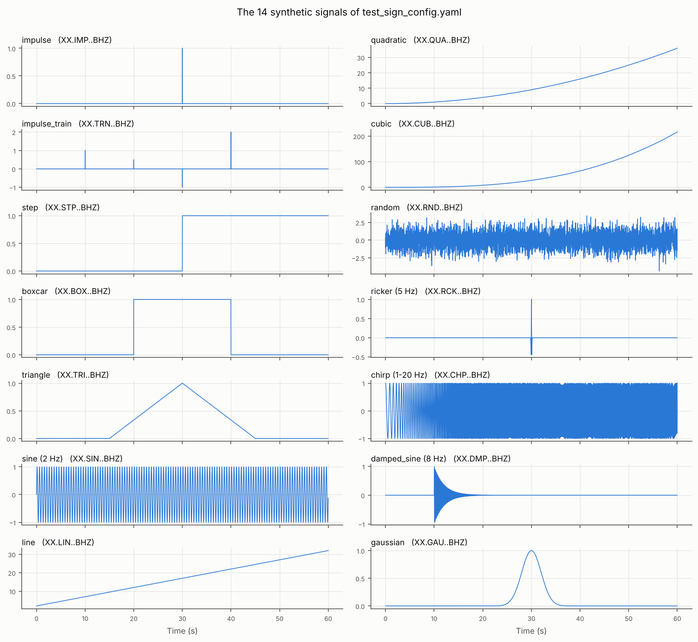
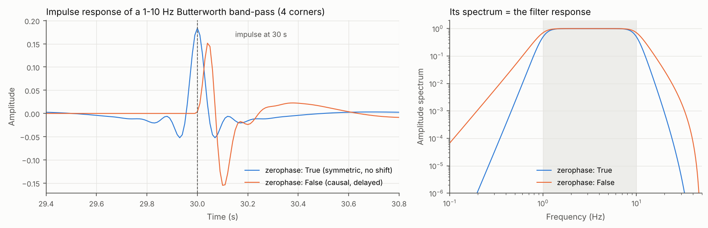
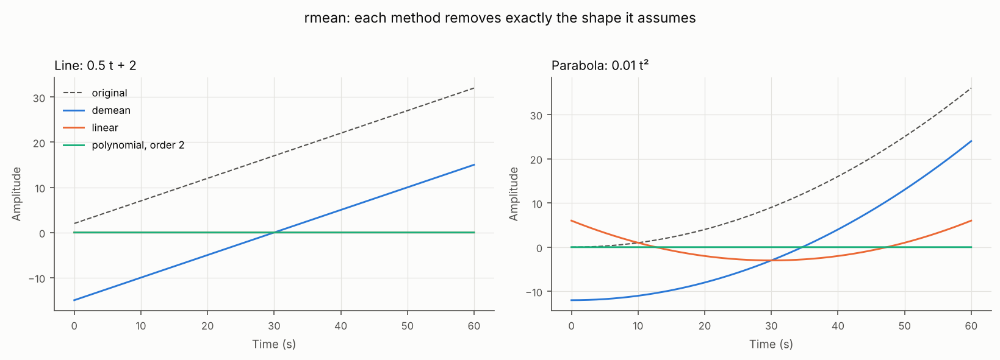
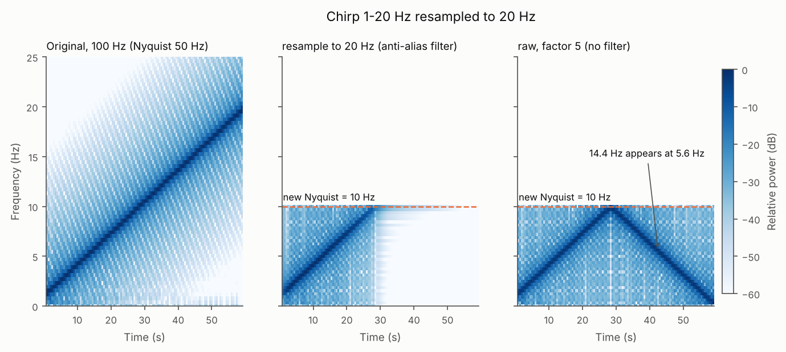
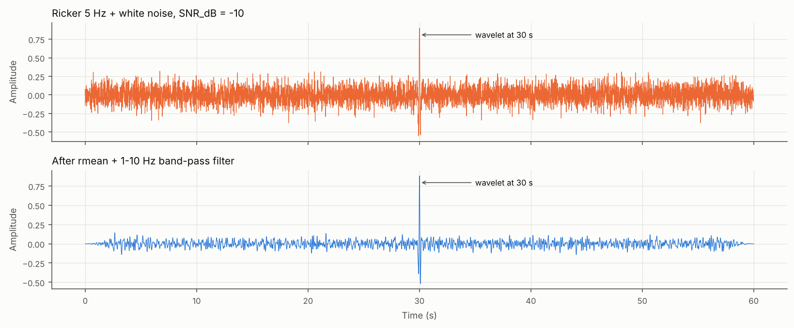
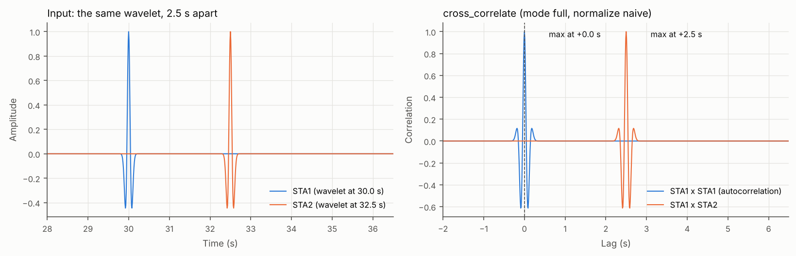

# <span style="color:darkcyan;"> **Synthetic Test Signals Tutorial 4** </span>

In this tutorial, we will learn how to **generate synthetic signals** with surfquake and use them to **test** what the processing methods do. We will work with the commands `make_config`, `quick` and `specplot`.

Why synthetic signals? With real data we never know exactly what the "true" signal is, so it is difficult to tell whether a result comes from the Earth, from the noise, or from the processing itself. With a synthetic signal **we know the answer in advance**: we know where the spike is, which frequencies the signal contains, and how many seconds one trace is delayed with respect to another. So we can check, step by step, that each method does what we expect, and learn what it does before applying it to real data.

In this tutorial we will:

1. Generate and look at all the types of synthetic signals.
2. See the **impulse response** of a filter, with and without phase shift.
3. Check how **detrending** (`rmean`) removes trends.
4. Watch **aliasing** happen when resampling without an anti-alias filter.
5. Bury a wavelet in **noise** and recover it by filtering.
6. Measure a **time delay** between two stations with cross-correlation.
7. Combine synthetic signals with real data.

No data download is needed: all the traces are created by surfquake.

We will follow this structure:

- *Config Files:* tutorial4/configs
- *Folder for the tutorial output:* tutorial4/output, this will be created by surfquake.

```
--tutorial4
    --configs
        --test_sign_config.yaml
        --plotting_config.yaml
        --ex1_impulse.yaml
        --ex2_trends.yaml
        --ex3_aliasing.yaml
        --ex4_noise.yaml
        --ex5_delay.yaml
```

All the commands of this tutorial are run from the folder that contains `tutorial4`.

Please, first open a terminal, activate your environment and type the following command to overview all surfquake capabilities:

```bash
surfquake -h
```

---

## How synthetic signals work

A normal config file has an `Analysis` section with the processing steps. To generate synthetic traces, the config file has a **`Source`** section instead of (or in addition to) the `Analysis` section, and the command `quick` is run **without `-w`**: instead of reading files, surfquake builds the traces described in `Source`, and then processes them with the `Analysis` steps exactly as it would process real data.

```yaml
Source:                 # what traces to create
  trace_1:
    ...
  trace_2:
    ...
Analysis:               # (optional) how to process them, as with real data
  process_1:
    ...
```

Each entry of `Source` (`trace_1`, `trace_2`, ...) creates **one trace**, in numerical order. An entry has two parts:

**1. The header**, which identifies the trace as in real data:

| Key | Description |
|-----|-------------|
| `network`, `station`, `location`, `channel` | Trace codes, e.g. `'XX'`, `'IMP'`, `''`, `'BHZ'`. Use a **different station code for each trace**: the output files are named after them. `XX` is the usual code for test networks. |
| `starttime` | UTC time of the first sample, `'YYYY-MM-DDTHH:MM:SS'` (default 1970-01-01). |
| `sampling_rate` | Samples per second, in Hz (default 100). |
| `duration` | Length of the trace, in seconds (default 60). |

**2. The signal**: `signal_type` and its parameters.

| `signal_type` | Signal | Parameters | Good for testing |
|---------------|--------|------------|------------------|
| `impulse` | A single spike | `amplitude`, `sample` | Impulse response of filters and instruments. |
| `impulse_train` | Several spikes | `samples`, `amplitudes` | Repetitions, cepstrum, stacking. |
| `step` | 0, then `amplitude` from the middle on | `amplitude` | Step response, integration, offsets. |
| `boxcar` | Rectangular pulse (1/3 to 2/3 of the trace) | `amplitude` | Spectra (sinc), tapers, convolution. |
| `triangle` | Triangular pulse (25 % to 75 %) | `amplitude` | Source time functions, smoothing. |
| `sine` | $A \sin(2\pi f t + \phi)$ | `frequency`, `phase`, `amplitude` | Filters, spectra, polarity. |
| `line` | $\text{slope}\cdot t + \text{intercept}$ | `slope`, `intercept` | Detrending. |
| `quadratic` | $a t^2 + b t + c$ | `a`, `b`, `c` | Polynomial detrending, integration. |
| `cubic` | $a t^3 + b t^2 + c t + d$ | `a`, `b`, `c`, `d` | Polynomial detrending. |
| `random` | Gaussian white noise | `mean`, `std`, `seed` | Noise, spectral methods, coherence. |
| `ricker` | Ricker wavelet (zero phase) | `frequency`, `time`, `amplitude` | A simple seismic "arrival": picking, correlation, detection. |
| `chirp` | Sine sweeping from `f0` to `f1` | `f0`, `f1`, `method`, `amplitude`, `phase` | Time-frequency analysis, aliasing, filter bands. |
| `damped_sine` | Decaying oscillation from `time` on | `frequency`, `decay`, `amplitude`, `phase`, `time` | Resonances, spectral peaks, wavelets. |
| `gaussian` | Bell-shaped pulse | `sigma`, `time`, `amplitude` | Smooth pulses, smoothing, envelopes. |

Rules for the parameters:

- `time` is in **seconds from the first sample**, and `sample` / `samples` are **sample indices** starting at 0. Both must lie inside the trace.
- Frequencies are in Hz and must not exceed the Nyquist frequency (`sampling_rate` / 2).
- Phases are in degrees.
- `seed` (for `random`): an integer gives the same noise every run (reproducible), `null` a different noise each time.

---

## Generate Config Files

The template contains one example of every signal type, all documented. Let's prepare it, together with the plotting configuration:

```bash
surfquake make_config -h
surfquake make_config -c test_sign_config -o "./tutorial4/configs"
surfquake make_config -c plotting_config -o "./tutorial4/configs"
```

The [plotting configuration](https://projectisp.github.io/surfquaketutorial.github.io/plotting_interaction_documentation/){: target="_blank" rel="noopener noreferrer" } is commented to explain the functionality, and the processing methods are described [here for traces](https://projectisp.github.io/surfquaketutorial.github.io/processing_config/){: target="_blank" rel="noopener noreferrer" } and [here for streams](https://projectisp.github.io/surfquaketutorial.github.io/processing_stream_config/){: target="_blank" rel="noopener noreferrer" }.

---

## Step 1: Generate and look at all the signals

The template can be run as it is: it creates 14 traces, one per signal type.

```bash
surfquake quick -h
surfquake quick -c "./tutorial4/configs/test_sign_config.yaml" --plot_config "./tutorial4/configs/plotting_config.yaml"
```

Note that there is **no `-w`**: the traces come from the `Source` section. Move through the pages with `n` and `b`.



To save the traces as files, use the automatic mode with an output folder:

```bash
surfquake quick -c "./tutorial4/configs/test_sign_config.yaml" -o "./tutorial4/output" -a
```

The files are written in HDF5 format, named `network.station.location.channel.D.year.julday.h5`, for example `XX.RCK..BHZ.D.2024.1.h5`. They can be read like any other waveform file, with `-w`:

```bash
surfquake info -w "./tutorial4/output/*" -c 3
```

---

## Step 2: The impulse response of a filter

An impulse contains **all the frequencies with the same amplitude**. So, if we filter an impulse, what comes out is exactly the filter itself: its **impulse response**. Its spectrum is the frequency response of the filter.

Create the file `ex1_impulse.yaml`:

```yaml
Source:
  trace_1:
    network: 'XX'
    station: 'IMP'
    location: ''
    channel: 'BHZ'
    starttime: '2024-01-01T00:00:00'
    sampling_rate: 100.0
    duration: 60.0
    signal_type: 'impulse'
    amplitude: 1.0
    sample: 3000          # the spike is at 30 s
Analysis:
  process_1:
    name: 'filter'
    type: 'bandpass'
    fmin: 1.0
    fmax: 10.0
    corners: 4
    zerophase: True
```

```bash
surfquake quick -c "./tutorial4/configs/ex1_impulse.yaml" --plot_config "./tutorial4/configs/plotting_config.yaml"
```

Zoom around 30 s. Then open the prompt with `v` and look at its spectrum, which is the frequency response of the filter:

```bash
spectrum 0 loglog
```

Now change `zerophase: True` to `zerophase: False`, and run it again. Close the window and type `r` in the terminal to reprocess with the new config, or run the command again.



What you should see:

| `zerophase` | Result |
|-------------|--------|
| `True` | A **symmetric** wavelet centred exactly at **30.000 s**, with energy **before** the impulse. |
| `False` | **Nothing before 30 s**; the wavelet starts at the impulse, its maximum is **delayed** (about 30.10 s) and it is not symmetric. |

!!! note "What does this mean for real data?"
    A **zero-phase** filter (applied forwards and backwards) does not move the arrivals, so it is the right choice for **picking** times. But it spreads energy **before** the onset, which can make a first motion look earlier, or create a small "precursor". A **causal** filter never puts energy before the onset, so it is the choice for **first-motion polarities** and for onsets of very impulsive signals, but it delays and distorts the waveform.

---

## Step 3: Removing trends

Real records often contain offsets and slow drifts. We will test the `rmean` methods with a line and a parabola, whose exact shape we know.

Create the file `ex2_trends.yaml`:

```yaml
Source:
  trace_1:
    network: 'XX'
    station: 'LIN'
    location: ''
    channel: 'BHZ'
    starttime: '2024-01-01T00:00:00'
    sampling_rate: 100.0
    duration: 60.0
    signal_type: 'line'
    slope: 0.5
    intercept: 2.0
  trace_2:
    network: 'XX'
    station: 'QUA'
    location: ''
    channel: 'BHZ'
    starttime: '2024-01-01T00:00:00'
    sampling_rate: 100.0
    duration: 60.0
    signal_type: 'quadratic'
    a: 0.01
    b: 0.0
    c: 0.0
Analysis:
  process_1:
    name: 'rmean'
    method: 'demean'
```

Run it, then change `method` to `'linear'`, and finally to `'polynomial'` with `order: 2`:

```bash
surfquake quick -c "./tutorial4/configs/ex2_trends.yaml" --plot_config "./tutorial4/configs/plotting_config.yaml"
```

What you should see (maximum absolute value left in the trace):

| `method` | Line (`LIN`) | Parabola (`QUA`) | Why |
|----------|--------------|------------------|-----|
| (no processing) | 32 | 36 | The original signals. |
| `demean` | 15 | 24 | Only the mean is removed: the slope remains. |
| `linear` | ~0 | 6 | A straight line is removed exactly; a parabola is not a line, so a curved residual remains. |
| `polynomial`, `order: 2` | ~0 | ~0 | A second-order polynomial fits both. |



!!! tip
    Use the simplest method that removes your trend: high polynomial orders can also remove real long-period signals.

---

## Step 4: Aliasing

When the sampling rate is reduced, frequencies above the new **Nyquist frequency** (half the new sampling rate) cannot be represented. They do not disappear: they **fold back** into the band and appear as false, lower frequencies. This is **aliasing**, and once it has happened it cannot be undone. A chirp, which sweeps all frequencies from 1 to 20 Hz, makes it easy to see.

Create the file `ex3_aliasing.yaml`. We resample the chirp from 100 Hz to 20 Hz (new Nyquist: 10 Hz) with the correct method, `resample`, which applies an anti-alias filter first:

```yaml
Source:
  trace_1:
    network: 'XX'
    station: 'CHP'
    location: ''
    channel: 'BHZ'
    starttime: '2024-01-01T00:00:00'
    sampling_rate: 100.0
    duration: 60.0
    signal_type: 'chirp'
    f0: 1.0
    f1: 20.0
    method: 'linear'
    amplitude: 1.0
Analysis:
  process_1:
    name: 'resample'
    sampling_rate: 20
    pre_filter: True
```

```bash
surfquake quick -c "./tutorial4/configs/ex3_aliasing.yaml" --plot_config "./tutorial4/configs/plotting_config.yaml"
```

Open the prompt with `v` and look at the spectrogram:

```bash
spectrogram 0 2.0 75
```

Now replace the `resample` step with a plain decimation, `raw`, which keeps one sample out of 5 **without** any filter:

```yaml
Analysis:
  process_1:
    name: 'raw'
    factor: 5
    integers: False
```

Run it again and compare the spectrograms.



What you should see:

| Time | True frequency | `resample` (with anti-alias filter) | `raw` (no filter) |
|------|----------------|-------------------------------------|-------------------|
| 10–15 s | ~5 Hz | 5 Hz, full amplitude | 5 Hz, full amplitude |
| 40–45 s | ~14.4 Hz | **removed** (amplitude ~0) | appears at **5.6 Hz** (= 20 − 14.4), full amplitude |
| 55–60 s | ~19.2 Hz | **removed** | appears at **0.8 Hz** (= 20 − 19.2), full amplitude |

With `raw`, the spectrogram shows the sweep going **up** to 10 Hz and then coming back **down**, as if reflected by a mirror at the Nyquist frequency. Those false frequencies look perfectly real: in real data you could not tell them apart from true signals.

!!! warning
    Always use `resample` (with `pre_filter: True`) to reduce the sampling rate for analysis. `raw` is only meant to speed up the plotting of long traces.

---

## Step 5: Recovering a signal from the noise

We bury a Ricker wavelet (a simple model of a seismic arrival, centred at 5 Hz) in white noise, and recover it with a band-pass filter.

Create the file `ex4_noise.yaml`:

```yaml
Source:
  trace_1:
    network: 'XX'
    station: 'RCK'
    location: ''
    channel: 'BHZ'
    starttime: '2024-01-01T00:00:00'
    sampling_rate: 100.0
    duration: 60.0
    signal_type: 'ricker'
    frequency: 5.0
    time: 30.0
    amplitude: 1.0
Analysis:
  process_1:
    name: 'add_noise'
    noise_type: 'white'
    SNR_dB: -10
  process_2:
    name: 'rmean'
    method: 'linear'
  process_3:
    name: 'filter'
    type: 'bandpass'
    fmin: 1.0
    fmax: 10.0
    corners: 4
    zerophase: True
```

First run it **without** the filter (delete or comment the `process_3` block), then with it:

```bash
surfquake quick -c "./tutorial4/configs/ex4_noise.yaml" --plot_config "./tutorial4/configs/plotting_config.yaml"
```



What you should see (peak of the wavelet divided by the standard deviation of the noise):

| `SNR_dB` | Before filtering | After the 1–10 Hz filter |
|----------|------------------|--------------------------|
| 10 | ~100 | ~220 |
| 0 | ~32 | ~72 |
| −10 | ~9 | ~23 |

The filter removes the noise outside the band of the wavelet, while keeping the wavelet: the peak-to-noise ratio improves by more than 2 times. White noise has energy at all frequencies, and the wavelet only between ~1 and ~12 Hz, so the narrower the filter around the signal, the larger the gain.

!!! note "About `SNR_dB`"
    `SNR_dB` compares the noise with the **mean power of the whole trace**. A short pulse in a long trace has a very small mean power, so even `SNR_dB: 0` leaves the pulse clearly visible. To create a difficult test with short signals, use **negative** values (−10, −20 dB).

Try it: lower `SNR_dB` until you cannot see the wavelet before filtering, and check whether you can still see it after. You can also test the characteristic functions on it (see [Characteristic Functions](https://projectisp.github.io/surfquaketutorial.github.io/characteristic_functions_documentation/){: target="_blank" rel="noopener noreferrer" }), for example by adding an STA/LTA step:

```yaml
  process_4:
    name: 'snr'
    method: 'classic'
    sign_win: 0.5
    noise_win: 10
```

---

## Step 6: Measuring a time delay with cross-correlation

We create the same wavelet at two "stations", the second one **2.5 s later**, as if the wave took 2.5 s to travel from one to the other. The cross-correlation should find that delay.

Create the file `ex5_delay.yaml`:

```yaml
Source:
  trace_1:
    network: 'XX'
    station: 'STA1'
    location: ''
    channel: 'BHZ'
    starttime: '2024-01-01T00:00:00'
    sampling_rate: 100.0
    duration: 60.0
    signal_type: 'ricker'
    frequency: 5.0
    time: 30.0
  trace_2:
    network: 'XX'
    station: 'STA2'
    location: ''
    channel: 'BHZ'
    starttime: '2024-01-01T00:00:00'
    sampling_rate: 100.0
    duration: 60.0
    signal_type: 'ricker'
    frequency: 5.0
    time: 32.5
Analysis:
  process_1:
    name: 'cross_correlate'
    mode: 'full'
    normalize: 'naive'
    reference_idx: 0
    trim: True
```

To see the result against the lag time, open the plotting configuration and set:

```yaml
plot_type: record
record_option: egf
```

```bash
surfquake quick -c "./tutorial4/configs/ex5_delay.yaml" --plot_config "./tutorial4/configs/plotting_config.yaml"
```



What you should see:

- `XX.STA1_STA1..BXZ`: the **autocorrelation** of the reference, with its maximum (1.0) at lag **0 s**.
- `XX.STA1_STA2..BXZ`: the cross-correlation, with its maximum (1.0) at lag **+2.5 s**: STA2 records the wave 2.5 s after STA1.

Try it: change `time` of the second trace, or add noise to both traces with `add_noise` before the correlation, and check that the peak stays at the right lag.

!!! note "Why `normalize: 'naive'`?"
    With `normalize: 'full'`, each lag is divided by the local energy of the traces. The synthetic traces are exactly **zero** far from the wavelet, so that energy is zero and the result is undefined (NaN). Real data, and synthetic traces with noise added, always have some energy, so `full` works for them.

---

## Step 7: Combining synthetic signals with real data

A powerful test is to **inject** a synthetic signal of known shape into real noise, for example to know the smallest event your detector can find. It is done in two runs:

1. Generate the synthetic trace and save it. Give it a `starttime` **inside** the time window of your real data, and the same `sampling_rate`:

    ```bash
    surfquake quick -c "./tutorial4/configs/ex4_noise.yaml" -o "./tutorial4/output" -a
    ```

2. Read the real data **and** the synthetic files together with `-w` (paths separated by a comma), and process them as usual:

    ```bash
    surfquake quick -w "./data/*,./tutorial4/output/*" -c "./tutorial4/configs/typical_config.yaml" --plot_config "./tutorial4/configs/plotting_config.yaml"
    ```

To add the synthetic signal **onto** a real trace (signal + real noise in the same trace), use the `algebra` method, e.g. `expression: "tr1 + tr2"`. See [Processing Stream](https://projectisp.github.io/surfquaketutorial.github.io/processing_stream_config/){: target="_blank" rel="noopener noreferrer" }.

!!! note
    When `-w` is given, the `Source` section of the config file is ignored: generation only happens without `-w`.

---

## Using Bash script

Finally, we can run all the exercises at once and save their results with a [bash script file](https://projectisp.github.io/surfquaketutorial.github.io/bash_script/){: target="_blank" rel="noopener noreferrer" }. Create a file named `run_synthetic.sh`:

```bash
#!/bin/bash
set -e

# Activate your conda environment
eval "$(conda shell.bash hook)"
conda activate surfquake  # Replace with the name of your environment

for exercise in ex1_impulse ex2_trends ex3_aliasing ex4_noise ex5_delay; do
    echo "Running $exercise"
    surfquake quick -c "./tutorial4/configs/$exercise.yaml" -o "./tutorial4/output/$exercise" -a
done
```

Open a terminal in your working directory and run it:

```bash
chmod u+x run_synthetic.sh
./run_synthetic.sh
```

---

## Discussion

Synthetic signals turn processing into an experiment with a known answer:

- **Filters**: an impulse shows what a filter really does, and the price of zero phase (energy before the onset) or causal filtering (delay and distortion).
- **Detrending**: each method removes exactly the shape it assumes, and leaves the rest.
- **Resampling**: without an anti-alias filter, high frequencies become false low frequencies that look completely real.
- **Noise**: filtering in the band of the signal recovers signals that are invisible in the raw trace.
- **Correlation**: a known delay is recovered exactly, which validates the timing of your whole processing chain.

Whenever you are not sure about a new method or a combination of parameters, test it first on a synthetic signal: if it does not give the expected answer on a signal you know, it will not give a reliable answer on real data.
