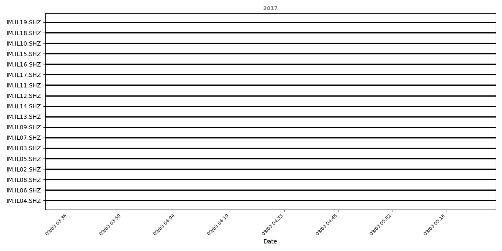
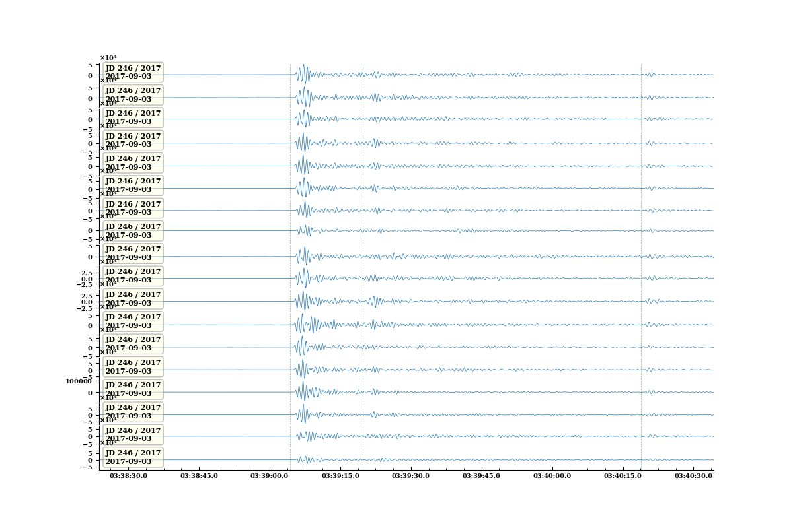
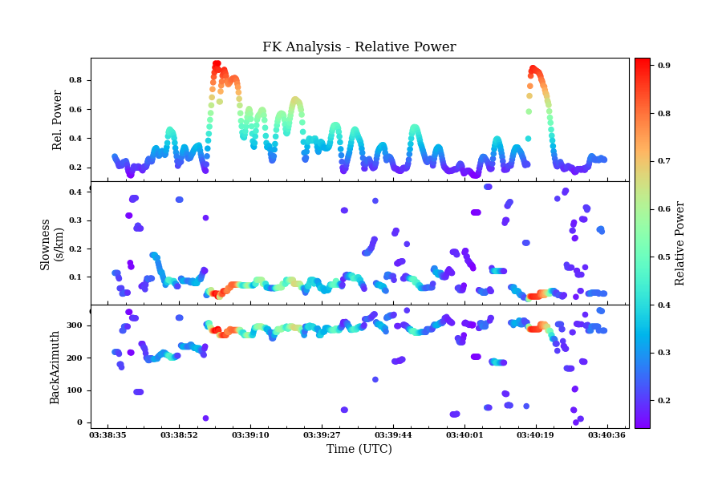
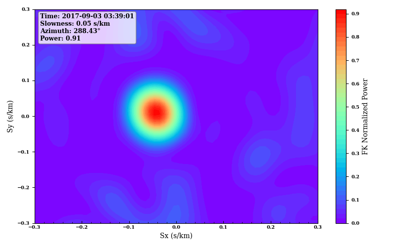
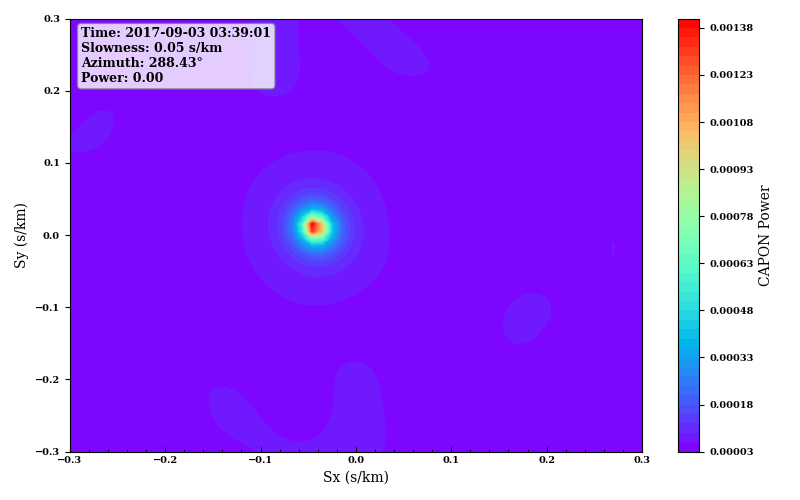

# <span style="color:darkcyan;"> **Array Processing: Beamforming Tutorial 3** </span>

In this tutorial, we will learn how to work with the commands: `explore`, `info`, `quick` and `beamplot` to estimate the back-azimuth and the apparent slowness of a teleseismic P wave recorded by a seismic array.

The event is the **North Korea nuclear test of 3 September 2017** (origin time 03:30:01 UTC), recorded at the **ILAR array** (network IM, Eielson, Alaska). ILAR is a small-aperture array (about 10 km across) of vertical short-period sensors, so it is a nice example to see how a plane wave crosses an array.

In this tutorial we will follow this structure:

- *Seismic files:* tutorial3/data
- *Metadata:* tutorial3/metadata
- *Config Files:* tutorial3/configs
- *Folder for the tutorial output:* tutorial3/beam, this will be created by surfquake.

```
--tutorial3
    --data
        --IM.IL02..SHZ
        --IM.IL03..SHZ
        --IM.IL04..SHZ
        ......
        --IM.IL19..SHZ
    --metadata
        --dataless.dlsv
    --configs
        --stream_config.yaml
        --plotting_config.yaml
        --beam_config.yaml
```

For this tutorial you need to download the [seismic data here](https://github.com/ProjectISP/ISP/tree/master/isp/examples/NuclearExplotionILAR_2017){: target="_blank" rel="noopener noreferrer" } and the [metadata here](https://github.com/ProjectISP/ISP/tree/master/isp/Metadata/dataless_LASA){: target="_blank" rel="noopener noreferrer" }. In this tutorial the metadata is **not optional**: beamforming needs the coordinates of every station of the array.

!!! note
    The metadata folder is called `dataless_LASA`, but the file `dataless.dlsv` contains the stations of the ILAR array (IM.IL01 to IM.IL31). It is the right file for this data.

Please, first open a terminal, activate your environment and type the following command to overview all surfquake capabilities:

```bash
surfquake -h
```

---

## A bit of theory

When a seismic wave arrives from far away, its wavefront is almost a plane when it crosses the array. Each station records the same signal, but shifted in time. These delays depend on two parameters:

- **Back-azimuth (BAz):** direction from the array to the source, in degrees clockwise from North.
- **Apparent slowness (s):** inverse of the apparent velocity of the wavefront along the surface, in s/km. Steep incident waves (teleseismic P) have small slowness, while waves travelling along the surface (Lg, Rg) have large slowness.

Beamforming tests a grid of slowness vectors, shifts and stacks the traces for each one, and looks for the one that gives the maximum coherent energy. The result for each time window is a pair (BAz, s) plus the relative power of the beam.

For this event we can compute what we expect to find (IASP91 model, epicentre 41.34°N 129.04°E):

| Parameter                | Expected value          |
|--------------------------|-------------------------|
| Epicentral distance      | ~51°                    |
| P arrival at ILAR        | ~03:39:05 UTC           |
| Back-azimuth             | ~286°                   |
| P apparent slowness      | ~0.068 s/km (~14.7 km/s) |

Keep this table at hand, we will compare our results with it.

Please review the following documentation:

[Beamforming](https://projectisp.github.io/surfquaketutorial.github.io/beamforming_documentation/){: target="_blank" rel="noopener noreferrer" }

> **Scientific Reference**:
>
> Rost, S., & Thomas, C. (2002). Array seismology: Methods and applications. *Reviews of Geophysics*, 40(3).

---

## Generate Config Files

The beamforming is a **stream** method, it uses all traces together. Its template is inside the stream configuration file. Let's prepare the necessary files.

```bash
surfquake make_config -h
surfquake make_config -c stream_config -o "./tutorial3/configs"
surfquake make_config -c plotting_config -o "./tutorial3/configs"
```

The [plotting configuration](https://projectisp.github.io/surfquaketutorial.github.io/plotting_interaction_documentation/){: target="_blank" rel="noopener noreferrer" } is commented to explain the functionality. The parametrization for signal processing can be found [here for traces](https://projectisp.github.io/surfquaketutorial.github.io/processing_config/){: target="_blank" rel="noopener noreferrer" } and [here for streams](https://projectisp.github.io/surfquaketutorial.github.io/processing_stream_config/){: target="_blank" rel="noopener noreferrer" }.

---

## Explore your data

First, let's check that all stations have data for the same time span.

```bash
surfquake explore -h
surfquake explore -w './tutorial3/data/*'
```

You should see 18 stations (IL02 to IL19) recording continuously for two hours, starting at the origin time of the test.



---

## Look at the files header

```bash
surfquake info -h
surfquake info -w './tutorial3/data/*' -c 3
```

    File                 | IM.IL02..SHZ              | IM.IL03..SHZ              | IM.IL04..SHZ
    Network              | IM                        | IM                        | IM
    Station              | IL02                      | IL03                      | IL04
    Location             |                           |                           |
    Channel              | SHZ                       | SHZ                       | SHZ
    Start Time           | 2017-09-03T03:30:01.0000  | 2017-09-03T03:30:01.0000  | 2017-09-03T03:30:01.0000
    End Time             | 2017-09-03T05:30:01.0000  | 2017-09-03T05:30:01.0000  | 2017-09-03T05:30:01.0000
    Sampling Rate (Hz)   | 20.0                      | 20.0                      | 20.0
    Delta (s)            | 0.05                      | 0.05                      | 0.05
    Npts                 | 144001                    | 144001                    | 144001

All traces have the same sampling rate (20 Hz) and the same start time. This is important: beamforming compares the traces sample by sample.

---

## Find the P wave

Let's plot the array and look for the P arrival. We pass the metadata with `-i`, it will be needed later by the beamforming.

```bash
surfquake quick -h
surfquake quick -w "./tutorial3/data/*" -i "./tutorial3/metadata/dataless.dlsv" --plot_config "./tutorial3/configs/plotting_config.yaml"
```
- select starttime press `u` around `2017-09-03T03:38:37` and select endtime pressing `i` around `2017-09-03T03:40:39`.
- Open an interactive prompt pressing `v`.
- Filter the traces in the band where the P wave is clear:

```bash
help filter
filter bandpass 0.8 2.2 --corners 4 --zerophase True
```

After filtering, the figure is redrawn and you are back in picking mode.

- Zoom around 03:39 UTC, about 9 minutes after the origin time. You will see the P wave arriving at all stations almost at the same time.
- Set the analysis time window: place the mouse a bit before the P wave (around `2017-09-03T03:38:37`) and press `u` (start time), then place it after the main P energy (around 2017-09-03T03:40:39) and press `i` (end time).



!!! tip
    The P wave of a teleseism crosses the 10 km of ILAR in less than one second, so you will not see the delays by eye. This is exactly why we need the beamforming.

---

## Interactive Beamforming

With the time window set, open the prompt again pressing `v`.

### Beam: time evolution of slowness and back-azimuth

The command `beam` slides a short window (`--win`, in seconds) along the selected time window and computes the FK beamforming in each one.

```bash
help beam
beam --fmin 0.8 --fmax 2.2 --smax 0.3 --grid 0.01 --win 3 --overlap 0.05
```

- `--fmin`, `--fmax`: frequency band of the analysis (Hz).
- `--smax`: maximum slowness of the grid (s/km). 0.3 s/km covers all P and S phases.
- `--grid`: slowness grid spacing (s/km). With 0.01 we can separate 0.06 from 0.07 s/km, the default 0.05 is too coarse for a teleseismic P.
- `--win`: length of each sliding window (s). It should contain a few cycles of the lowest frequency.
- `--overlap`: overlap between consecutive windows (fraction, 0.05 = 5 %).

The figure shows, from top to bottom, the relative power, the slowness and the back-azimuth of each window, colored by relative power.



Look at the windows with the highest relative power at the P arrival. The back-azimuth should be close to 286° and the slowness close to 0.068 s/km.

### Slowness map of a single window

The beam figure is interactive. Point with the mouse at a power peak, press a number to select the method and then press `e` to plot the slowness map of that window:

    KEY             | ACTION
    ---             | ------
    1               | Conventional FK
    2               | Capon
    3               | Multitaper Coherence
    4               | Music for 1 signal
    5               | Music for 2 signals
    6               | Music for 3 signals



The maximum of the map gives the slowness vector of the wave: its distance to the centre is the slowness, and its direction is the back-azimuth.

Alternatively, you can compute the slowness map of the whole selected time window directly from the prompt with `smap`. Write the method in capital letters (`FK`, `CAPON`, `MTP.COHERENCE`, `MUSIC`):

```bash
help smap
smap --method FK --fmin 0.8 --fmax 2.2 --smax 0.3 --grid 0.01
smap --method CAPON --fmin 0.8 --fmax 2.2 --smax 0.3 --grid 0.01
```

Compare both maps. Capon gives a sharper maximum than the conventional FK, because it suppresses the energy coming from other directions.



!!! note
    For `smap`, select a short time window around the P onset (a few seconds) with `u` and `i`. A long window mixes the P wave with the coda and the noise, and the maximum becomes wider.

To close the interactive session:

```bash
exit
```

---

## Automatic

In this section we compute the same beamforming, but using a config file. The advantage is that we can automate the process for many events and save the results for later use.

Make a copy of `stream_config.yaml` and name it `beam_config.yaml`. Keep the pre-processing, cut the traces around the P wave and enable the `beam` step:

```yaml
Analysis:
  process_1:
    name: 'rmean'
    method: 'linear'
  process_2:
    name: 'rmean'
    method: 'simple'
  process_3:
    name: 'taper'
    method: 'cosine'
    max_percentage: 0.05
  process_4:
    name: 'cut_stream'
    method: 'absolute'
    start: 2017-09-03T03:37:00
    end: 2017-09-03T03:41:30
  process_5:
    name: 'beam'
    method: 'FK'
    timewindow: 3.0
    overlap: 0.05
    fmin: 0.8
    fmax: 2.2
    smax: 0.3
    slow_grid: 0.01
    output_folder: './tutorial3/beam'
```

- `cut_stream` keeps three minutes around the P wave. Without it, the beamforming would run along the two hours of data.
- `method` can be `FK` or `CAPON`.
- The beamforming filters the traces in the band `fmin`–`fmax`, so we do not need a `filter` step.

Run the `quick` command in automatic mode. Remember to pass the metadata:

```bash
surfquake quick -w "./tutorial3/data/*" -i "./tutorial3/metadata/dataless.dlsv" -c "./tutorial3/configs/beam_config.yaml" -a
```

The result is saved in `./tutorial3/beam` as a binary file named after the year and the julian day of the first trace, `2017.246.beam`.

---

## Plot the results and find the P wave automatically

Open the result with the command `beamplot`:

```bash
surfquake beamplot -h
surfquake beamplot -f "./tutorial3/beam/2017.246.beam"
```

You will get the same figure as in the interactive section, and you can also open the slowness maps with the keys `1`–`6` and `e`.

Now let's ask surfquake to find the power peaks that match a P wave. The option `--find_solutions` accepts the shortcuts `regional` and `teleseismic`, or your own slowness ranges in JSON format. The `teleseismic` shortcut uses 0.04–0.07 s/km for P, and our expected value (0.068 s/km) is very close to the limit, so we define our own range:

```bash
surfquake beamplot -f "./tutorial3/beam/2017.246.beam" --find_solutions '{"P": [0.05, 0.08]}' --baz_range 260 310 --min_power 0.6 --write_path "./tutorial3/beam/solutions.txt"
```

- `--baz_range`: only accept back-azimuths between 260° and 310°.
- `--min_power`: minimum relative power to accept a peak.
- `--write_path`: the solutions are appended to this text file.

The terminal shows the detected peaks:

    [INFO] Found N beam peaks:
      2017-09-03T03:39:... | Phase: P        | BAz: ...° | S: ... s/km | Pow: ...

---

## Discussion

Compare your solution with the expected values of the table at the beginning of the tutorial.

- **Back-azimuth:** the measured value is usually a few degrees off the theoretical one. The difference comes from the structure under the array and along the path, which the 1D model does not include.
- **Slowness:** the measured slowness depends on the slowness grid. With `slow_grid: 0.05` you would only obtain 0.05 or 0.10 s/km, so always use a grid fine enough for the phase you are looking for.
- **Phase identification:** a slowness of ~0.068 s/km together with a back-azimuth pointing to the Korean peninsula confirms that this is the P wave from the test, and not a local or regional event.

As an exercise, try:

- Change the band to `fmin: 2.0` and `fmax: 4.0`. What happens with the relative power? Why?
- Change `method` to `CAPON` and compare the solutions.
- Move the `cut_stream` window to the PcP and PP arrivals (about 1.5 and 2 minutes after P). Can you find them? Which slowness do they have?

---

## Using Bash script

Finally, we can concatenate the automatic steps in a [bash script file](https://projectisp.github.io/surfquaketutorial.github.io/bash_script/){: target="_blank" rel="noopener noreferrer" }. Create a file named `run_beam.sh`:

```bash
#!/bin/bash

# Activate your conda environment
eval "$(conda shell.bash hook)"
conda activate surfquake  # Replace with the name of your environment

surfquake quick -w "./tutorial3/data/*" -i "./tutorial3/metadata/dataless.dlsv" -c "./tutorial3/configs/beam_config.yaml" -a
surfquake beamplot -f "./tutorial3/beam/2017.246.beam" --find_solutions '{"P": [0.05, 0.08]}' --baz_range 260 310 --write_path "./tutorial3/beam/solutions.txt" --save_path "./tutorial3/beam/beam.png"
```

Open a terminal in your working directory and run it:

```bash
chmod u+x run_beam.sh
./run_beam.sh
```
