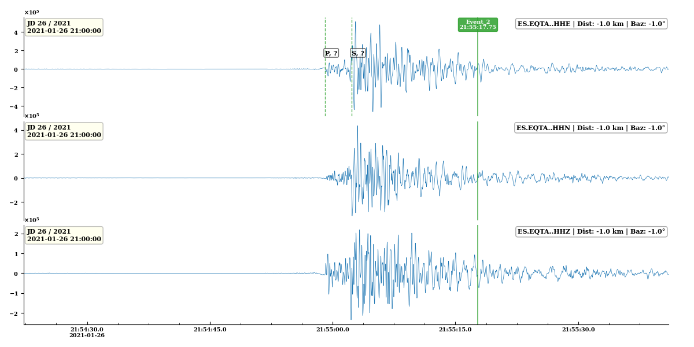

# <span style="color:darkcyan;"> **Event Analysis: Automatic Phase Picking Tutorial 5** </span>

In the previous tutorials, we always knew **when** the earthquakes happened: the event file told surfquake where to cut. In real life, the first problem is the opposite: we have hours or days of continuous data, and we need to find the **arrival times of the P and S waves** of every earthquake inside it. Doing it by hand is impossible when a seismic sequence produces hundreds of events. In this tutorial, we will learn how to work with the commands `project`, `pick` and `quick` to:

1. Organise continuous data in a **project**.
2. Run the deep-learning picker **PhaseNet** on all the stations.
3. Understand the three **output files** of the picker.
4. Read the picks of one earthquake and check that they make sense.
5. Draw the picks on top of the waveforms.
6. Choose the **probability thresholds** and select stations, channels and dates.
7. Run the picker from **Python** and from a **bash script**.

The data is from the **Granada seismic sequence (southern Spain) of January 2021**. We will use 1.5 hours of continuous data, from 21:00 to 22:30 UTC on **26 January 2021**, recorded by 19 stations of the Spanish network (ES). During that time, three earthquakes of magnitude around 4 (ML 4.1, 4.1 and 4.3) happened very close to each other, near 37.19° N, 3.69° W and about 5 km deep, at 21:36:32, 21:44:18 and 21:54:55 UTC, together with many smaller aftershocks.

In this tutorial we will follow this structure:

- *Seismic files:* tutorial5/data
- *Metadata:* tutorial5/metadata
- *Config Files:* tutorial5/configs
- *Project:* tutorial5/project
- *Folder for the picks:* tutorial5/picks, this will be created by surfquake.

```
--tutorial5
    --data
        --ES.E0802..HHE.D.2021.26
        --ES.E0802..HHN.D.2021.26
        --ES.E0802..HHZ.D.2021.26
        ......
        --ES.UMV15..EHZ.D.2021.26
    --metadata
        --ES_network.xml
    --configs
        --typical_config.yaml
        --plotting_config.yaml
    --project
```

For this tutorial you need to download the [seismic data here](https://github.com/rcabdia/test_surfquake/tree/main/Granada/inputs/waveforms_cut){: target="_blank" rel="noopener noreferrer" } (52 files, about 30 MB). The [metadata](https://github.com/rcabdia/test_surfquake/tree/main/Granada/inputs/metadata){: target="_blank" rel="noopener noreferrer" } is **not needed** to pick, because PhaseNet only looks at the waveforms, but download it too: you will need it in the next steps of the workflow (association and location).

The config files are the same as in [Tutorial 1](tutorial1.md). All the commands of this tutorial are run from the folder that contains `tutorial5`.

!!! note
    PhaseNet is a neural network: running it takes some time and memory. With this small dataset it takes from a few seconds to a few minutes, depending on your computer. If you have a GPU configured for TensorFlow, surfquake uses it automatically.

---

## Step 1: What does PhaseNet do?

PhaseNet ([Zhu and Beroza, 2019](https://academic.oup.com/gji/article/216/1/261/5129142){: target="_blank" rel="noopener noreferrer" }) is a neural network trained with hundreds of thousands of P and S arrivals picked by analysts. It reads a seismogram and returns, for **every sample**, three probabilities that add up to 1:

- the probability that a **P wave** arrives at that sample,
- the probability that an **S wave** arrives at that sample,
- the probability that it is **noise**.

When an earthquake arrives, the P probability rises to a sharp peak at the onset of the P wave, and the S probability rises at the onset of the S wave. A **pick** is a peak of the probability curve that is higher than a **threshold** (0.3 by default). Its time is the arrival time, and its height, the **probability** (between 0 and 1), tells how confident the network is.

Before the network, surfquake prepares every file:

1. Removes slow trends (a spline detrend) and merges gaps, filling them with zeros.
2. Applies a **high-pass filter at 0.5 Hz** to remove long-period noise.
3. Keeps the UTC day that contains most of the samples of the file.

Three things are important to know about how surfquake runs PhaseNet:

- **Each file is picked alone.** The network is given one component at a time, so the same P wave is usually picked on Z, N and E: you will see up to three picks of the same arrival. This is normal, and the associator handles it later.
- **PhaseNet was trained with data at 100 Hz.** The Granada data is 100 Hz. If your data has another sampling rate, resample it to 100 Hz before picking.
- **All the files should cover the same time span.** The network uses the length of the first file for all of them, so a longer file is cut. Daily files (or, like here, files cut to the same window) are the ideal input.

---

## Step 2: Create a project

As in [Tutorial 1 (Part 2)](tutorial1_part2.md), the first step is to index the files in a **project**.

Please review the following documentation:

[Project](https://projectisp.github.io/surfquaketutorial.github.io/project/){: target="_blank" rel="noopener noreferrer" }

```bash
surfquake project -d ./tutorial5/data -s ./tutorial5/project -n granada
```

- `-d`: folder with the waveform files.
- `-s`: folder where the project is saved.
- `-n`: name of the project (the file name).

The terminal shows a summary of the project: 1 network, 19 stations and 52 files, from 21:00 to 22:30 on 26 January 2021. Not every station has three components: EMIN and EMLI have only two, and ENIJ only the vertical one. The picker works with whatever is available.

The project is saved as `./tutorial5/project/granada`.

---

## Step 3: Run the picker

Please review the following documentation:

[Phase Picker](https://projectisp.github.io/surfquaketutorial.github.io/picker/){: target="_blank" rel="noopener noreferrer" }

```bash
surfquake pick -h
surfquake pick -f ./tutorial5/project/granada -o ./tutorial5/picks -pt 0.3 -st 0.3 --verbose
```

- `-f`: the project file.
- `-o`: folder where the picks are written. It is created if it does not exist.
- `-pt`, `-st`: minimum probability of a P pick and of an S pick (0.3 is the default).
- `--verbose`: prints the number of P and S picks of every file.

While it runs, surfquake shows the device it uses and the progress:

    [PhaseNet] 52 files | device: CPU | batch size: 3 | min prob P/S: 0.3/0.3
        ES.E0802..HHE.D.2021.26: ... P, ... S picks
        ......
    [PhaseNet] 3/52 files (6%) | elapsed 0:00:04 | remaining ~0:01:05

At the end, it prints a summary similar to this one (the time depends on your computer):

    ============================================================
     PhaseNet summary
    ============================================================
     Files processed     : 52
     Stations with picks : 19
     P picks             : 1140
     S picks             : 1123
     Total time          : 0:01:10
     Results saved in    : .../tutorial5/picks
       original_picks.csv, nll_picks.txt and one folder per day (REAL format)
    ============================================================

More than 2000 picks in only 1.5 hours! Do not worry: three large earthquakes and their aftershocks produce many real arrivals, each arrival is often picked on three components, and some picks are noise. The next steps show how to read them.

!!! tip
    To force the CPU (for example if your GPU does not have enough memory), add `--device cpu`. With `--device gpu`, surfquake stops with an error if no GPU is found.

---

## Step 4: The output files

The picker writes the same picks in three formats, each one for a different use:

```
--tutorial5
    --picks
        --original_picks.csv
        --nll_picks.txt
        --20210126
            --ES.E0802.P.txt
            --ES.E0802.S.txt
            --ES.EADA.P.txt
            ......
```

### original_picks.csv: the complete table

One line per pick, with all the information. This is the file to open with a spreadsheet or with pandas:

    date,fname,year,month,day,net,station,flag,tt,date_time,weight,amplitude,phase,channel
    20210126,ES.E0802.P,2021,1,26,ES,E0802,1,77809.42,2021-01-26T21:36:49.420000,0.7245163321495056,498471187.5,P,HHE

The important columns are:

- `date_time`: the arrival time (UTC).
- `phase`: P or S.
- `weight`: the **probability** of the pick, given by PhaseNet.
- `net`, `station`, `channel`: where it was picked.
- `tt`: the arrival time in seconds from 00:00 of that day (77809.42 s = 21:36:49.42).
- `amplitude`: the maximum amplitude of the waveform just after the pick (10 s after a P, 5 s after an S). It is measured in **counts** and multiplied by a fixed factor, so it is not a physical amplitude: use it only to compare picks of the same channel.

### 20210126/: input for the associator

One folder per day, and one file per station and phase (`ES.EADA.P.txt`), with three columns: `tt`, probability and amplitude. This is the input format of the associator REAL, used by `surfquake associate`. Here are the first P picks of EADA. The first three are the same P wave of the first earthquake, picked on HHE, HHN and HHZ:

    77815.05 0.753131 5.795099e+08
    77815.05 0.760775 5.920444e+08
    77815.07 0.766324 8.130278e+08
    78030.83 0.535015 1.220437e+07

### nll_picks.txt: the NonLinLoc format

All the picks in the phase format of the location program NonLinLoc, one per line:

    Station_name	Instrument	Component	P_phase_onset	P_phase_descriptor	First_Motion	Date	Hour_min	Seconds	Err	ErrMag	Coda_duration	Amplitude	Period
    E0802  ?    HHE  ? P      ? 20210126 2136 49.4200 GAU 1.50e-01 -1.00e+00 4.98e+08 -1.00e+00

The column `ErrMag` is the **uncertainty** of the pick in seconds, translated from the probability: the more confident the pick, the smaller the error (0.02 s above 0.95, up to 0.5 s below 0.6). This file can also be loaded in the interactive plot (Step 6) and is the input of `surfquake polarity`.

---

## Step 5: The picks of one earthquake

Let's look at the first earthquake, at **21:36:32.6 UTC**. Open `original_picks.csv` and keep the picks between 21:36:32 and 21:37:20. For every station, this table shows the P and the S pick with the highest probability, ordered by time:

| Station | P pick (21:3x:xx) | Prob. P | S pick | Prob. S | S − P (s) |
|---------|-------------------|---------|--------|---------|-----------|
| UMV15 | 36:33.98 (EHZ) | 0.97 | 36:35.89 (EHE) | 0.83 | 1.9 |
| EQTA  | 36:36.33 (HHZ) | 0.96 | 36:40.00 (HHE) | 0.78 | 3.7 |
| EGOR  | 36:38.37 (HHZ) | 0.92 | 36:44.18 (HHZ) | 0.43 | 5.8 |
| ELGU  | 36:38.61 (HHZ) | 0.82 | 36:44.25 (HHE) | 0.52 | 5.6 |
| EBER  | 36:46.14 (HHZ) | 0.88 | – | – | – |
| E0802 | 36:49.29 (HHZ) | 0.93 | 37:01.90 (HHE) | 0.65 | 12.6 |
| EADA  | 36:55.07 (HHZ) | 0.77 | 37:12.09 (HHN) | 0.48 | 17.0 |
| ENIJ  | 36:55.08 (HHZ) | 0.83 | 37:19.06 (HHZ) | 0.44 | 24.0 ⚠ |
| EALB  | 36:56.75 (HHZ) | 0.83 | 37:15.70 (HHN) | 0.31 | 19.0 |
| ECAB  | 37:00.66 (HHZ) | 0.65 | – | – | – |
| TLOR  | 37:04.22 (HHZ) | 0.67 | – | – | – |
| ESPR  | 37:04.71 (HHZ) | 0.63 | – | – | – |
| EZAR  | 37:05.31 (HHZ) | 0.68 | – | – | – |
| EMUR  | 37:09.70 (HHE) | 0.81 | – | – | – |
| ETOB  | 37:11.25 (HHZ) | 0.90 | 37:17.21 (HHE) | 0.42 | 6.0 ⚠ |
| EMIN  | 37:11.82 (HHZ) | 0.93 | – | – | – |

What can we learn from this table?

- **The P picks are very good.** Almost all the stations have a P pick, most of them with probability above 0.8, and the same arrival is picked on the three components within a few hundredths of a second.
- **The arrivals follow the distance.** The closest station, UMV15, records the P wave 1.4 s after the origin time, and the furthest ones about 40 s later.
- **S − P grows with distance.** A simple rule for local earthquakes is that the distance (in km) is about 8 times S − P (in s): UMV15 is about 15 km from the earthquake, EQTA about 30 km and E0802 about 100 km.
- **The S picks are fewer and less confident.** The S wave arrives in the coda of the P wave, so it is harder to recognise: many stations have no S pick, and their probabilities are usually lower. The S is picked mostly on the **horizontal** components, where it is larger.
- **Not every pick is right.** Two S picks are suspicious (⚠). ENIJ has almost the same P time as EADA, so its S − P should also be about 17 s, not 24 s. ETOB has an S − P of only 6 s while its P arrives 40 s after the origin time: it is probably a pick of another arrival. These are the picks that the **associator** and the **location** will reject, because they do not fit with the other stations.

Notice also TLOR, which has several P picks within one second with low probabilities (0.3 to 0.4) on its horizontal components: when the onset is not sharp, PhaseNet can give more than one peak.

---

## Step 6: Draw the picks on the waveforms

A table is useful, but it is always worth looking at the picks on the waveforms. Let's open the first earthquake at EQTA, the second closest station, with `quick`, cutting a window of 70 s with `--min_date` and `--max_date`:

```bash
surfquake quick -w "./tutorial5/data/ES.EQTA*" -c ./tutorial5/configs/typical_config.yaml --plot_config ./tutorial5/configs/plotting_config.yaml --min_date "2021-01-26 21:36:25" --max_date "2021-01-26 21:37:35"
```

The pattern `ES.EQTA*` selects the three components of EQTA. Change it to see other stations, for example `"./tutorial5/data/ES.UMV15*"`, or `"./tutorial5/data/*HZ*"` for the vertical component of all the stations.

In the interactive prompt, load the picks:

```
>> load_picks --file ./tutorial5/picks/nll_picks.txt
```

surfquake draws every pick on the trace of the same station and channel, and stores it in the [trace header](https://projectisp.github.io/surfquaketutorial.github.io/trace_header_documentation/){: target="_blank" rel="noopener noreferrer" } (`picks`). The picks of the whole 1.5 hours are read, but only those inside the window are visible.



Look at EQTA: the P pick is exactly at the sharp onset of the P wave on the three components, and the S pick on the horizontal components at the start of the larger S wave, 3.7 s later. You can now move, delete or add picks by hand, as explained in [Plotting Interaction](https://projectisp.github.io/surfquaketutorial.github.io/plotting_interaction_documentation/){: target="_blank" rel="noopener noreferrer" }, and save them.

!!! tip
    To see the picks of the second and third earthquakes, change the window to 21:44:10–21:45:20 and 21:54:50–21:56:00.

---

## Step 7: Choosing the thresholds

The thresholds `-pt` and `-st` decide which peaks of the probability curve become picks. It is a compromise:

- A **low** threshold finds the arrivals of small earthquakes, but also picks noise.
- A **high** threshold keeps only clear arrivals, but misses the small events and many S waves.

With the Granada picks, this is the number of picks that you would keep with each threshold:

| Threshold | P picks | S picks |
|-----------|---------|---------|
| 0.3 | 1140 | 1123 |
| 0.5 | 702 | 544 |
| 0.7 | 388 | 188 |
| 0.9 | 128 | 15 |

The S picks fall much faster than the P picks: above 0.9 almost no S wave survives. In the table of Step 5, a threshold of 0.5 would remove the suspicious S of ENIJ and ETOB, but also the good S picks of EADA and EALB.

The usual strategy is to **keep low thresholds (0.3)** and let the associator and the location clean the false picks: a false pick that does not match other stations is simply not associated to any event. Raise the threshold only if the noisy picks are so many that the association becomes slow, or if you want only the best picks (for example, for a tomography).

```bash
surfquake pick -f ./tutorial5/project/granada -o ./tutorial5/picks_05 -pt 0.5 -st 0.4
```

### Picking only some stations, channels or times

You do not need to pick the whole project. The same filters as in other commands are available:

```bash
# Only the vertical components (HHZ and EHZ)
surfquake pick -f ./tutorial5/project/granada -o ./tutorial5/picks_Z -ch "?HZ"

# Only three stations
surfquake pick -f ./tutorial5/project/granada -o ./tutorial5/picks_sta -s "UMV15|EQTA|EGOR"
```

A filter can be a pattern with `*` and `?`, or a list of names separated by `|`. Always write it between quotes, because `*`, `?` and `|` have a special meaning in the terminal.

Picking only the vertical components is faster and gives one P pick per arrival, but you lose most of the S picks, which are better seen on the horizontal components.

With a long archive of daily files, `--min_date` and `--max_date` select the days to pick. They select **files**, they do not cut them: in this tutorial all the files cover the same 1.5 hours, so a date filter would keep all of them.

---

## Step 8: Picking from Python

The same can be done from a Python script, using the library. Create a file named `run_picking.py`:

```python linenums="1"
from multiprocessing import freeze_support
from surfquakecore.phasenet.phasenet_handler import PhasenetISP, PhasenetUtils
from surfquakecore.project.surf_project import SurfProject

project_file = "./tutorial5/project/granada"
output_picks = "./tutorial5/picks"

if __name__ == '__main__':
    freeze_support()

    # Load the project and keep only the vertical components
    sp = SurfProject.load_project(path_to_project_file=project_file)
    sp.filter_project_keys(channel="?HZ")

    # Run PhaseNet
    picker = PhasenetISP(sp.project, amplitude=True, min_p_prob=0.3, min_s_prob=0.3, output=output_picks)
    picks = picker.phasenet()

    # Convert the predictions to a table and write the three formats
    picks_results = PhasenetUtils.split_picks(picks)
    PhasenetUtils.convert2real(picks_results, output_picks)
    PhasenetUtils.save_original_picks(picks_results, output_picks)
    PhasenetUtils.write_nlloc_format(picks_results, output_picks)

    # The table is a pandas DataFrame: you can work with it directly
    best = picks_results[picks_results["weight"] > 0.8]
    print(best[["station", "channel", "phase", "date_time", "weight"]])
```

```bash
python run_picking.py
```

The lines `if __name__ == '__main__':` and `freeze_support()` are needed because the reading of the files runs in parallel; without them, the script may fail on Windows and macOS.

---

## Step 9: The bash script

Finally, the whole workflow in a [bash script file](https://projectisp.github.io/surfquaketutorial.github.io/bash_script/){: target="_blank" rel="noopener noreferrer" }. Create a file named `run_picking.sh`:

```bash
#!/bin/bash
# Activate your conda environment
eval "$(conda shell.bash hook)"
conda activate surfquake  # Replace with the name of your environment

BASE=./tutorial5

surfquake project -d $BASE/data -s $BASE/project -n granada
surfquake pick -f $BASE/project/granada -o $BASE/picks -pt 0.3 -st 0.3 --verbose
```

```bash
chmod u+x run_picking.sh
./run_picking.sh
```

---

## What comes next?

The picks are only the first step of the automatic workflow. With the same Granada data, the next steps are:

1. **Association** (`surfquake associate`): groups the picks of different stations that belong to the same earthquake, using the daily folders and the metadata. Here, it finds the earthquakes of the sequence and discards the isolated false picks. See [Clustering Associate](https://projectisp.github.io/surfquaketutorial.github.io/associate/){: target="_blank" rel="noopener noreferrer" }.
2. **Location** (`surfquake locate`): computes the hypocentre of every event with NonLinLoc. See [Event Location](https://projectisp.github.io/surfquaketutorial.github.io/locate/){: target="_blank" rel="noopener noreferrer" }.
3. **Source parameters and moment tensor** (`surfquake source`, `surfquake mti`): magnitudes and focal mechanisms.

The results of the complete workflow with this data can be found in the [Granada example](https://github.com/rcabdia/test_surfquake/tree/main/Granada){: target="_blank" rel="noopener noreferrer" }.

---

## Discussion

- PhaseNet turns every seismogram into **probability curves** for P, S and noise; a **pick** is a peak above the threshold, and its height is the **probability**.
- Each file is picked **alone**, so the same arrival can be picked on the three components.
- The input should be at **100 Hz**, and all the files should cover the **same time span**.
- The picks are written in three formats: `original_picks.csv` (complete table), daily folders (input of the associator REAL) and `nll_picks.txt` (NonLinLoc, interactive plot and polarities).
- **P** picks are usually precise and confident; **S** picks are fewer, less confident and found mostly on the horizontal components.
- Some picks are wrong: keep low thresholds and let the **associator** and the **location** reject the picks that do not fit.
- Always check a few events on the waveforms with `load_picks`.

---

## References

Zhu, Weiqiang, and Gregory C. Beroza. "PhaseNet: a deep-neural-network-based seismic arrival-time picking method." Geophysical Journal International 216.1 (2019): 261-273.
