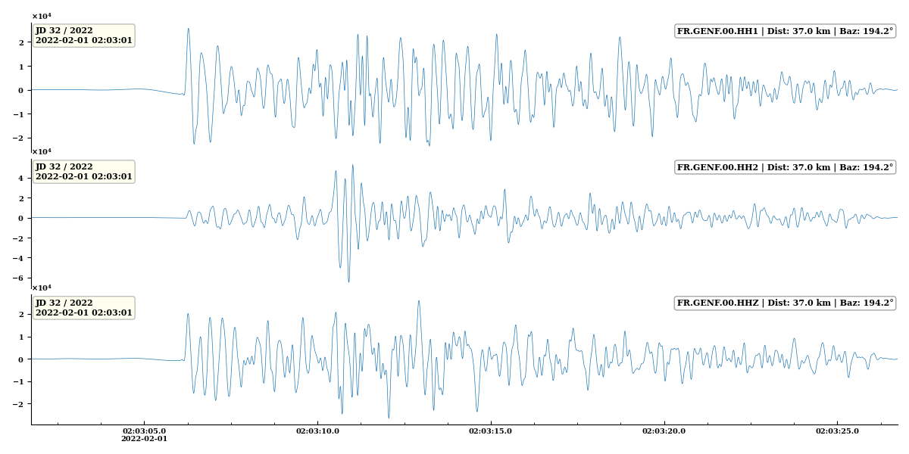
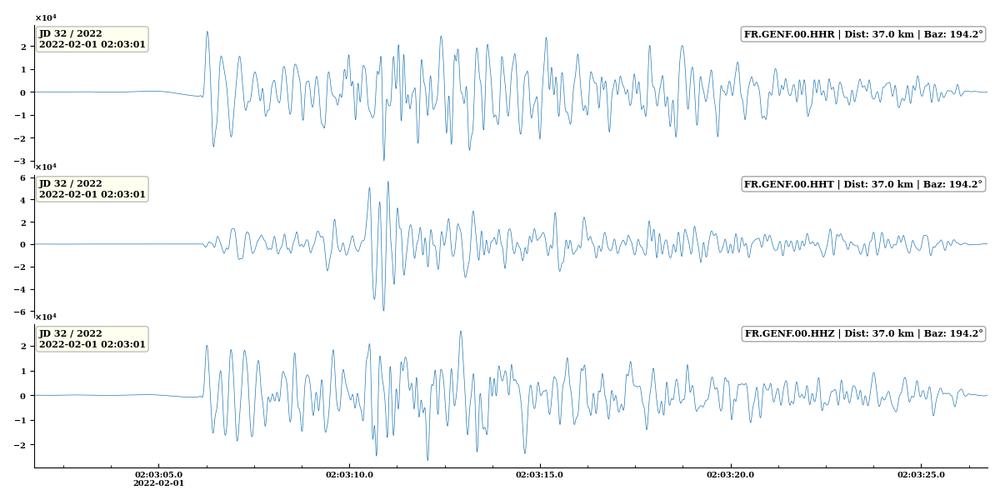
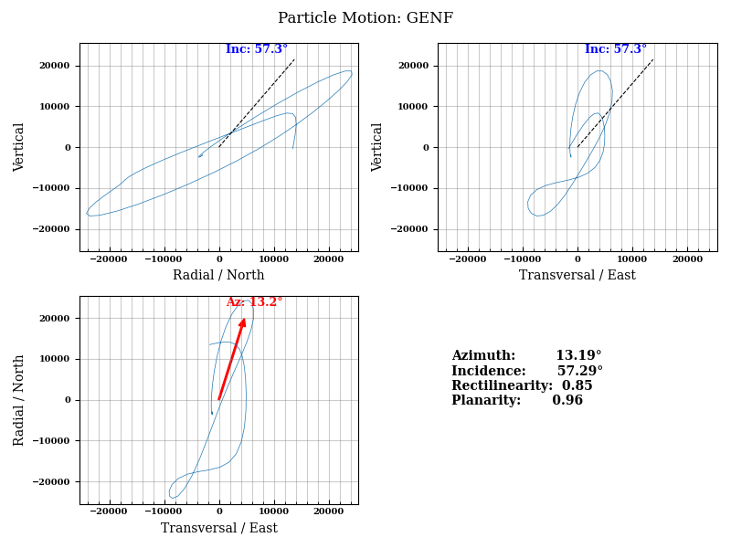
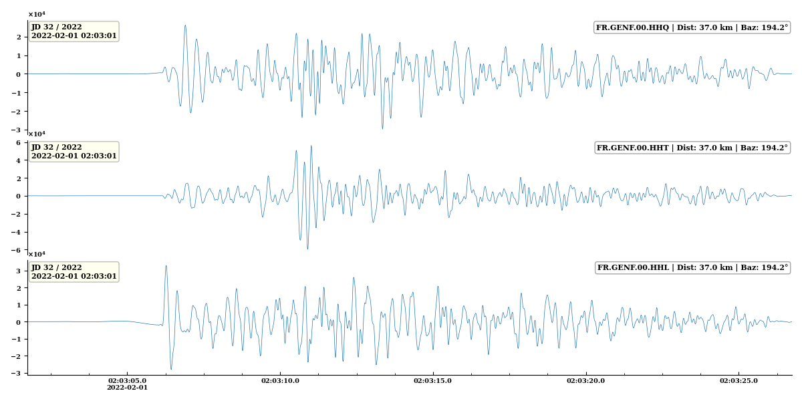

# <span style="color:darkcyan;"> **Three-Component Analysis: Rotation and Polarization Tutorial 3** </span>

A seismometer records the ground motion in three fixed directions: **Z** (up), **N** (north) and **E** (east). These directions are chosen by the installer, not by the earthquake: a P or an S wave arriving from the south-west is split between N and E, and it is difficult to see what kind of motion it produces. In this tutorial, we will learn how to work with the commands `processing` and the interactive commands `rotate` and `pm` to:

1. Understand the **coordinate systems** ZNE, ZRT and LQT, and the **back-azimuth**.
2. **Rotate** the horizontal components to **Radial** and **Transverse**, and separate the P, SV and SH motions.
3. Measure the **polarization** of the P wave: its direction, incidence angle and shape.
4. Use the measured incidence to **rotate to LQT**.
5. Rotate all the stations of an event **automatically** with a config file.
6. Use polarization to **check the stations**: which measurements can be trusted, and which sensors are not oriented to the north.

We will use the same data as in [Tutorial 1 (Part 2)](tutorial1_part2.md): 10 stations around Andorra during the seismic sequence of 1 February 2022. We will analyse the largest earthquake, of magnitude **ML 3.5**, at **02:03:00.3 UTC**, 42.500° N, 1.462° E and 5.3 km deep. We will follow this structure:

- *Seismic files:* tutorial1/data
- *Metadata:* tutorial1/metadata
- *Project:* tutorial1/project
- *Event file:* tutorial1/events
- *Config Files:* tutorial1/configs

```
--tutorial1
    --data
        --CA.ARBS..HH1.D.2022.32
        --CA.ARBS..HH2.D.2022.32
        --CA.ARBS..HHZ.D.2022.32
        ......
        --FR.VALC.00.HHZ.D.2022.32
    --metadata
        --inv_all.xml
    --project
        --andorra
    --events
        --event_ml35.txt
    --configs
        --typical_config.yaml
        --plotting_config.yaml
        --rotate_config.yaml
```

If you have not done Tutorial 1, download the [seismic data here](https://github.com/rcabdia/test_surfquake/tree/main/Andorra/inputs/waveforms_cut){: target="_blank" rel="noopener noreferrer" } and the [metadata here](https://github.com/rcabdia/test_surfquake/tree/main/Andorra/inputs/metadata){: target="_blank" rel="noopener noreferrer" }, create the config files and the project:

```bash
surfquake make_config -c typical_config -o "./tutorial1/configs"
surfquake make_config -c plotting_config -o "./tutorial1/configs"
surfquake project -d ./tutorial1/data -s ./tutorial1/project -n andorra
```

In this tutorial the **metadata is required**: surfquake needs the coordinates of the stations to compute the direction of the earthquake.

Open `plotting_config.yaml` and set `back2future: true`. With it, the command `back2future` restores the original traces, so we can try several rotations on the same data.

All the commands of this tutorial are run from the folder that contains `tutorial1`.

---

## Step 1: Coordinate systems

### The back-azimuth

The **back-azimuth** (baz) is the direction from the **station to the earthquake**, measured clockwise from the north. The **azimuth** is the opposite direction, from the earthquake to the station. For example, the earthquake is south of station GENF, so its back-azimuth at GENF is about 194°.

When an event file and the metadata are given, surfquake computes the distance, the azimuth and the back-azimuth of every station, and stores them in the [trace header](https://projectisp.github.io/surfquaketutorial.github.io/trace_header_documentation/){: target="_blank" rel="noopener noreferrer" } (`geodetic`), together with the theoretical arrivals and the **incidence angle** of the first arrival.

### ZNE, ZRT and LQT

There are three common ways to describe the same ground motion:

- **ZNE**: vertical, north and east. The directions of the sensor.
- **ZRT**: the horizontal components are rotated around the vertical axis. The **Radial** (R) component points along the great circle that joins the earthquake and the station, away from the earthquake; the **Transverse** (T) component is perpendicular to it. Z is unchanged.
- **LQT**: a 3D rotation that also tilts the axes by the incidence angle of the ray. **L** points along the direction of the P ray, **Q** is perpendicular to it in the vertical plane that contains the ray (the SV direction), and **T** is the same transverse component (the SH direction).

The rotation from N, E to R, T is:

$$
R = -N\cos(\text{baz}) - E\sin(\text{baz}), \qquad T = N\sin(\text{baz}) - E\cos(\text{baz})
$$

Why is it useful? Because each wave moves the ground in a known direction **relative to the ray**:

| Wave | Motion | Where it is after rotation |
|------|--------|----------------------------|
| P | along the ray | Z and **R** (ZRT), **L** (LQT) |
| SV | perpendicular to the ray, in the vertical plane | Z and **R** (ZRT), **Q** (LQT) |
| SH | horizontal, perpendicular to the ray | **T** |
| Rayleigh | ellipse in the vertical plane | Z and R |
| Love | horizontal, perpendicular to the ray | T |

So, after a good rotation, the **P wave disappears from T**, and the T component shows only SH (and Love) energy.

Please review the following documentation:

[Rotate Seismograms](https://projectisp.github.io/surfquaketutorial.github.io/processing_stream_config/){: target="_blank" rel="noopener noreferrer" } and [Particle Motion](https://projectisp.github.io/surfquaketutorial.github.io/particle_motion_documentation/){: target="_blank" rel="noopener noreferrer" }

---

## Step 2: The event and its geometry

Create the file `./tutorial1/events/event_ml35.txt` with the earthquake:
    
    date;hour;latitude;longitude;depth;magnitude
    2022-02-01;02:03:00.3;42.5003;1.4619;5.3;3.49

For this earthquake, the geometry of the stations is:

| Station | Distance (km) | Back-azimuth (°) | Incidence of `p` (°) |
|---------|---------------|------------------|----------------------|
| PAND | 7.4 | 249.4 | 54.3 |
| ARBS | 9.4 | 321.1 | 60.5 |
| CEST | 20.3 | 122.5 | 75.2 |
| CSOR | 30.5 | 62.6 | 80.0 |
| CORG | 32.4 | 21.6 | 80.6 |
| SALF | 36.5 | 141.9 | 81.6 |
| GENF | 37.0 | 194.2 | 81.7 |
| VALC | 49.2 | 284.9 | 83.6 |
| CARF | 57.9 | 245.9 | 84.5 |
| FNEB | 69.2 | 229.9 | 85.3 |

The stations surround the earthquake, so every direction is represented. The incidence angle is the angle between the ray and the vertical at the station, computed by TauP with the IASP91 model: 0° is a ray arriving from below, 90° a horizontal ray. The closer the station, the more vertical the ray.

---

## Step 3: The three components of GENF

We start with a single station, **GENF**, at 37 km, where the P wave is very clear. Let's open the earthquake, from 5 s before to 20 s after the first arrival:

```bash
surfquake processing -p ./tutorial1/project/andorra -i ./tutorial1/metadata/inv_all.xml -e ./tutorial1/events/event_ml35.txt -c ./tutorial1/configs/typical_config.yaml -s GENF --phases p,s,P,S -cs 5 -ce 20 --plot_config ./tutorial1/configs/plotting_config.yaml
```

- `-s GENF`: only the station GENF.
- `--phases p,s,P,S`: the phases computed for the header. For local earthquakes, include `p` and `s` (see [Tutorial 1, Part 2](tutorial1_part2.md)).
- `-cs 5 -ce 20`: the cut, in seconds before and after the first theoretical arrival.

The config file `typical_config.yaml` removes the trend, tapers and filters the traces between 0.5 and 8.5 Hz.



The three traces are FR.GENF.00.HHZ, HH1 and HH2. Instead of N and E, GENF has the horizontal components **1** and **2**, a name used when the sensor is not exactly aligned with the north. The metadata says that HH1 points to 7° and HH2 to 97°, so they are close to N and E: surfquake reads 1 as N and 2 as E, and the error of 7° is small for this tutorial.

Look at the arrivals:

- The **P wave** arrives at about 02:03:06.1. It is clear on Z and on HH1 (north), and smaller on HH2 (east).
- The **S wave** arrives about 4.4 s later, at 02:03:10.5. It is largest on HH2 (east).

!!! note
    The theoretical `p` arrival of the IASP91 model is at 02:03:06.7, about 0.6 s later than the real P wave. IASP91 is a global model; the crust of the Pyrenees is faster for these short paths. Always use the observed onset, not the theoretical one, to choose the analysis windows.

---

## Step 4: Rotate to Radial and Transverse

Place the mouse on the figure and press `v` to open the command prompt. Then rotate:

```
>> rotate NE->RT
```

Without an angle, `rotate` reads the back-azimuth of each station from its header (194.2° for GENF). The terminal confirms the rotation:

    [INFO] FR.GENF.00.HH?: NE->RT with baz=194.22°
    [INFO] Rotation 'NE->RT' complete: 1 station groups rotated, 0 not rotated.

The channels are renamed HHR and HHT, and the figure is redrawn:



Compare the maximum amplitudes (in counts) before and after the rotation:

| Window | N (HH1) | E (HH2) | R | T |
|--------|---------|---------|---|---|
| P wave | 25 700 | 8 300 | 26 400 | 6 900 |
| S wave | 23 100 | 64 800 | 30 100 | 59 800 |

- The **P wave** moves to the **R** component: on T it is about 4 times smaller. The small P energy left on T comes from the 7° orientation of the sensor, the noise, and the 3D structure, which bends the rays out of the great circle.
- The **S wave** is largest on **T**: at GENF this earthquake radiates mostly **SH** energy. The ratio between SH and SV depends on the focal mechanism and on the direction to the station, so at other stations the S wave can be larger on R.

The interactive rotation is also possible with a fixed angle, for example `rotate NE->RT 194.2`.

---

## Step 5: Particle motion of the P wave

The rotation used the back-azimuth computed from the event location. **Polarization analysis** does the opposite: it measures the direction of the wave from the waveforms of a single station.

First, restore the original traces:

```
>> back2future
```

Now select a short window around the P wave: place the mouse at the onset of the P wave, at about **02:03:06.09**, and press `u`; then at about **02:03:06.64** (half a second later) and press `i`. Open the prompt with `v` and type:

```
>> pm
```

surfquake computes the covariance of the three components in the window, and its eigenvectors (Flinn, 1965). The largest eigenvector is the main direction of the motion. The particle motion is plotted in three planes (Z–N, Z–E and N–E), and the fourth panel of the figure shows the parameters:

    Azimuth:         15.02°
    Incidence:       55.62°
    Rectilinearity:  0.85
    Planarity:       1.00



The values may change a little with the window that you select. How do we read them?

- **Rectilinearity 0.85**: the motion is almost a straight line, as expected for a P wave. This tells us that the measurement is reliable.
- **Azimuth 15°**: the direction of the line, from the north. A line has two directions, so the polarization gives the back-azimuth **with an ambiguity of 180°**: 15° or 195°. The back-azimuth of the earthquake is 194.2°: the agreement is about 1°. The first motion solves the ambiguity: when the P wave pushes the ground up (compression), the horizontal motion points **away** from the earthquake.
- **Incidence 56°**: the P motion is 56° from the vertical. But the incidence of the `p` ray computed with IASP91 is 82°!

Why are the two incidence angles so different? Two reasons:

1. **The ray bends towards the vertical near the surface.** The rocks close to the surface are slower than the 5.8 km/s of IASP91, so the real ray arrives steeper than in the model.
2. **The free surface.** At the surface, the incoming P wave is reflected as P and SV waves, which add to the motion. The measured angle is an **apparent** incidence, which is different from the true angle of the ray.

So, the theoretical incidence describes the ray in the model, and the measured one describes the motion that the station really records. For the rotation to LQT, the measured one is the useful one.

!!! tip
    - Use a **short window** of a few periods of the P wave, starting at the onset. A long window mixes the P wave with its coda and with the S wave.
    - Filter first in a band where the P wave is clear. Here, the 0.5–8.5 Hz band of `typical_config.yaml` is enough.
    - Trust the azimuth only when the **rectilinearity** is high (above about 0.7).

---

## Step 6: Rotate to LQT

Restore the traces again, and rotate to LQT with the incidence from the header (the IASP91 value, 81.7°):

```
>> back2future
>> rotate ZNE->LQT
```

Then repeat with the incidence that we measured:

```
>> back2future
>> rotate ZNE->LQT 194.2 56
```

The two numbers are the back-azimuth and the incidence. These are the maximum amplitudes of the P wave on L and Q:

| Incidence used | L | Q |
|----------------|---|---|
| 81.7° (IASP91, from the header) | 29 000 | 16 300 |
| 56° (measured with `pm`) | 32 900 | 4 400 |

With the theoretical incidence, a large part of the P wave stays on Q. With the measured incidence, the P wave is concentrated on **L**, and Q is almost free of P energy: now Q shows the SV motion and T the SH motion, and the onset of the S wave is much easier to see.



!!! note
    In the LQT system, the T component is the same as in ZRT: only Z and R are rotated by the incidence angle.

---

## Step 7: Rotate all the stations automatically

The interactive commands are perfect to explore one station. To rotate all the stations of the event, add a `rotate` step to the config file. Create the file `./tutorial1/configs/rotate_config.yaml`:

```yaml
Analysis:
  process_1:
    name: 'rmean'
    method: 'linear'
  process_2:
    name: 'taper'
    method: 'cosine'
    max_percentage: 0.05
  process_3:
    name: 'filter'
    type: 'bandpass'
    fmin: 0.5
    fmax: 8.5
    corners: 4
    zerophase: True
  process_4:
    name: 'rotate'
    type: 'NE->RT'
    method: 'GAC'
```

- `type: 'NE->RT'`: the rotation. The others are `RT->NE`, `ZNE->LQT` and `LQT->ZNE`.
- `method: 'GAC'` (Great Arc Circle): the back-azimuth (and the incidence, for LQT) of each station is read from its header. With `method: 'FREE'`, the same `angle` (and `inclination`) is used for all the stations.

`rotate` is a stream method: by default it runs after the trace methods, on the stream of each event. The components of each station are renamed to Z/N/E if needed (1 → N, 2 → E) and cut to a common time window before rotating.

```bash
surfquake processing -p ./tutorial1/project/andorra -i ./tutorial1/metadata/inv_all.xml -e ./tutorial1/events/event_ml35.txt -c ./tutorial1/configs/rotate_config.yaml --phases p,s,P,S -cs 5 -ce 20 --plot_config ./tutorial1/configs/plotting_config.yaml
```

The terminal shows the back-azimuth used for every station, and a summary:

    [INFO] FR.PAND.00.HH?: NE->RT with baz=249.36°
    ......
    [INFO] Rotation 'NE->RT': 10 station groups rotated, 0 not rotated

A station is not rotated if it does not have both horizontal components, or if its header has no back-azimuth (for example, when the event file or the metadata is missing). Its traces are kept unrotated.

Now, all the stations are in ZRT, ordered by distance. Browse the pages with `n` and `b`: at most stations, the P wave is clearly smaller on T than on R.

!!! tip
    Add `-o ./tutorial1/rotated` to save the rotated traces of the event (HDF5 files that keep the header). You can open them later with `quick`, for example only the transverse components with `-w "./tutorial1/rotated/*HHT*"`.

---

## Step 8: Polarization to check the stations

Repeat Step 5 for every station (change `-s GENF` to another station). These are the results for a window from 0.05 s before to 0.35 s after the P onset, with the 0.5–8.5 Hz filter. The **expected azimuth** is the back-azimuth folded between 0° and 180°, because of the ambiguity of 180°:

| Station | Distance (km) | Expected azimuth (°) | Measured azimuth (°) | Difference (°) | Rectilinearity |
|---------|---------------|----------------------|----------------------|----------------|----------------|
| PAND | 7.4 | 69.4 | 90.9 | 21 | 0.33 |
| ARBS | 9.4 | 141.1 | 100.3 | −41 | 0.59 |
| CEST | 20.3 | 122.5 | 116.9 | −6 | 0.52 |
| CSOR | 30.5 | 62.6 | 46.6 | −16 | 0.79 |
| CORG | 32.4 | 21.6 | 12.1 | −10 | 0.85 |
| SALF | 36.5 | 141.9 | 146.0 | 4 | 0.81 |
| GENF | 37.0 | 14.2 | 15.0 | 1 | 0.85 |
| VALC | 49.2 | 104.9 | 97.7 | −7 | 0.21 |
| CARF | 57.9 | 65.9 | 64.2 | −2 | 0.70 |
| FNEB | 69.2 | 49.9 | 47.9 | −2 | 0.76 |

What does the table tell us?

- **Where the rectilinearity is high (0.7 or more)**, the measured azimuth agrees with the back-azimuth within 16°, and within 4° at GENF, SALF, CARF and FNEB. A single station gives the direction of the earthquake!
- **Where the rectilinearity is low**, the measurement cannot be trusted, even if the difference is small (VALC, 0.21). The P wave of VALC is weak, and the window contains mostly noise.
- **The closest stations** (PAND and ARBS) have low rectilinearity. Their rays arrive almost vertically, so the horizontal P motion is small, and the S wave arrives only 1.5–2 s after the P wave. Close to the earthquake, the azimuth is very sensitive to the noise and to the window.
- **The differences of 10–16°** (CSOR, CORG) can come from the 3D structure of the crust, which bends the rays, from the location of the earthquake, or from a small misorientation of the sensor.

### A sensor that is not oriented to the north

Look at the metadata of ARBS: its horizontal channels are HH1 and HH2, like GENF, but HH1 points to **241°** and HH2 to **331°**. The sensor is rotated 241° from the north! The orientation of every channel is the `Azimuth` field of the channel in the StationXML file. You can also print it with a few lines of Python:

```python
from obspy import read_inventory
inv = read_inventory("./tutorial1/metadata/inv_all.xml")
for net in inv:
    for sta in net:
        for cha in sta:
            print(net.code, sta.code, cha.code, cha.azimuth, cha.dip)
```

surfquake reads 1 as N and 2 as E, so for ARBS the "north" component is really pointing to 241°. This means that:

- The **rotation** of ARBS to R and T uses the wrong axes: its R and T components are **not** the real radial and transverse.
- The **azimuth** measured with `pm` at ARBS is relative to the axes of the sensor, not to the north.

Before rotating or measuring polarizations, always check the orientation of the horizontal components in the metadata, especially for components named 1 and 2 (or X and Y in ocean-bottom seismometers). With many earthquakes, the polarization of the P waves is also the standard method to **measure** the orientation of a sensor when it is unknown: the average difference between the measured azimuth and the back-azimuth is the misorientation.

---

## Step 9: The bash script

Finally, the whole workflow in a [bash script file](https://projectisp.github.io/surfquaketutorial.github.io/bash_script/){: target="_blank" rel="noopener noreferrer" }. Create a file named `run_rotation.sh`:

```bash
#!/bin/bash
# Activate your conda environment
eval "$(conda shell.bash hook)"
conda activate surfquake  # Replace with the name of your environment

BASE=./tutorial1

# 1. One station: rotate and measure the polarization interactively
surfquake processing -p $BASE/project/andorra -i $BASE/metadata/inv_all.xml -e $BASE/events/event_ml35.txt -c $BASE/configs/typical_config.yaml -s GENF --phases p,s,P,S -cs 5 -ce 20 --plot_config $BASE/configs/plotting_config.yaml

# 2. All the stations rotated to ZRT, saved to disk
surfquake processing -p $BASE/project/andorra -i $BASE/metadata/inv_all.xml -e $BASE/events/event_ml35.txt -c $BASE/configs/rotate_config.yaml --phases p,s,P,S -cs 5 -ce 20 -o $BASE/rotated --plot_config $BASE/configs/plotting_config.yaml
```

```bash
chmod u+x run_rotation.sh
./run_rotation.sh
```

---

## Discussion

- The **back-azimuth** is the direction from the station to the earthquake. surfquake computes it from the event file and the metadata, and stores it in the header.
- Rotating **NE → RT** puts the P and SV motion on R and the SH motion on T: after a good rotation, the P wave almost disappears from T.
- The **polarization** of the P wave measures the direction of the earthquake from a single station, with an ambiguity of 180°. Trust it only when the **rectilinearity** is high.
- The measured incidence is an **apparent** incidence: it is smaller than the theoretical one because of the slow near-surface rocks and the free surface. Use it for the **LQT** rotation, which then concentrates the P wave on L.
- Use `method: 'GAC'` in a config file to rotate all the stations of an event automatically.
- Always check the **orientation of the sensors** in the metadata. Components named 1/2 are read as N/E, so a misoriented sensor such as ARBS gives wrong R/T components and azimuths.

---

## References

Flinn, E. A. "Signal analysis using rectilinearity and direction of particle motion." Proceedings of the IEEE 53.12 (1965): 1874-1876.

Jurkevics, Andy. "Polarization analysis of three-component array data." Bulletin of the Seismological Society of America 78.5 (1988): 1725-1743.
