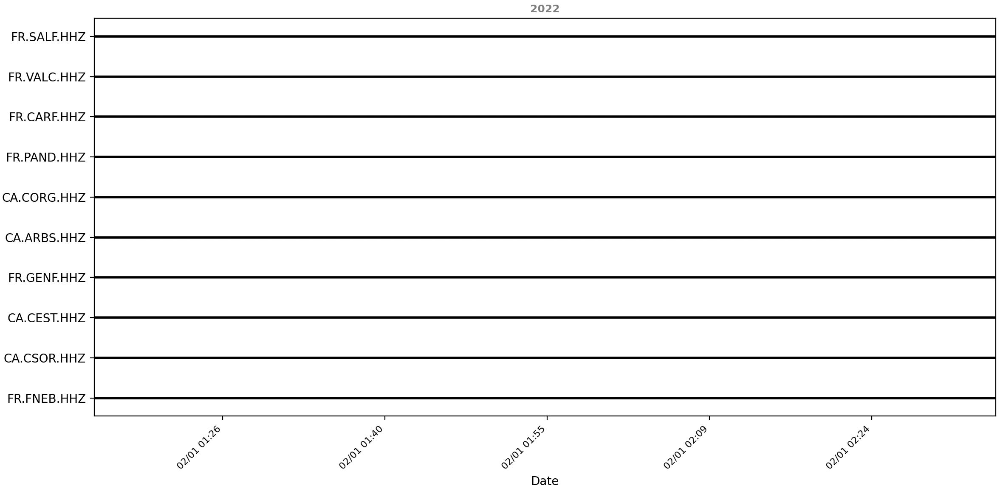
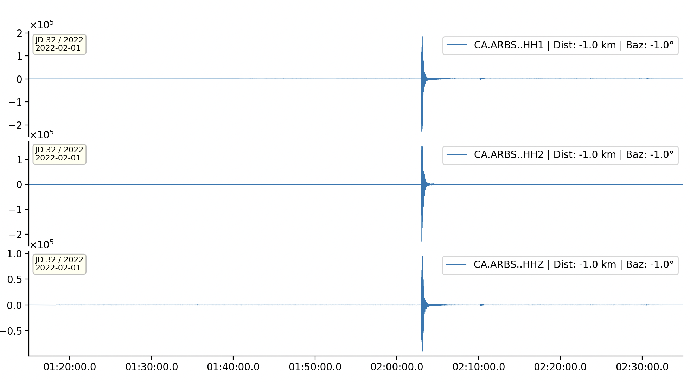

# <span style="color:darkcyan;"> **Signal Processing Tutorial** </span>

In this tutorial, we will learn how to work with the commands: `make_config`, `explore`, `info` and  `quick` to process your seismic waveforms.

In this tutorial we will follow this structure
- *Seismic files:* tutorial1/data
- *Metadata:* tutorial1/metadata
- *Config Files:* tutorial1/configs

    --tutorial
        --data
            --CA.ARBS..HH1.D.2022.32
            --CA.ARBS..HH2.D.2022.32
            --CA.ARBS..HHZ.D.2022.32
            ......
        --metadata
            --inv_all.xml
        --configs
            --typical_config.yaml
            --plotting_config.yaml


For this tutorial you need to download the [seismic data here](https://github.com/rcabdia/test_surfquake/tree/main/Andorra/inputs/waveforms_cut){: target="_blank" rel="noopener noreferrer" }. Optionally, download the corresponding [metadata](https://github.com/rcabdia/test_surfquake/tree/main/Andorra/inputs/metadata){: target="_blank" rel="noopener noreferrer" }.

Please, first open a terminal and type the following command to overviewall surfquake capabilities:

```bash
surfquake -h
```

## Generate Config Files

When working with seismic waveforms it is necessary to follow a signal processing workflow and plotting configuration. Let's prepare the necessary files.

```bash
surfquake make_config -h
surfquake make_config -c typical_config -o "./tutorial1/configs"
surfquake make_config -c plotting_config -o "./tutorial1/configs"
```

---

## Explore your data

Sometimes we have really big datasets, A first view of your data coverage, including gaps.  

```bash
surfquake explore -h
surfquake explore -w './tutorial1/data/*'
```



---

## Look at the files header


Now let see the header of your files. This tell you a lot of infomation about what is inside the files, such as sampling rate, number of points, start time of the header...

Please review the following documentation:

[Trace Header](https://projectisp.github.io/surfquaketutorial.github.io/trace_header_documentation/){: target="_blank" rel="noopener noreferrer" }

```bash
surfquake info -h
surfquake info -w './tutorial1/data/*' -c 3
```

    [INFO] 30 files retained after filtering.
    File                 | CA.ARBS..HH1.D.2022.32    | CA.ARBS..HH2.D.2022.32    | CA.ARBS..HHZ.D.2022.32
    Network              | CA                        | CA                        | CA
    Station              | ARBS                      | ARBS                      | ARBS
    Location             |                           |                           |
    Channel              | HH1                       | HH2                       | HHZ
    Start Time           | 2022-02-01T01:15:00.6200  | 2022-02-01T01:15:00.6200  | 2022-02-01T01:15:00.6200
    End Time             | 2022-02-01T02:35:00.2100  | 2022-02-01T02:35:00.2100  | 2022-02-01T02:35:00.2100
    Sampling Rate (Hz)   | 100.0                     | 100.0                     | 100.0
    Delta (s)            | 0.01                      | 0.01                      | 0.01
    Npts                 | 479960                    | 479960                    | 479960
    Picks                | None                      | None                      | None
    References           | None                      | None                      | None

---

## Process your waveform

Finally it is time to play with processing. In the example we filter the traces between 0.5-8.0 Hz with a butterworth filter, zero-phase.
Please review the next documentation:

[Trace processing](https://projectisp.github.io/surfquaketutorial.github.io/processing_config/){: target="_blank" rel="noopener noreferrer" } and [plotting](https://projectisp.github.io/surfquaketutorial.github.io/plotting_interaction_documentation/){: target="_blank" rel="noopener noreferrer" }

```bash
surfquake quick -h
surfquake quick -w "./tutorial1/data/*" -c "./configs/typical_config.yaml" --plot_config "./configs/plotting_config.yaml"
```


