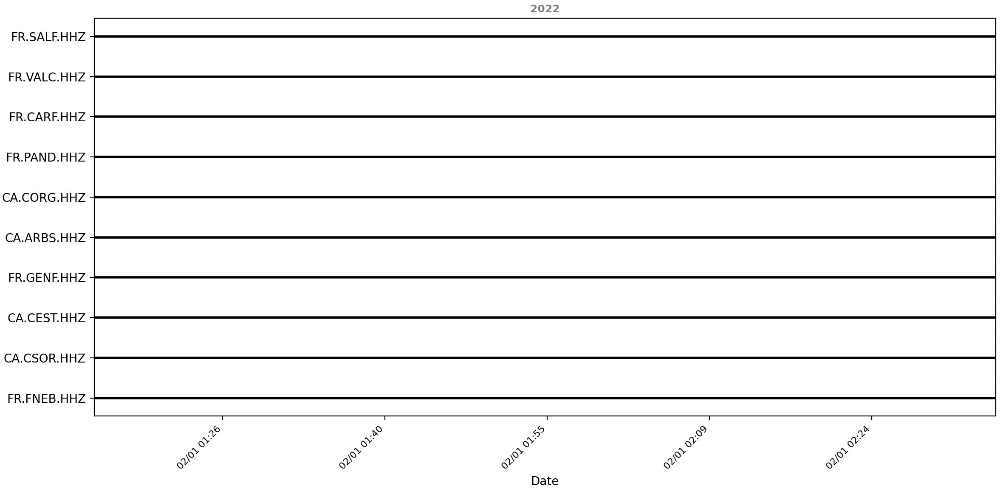
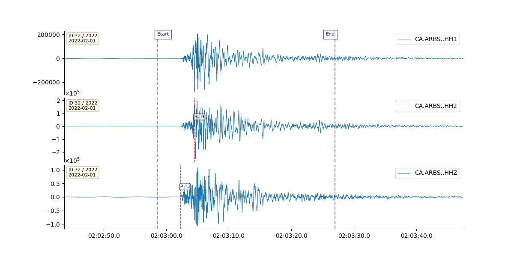

# <span style="color:darkcyan;"> **Basic Signal Processing Tutorial 1** </span>

In this tutorial, we will learn how to work with the commands: `make_config`, `explore`, `info` and `quick` to process your seismic waveforms.

In this tutorial we will follow this structure:

- *Seismic files:* tutorial1/data
- *Metadata:* tutorial1/metadata
- *Config Files:* tutorial1/configs
- *Folder for the tutorial output:* tutorial1/output, this will be created by surfquake.

```
--tutorial1
    --data
        --CA.ARBS..HH1.D.2022.32
        --CA.ARBS..HH2.D.2022.32
        --CA.ARBS..HHZ.D.2022.32
        ......
    --metadata
        --inv_all.xml
    --configs
        --typical_config.yaml
        --plotting_config.yaml
```

For this tutorial you need to download the [seismic data here](https://github.com/rcabdia/test_surfquake/tree/main/Andorra/inputs/waveforms_cut){: target="_blank" rel="noopener noreferrer" }. Optionally, download the corresponding [metadata](https://github.com/rcabdia/test_surfquake/tree/main/Andorra/inputs/metadata){: target="_blank" rel="noopener noreferrer" }.

All the commands of this tutorial are run from the folder that contains `tutorial1`.

Please, first open a terminal, activate your environment and type the following command to overview all surfquake capabilities:

```bash
surfquake -h
```

---

## Generate Config Files

When working with seismic waveforms, it is useful to describe the signal processing workflow and the plotting options in configuration files. Let's prepare the necessary files.

```bash
surfquake make_config -h
surfquake make_config -c typical_config -o "./tutorial1/configs"
surfquake make_config -c plotting_config -o "./tutorial1/configs"
```

The [plotting configuration](https://projectisp.github.io/surfquaketutorial.github.io/plotting_interaction_documentation/){: target="_blank" rel="noopener noreferrer" } is commented to explain the functionality. The parametrization for signal processing can be found [here for traces](https://projectisp.github.io/surfquaketutorial.github.io/processing_config/){: target="_blank" rel="noopener noreferrer" } and [here for streams](https://projectisp.github.io/surfquaketutorial.github.io/processing_stream_config/){: target="_blank" rel="noopener noreferrer" }.

---

## Explore your data

Sometimes we have really big datasets. Before processing, it is good to have a first view of the data coverage, including gaps.

```bash
surfquake explore -h
surfquake explore -w './tutorial1/data/*'
```

In this example we use the wildcard `*`, which means all files. No worries, only seismic files will be read.

Other useful wildcards are `*Z*` (all vertical components) or `*VALC*` (only station VALC). Keep in mind that wildcards work on the **file names**, not on the file headers.



---

## Look at the files header

Now let's look at the header of your files. It tells you a lot about what is inside them, such as the sampling rate, the number of points or the start time.

Please review the following documentation:

[Trace Header](https://projectisp.github.io/surfquaketutorial.github.io/trace_header_documentation/){: target="_blank" rel="noopener noreferrer" }

```bash
surfquake info -h
surfquake info -w './tutorial1/data/*' -c 3
```

    [INFO] 30 files retained after filtering.
    File                 | CA.ARBS..HH1.D.2022.32    | CA.ARBS..HH2.D.2022.32    | CA.ARBS..HHZ.D.2022.32
    Network              | CA                        | CA                        | CA
    Station              | ARBS                      | ARBS                      | ARBS
    Location             |                           |                           |
    Channel              | HH1                       | HH2                       | HHZ
    Start Time           | 2022-02-01T01:15:00.6200  | 2022-02-01T01:15:00.6200  | 2022-02-01T01:15:00.6200
    End Time             | 2022-02-01T02:35:00.2100  | 2022-02-01T02:35:00.2100  | 2022-02-01T02:35:00.2100
    Sampling Rate (Hz)   | 100.0                     | 100.0                     | 100.0
    Delta (s)            | 0.01                      | 0.01                      | 0.01
    Npts                 | 479960                    | 479960                    | 479960
    Picks                | None                      | None                      | None
    References           | None                      | None                      | None

The option `-c` sets how many traces (columns) are shown side by side.

---

## Process your waveforms

Finally, it is time to play with processing. The file `typical_config.yaml` removes the mean, applies a taper and filters the traces between 0.5 and 8.5 Hz with a zero-phase Butterworth bandpass filter:

```yaml
Analysis:
  process_1:
    name: 'rmean'
    method: 'linear'
  process_2:
    name: 'taper'
    method: 'cosine'
    max_percentage: 0.05
  process_3:
    name: 'filter'
    type: 'bandpass'
    fmin: 0.5
    fmax: 8.5
    corners: 4
    zerophase: True
```

Please review the following documentation:

[Trace processing](https://projectisp.github.io/surfquaketutorial.github.io/processing_config/){: target="_blank" rel="noopener noreferrer" } and [plotting](https://projectisp.github.io/surfquaketutorial.github.io/plotting_interaction_documentation/){: target="_blank" rel="noopener noreferrer" }

```bash
surfquake quick -h
surfquake quick -w "./tutorial1/data/*" -c "./tutorial1/configs/typical_config.yaml" --plot_config "./tutorial1/configs/plotting_config.yaml"
```



Navigate and process your data interactively. The keyboard shortcuts are printed in the terminal:

    =======================================================
    Plot Interaction Help
    =======================================================
    KEY             | ACTION
    ---             | ------
    n               | Next page
    b               | Previous page
    w               | Add reference time
    p               | Remove last reference
    c               | Clear all picks
    e               | Manual pick (interactive input)
    1–6             | Quick picks (P/S + polarity)
    d / Del         | Delete pick under cursor
    v               | Open command prompt
    u               | Set start time at cursor
    i               | Set end time at cursor
    Right-click drag | Select time window
    Double left-click | Add pick
    ESC / Enter     | Exit current mode
    =======================================================

Your picks are saved in the file set by `pick_output_file` in `plotting_config.yaml` (default `./picks.csv`).

---

## Automatic processing

Sometimes we do not want to plot the seismograms, only to process them and write the output files to disk. This is done by adding the option `-a` (automatic mode) and an output folder with `-o`:

```bash
surfquake quick -w "./tutorial1/data/*" -c "./tutorial1/configs/typical_config.yaml" -o "./tutorial1/output" -a
```

The processed traces are saved in `H5 format`. Picks, reference times and geodesic information travel with the traces in the `header`.

If you also want to save the figures automatically, edit these fields in `./tutorial1/configs/plotting_config.yaml`:

```yaml
plot_output_path: ./tutorial1/figures
show_plot: false
```

and run the command again, now passing the plotting configuration:

```bash
surfquake quick -w "./tutorial1/data/*" -c "./tutorial1/configs/typical_config.yaml" --plot_config "./tutorial1/configs/plotting_config.yaml" -o "./tutorial1/output" -a
```

With `show_plot: false` nothing is displayed on screen: all pages are written to `plot_output_path` and surfquake does not ask any question. This is the mode to automate your plots.

| show_plot | plot_output_path | Result                       |
|-----------|------------------|------------------------------|
| true      | null             | displayed, not saved         |
| true      | ./figures        | displayed and saved          |
| false     | ./figures        | not displayed, saved (batch) |
| false     | null             | nothing shown or saved       |

!!! note
    In automatic mode (`-a`) the figures are only saved when `show_plot: false` **and** `plot_output_path` is set.

---

## Using Bash script

Now, how can you chain several surfquake commands? The answer is a [bash script file](https://projectisp.github.io/surfquaketutorial.github.io/bash_script/){: target="_blank" rel="noopener noreferrer" }.
Please, create a file named `run_commands.sh` and write the following commands in it:

```bash
#!/bin/bash

# Activate your conda environment
eval "$(conda shell.bash hook)"
conda activate surfquake  # Replace with the name of your environment

surfquake explore -w './tutorial1/data/*'
surfquake quick -w "./tutorial1/data/*" -c "./tutorial1/configs/typical_config.yaml" -o "./tutorial1/output" -a
```

Ok, let's run the bash script. Open a terminal in your working directory, where the `run_commands.sh` file is, and type:

```bash
chmod u+x run_commands.sh
./run_commands.sh
```

!!! tip
    Run the script with `./run_commands.sh` or `bash run_commands.sh`. On many Linux systems `sh` is not bash, and the activation of the environment fails.

---

## Interactive Processing

Open again the plot with the `quick` command (interactive mode, without `-a`):

```bash
surfquake quick -w "./tutorial1/data/*" -c "./tutorial1/configs/typical_config.yaml" --plot_config "./tutorial1/configs/plotting_config.yaml"
```

- Open an interactive prompt pressing `v`. The directions for interacting with the traces are printed in the terminal.
- In the new prompt type `help` to open the interactive signal processing menu. To get details and examples of one command, type for example `help filter`.

This is an excerpt of the menu (type `help` to see the full and updated list):

```
▸ Navigation
  n                      Next trace page
  b                      Previous trace page
  p                      Return to picking mode
  back2future / b2f      Restore original waveforms (undo all processing)
  exit                   Close interactive session

▸ Signal Processing
  algebra                Apply a Math expression on traces
  rmean                  Remove mean on traces
  taper                  Apply taper window on traces
  normalize / norm       Normalize traces
  remove_spikes          Remove spikes from traces
  filter                 Apply signal filtering
  cut                    Trim traces using picks or UTC times
  concat                 Merge trace segments
  rotate                 Rotate seismic components
  shift                  Align traces by phase arrivals
  write                  Export traces to HDF5

▸ Spectral Analysis
  spectrum / sp          Plot amplitude spectrum
  spectrogram / spec     Plot spectrogram
  cwt                    Continuous wavelet transform
  save_tf                Save Time-Frequency Analysis

▸ Array Processing
  beam                   FK beamforming analysis
  smap                   Slowness map estimation
  stack                  Trace stacking
  xcorr                  Cross-correlate traces
```

Let's try a few commands. First, filter the displayed traces between 1 and 5 Hz:

```bash
help filter
filter bandpass 1.0 5.0 --corners 4 --zerophase True
```

The commands that modify the traces (`filter`, `rmean`, `taper`, `back2future`...) redraw the figure and take you back to picking mode. Look at the result and press `v` again to reopen the prompt.

Now restore the original waveforms, undoing all the processing:

```bash
back2future
```

Press `v` again. To export the traces you have processed interactively:

```bash
write --folder_path ./tutorial1/output
```

To go back to picking mode without modifying the traces type `p`, and to close the session type `exit`.
