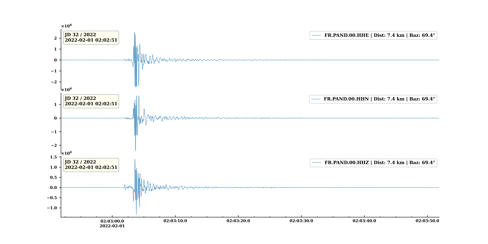
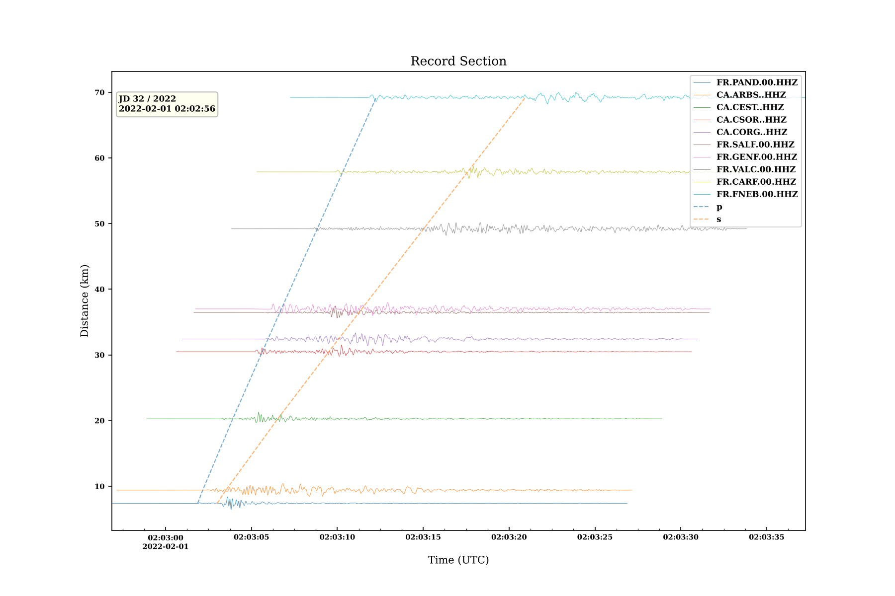
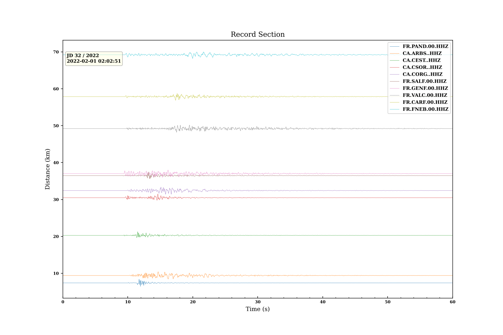

# <span style="color:darkcyan;"> **Basic Signal Processing Tutorial 2: Events and Record Sections** </span>

In the [first part](tutorial1.md) we processed whole files with `quick`. In seismology, however, we usually want to look at **earthquakes**: a short window of every station around the arrival of the waves of a known event. In this tutorial, we will learn how to work with the commands `project` and `processing` to:

1. Organise the data in a **project**.
2. Describe the earthquakes in an **event file**.
3. **Cut** the waveforms of every station around the arrival of the waves, automatically.
4. Plot **record sections**: all the stations ordered by distance, with the theoretical arrival times.
5. Choose the **phases** and the **cutting** strategy.
6. Measure **amplitudes** of all the events with your own script.

We will use the same data as in Part 1: 10 stations around Andorra, recording between 01:15 and 02:35 UTC on 1 February 2022, during a seismic sequence. We will follow this structure:

- *Seismic files:* tutorial1/data
- *Metadata:* tutorial1/metadata (required in this tutorial)
- *Config Files:* tutorial1/configs
- *Event file:* tutorial1/events
- *Project:* tutorial1/project
- *Folder for the tutorial output:* tutorial1/output, this will be created by surfquake.

```
--tutorial1
    --data
        --CA.ARBS..HH1.D.2022.32
        --CA.ARBS..HH2.D.2022.32
        --CA.ARBS..HHZ.D.2022.32
        ......
    --metadata
        --inv_all.xml
    --configs
        --typical_config.yaml
        --plotting_config.yaml
        --velocity_config.yaml
    --events
        --events.txt
    --project
```

If you have not done Part 1, download the [seismic data here](https://github.com/rcabdia/test_surfquake/tree/main/Andorra/inputs/waveforms_cut){: target="_blank" rel="noopener noreferrer" } and the [metadata here](https://github.com/rcabdia/test_surfquake/tree/main/Andorra/inputs/metadata){: target="_blank" rel="noopener noreferrer" }, and create the config files as explained there. This time the **metadata is required**: surfquake needs the coordinates of the stations to compute their distance to the earthquakes.

All the commands of this tutorial are run from the folder that contains `tutorial1`.

---

## Step 1: Create a project

A **project** is a small file that indexes all your waveform files: which networks, stations and channels you have, and which time span every file covers. Once it is created, surfquake knows where to find the data of any station at any time, without scanning the folders again. This is important with large archives, and it lets you select stations and channels by name.

Please review the following documentation:

[Project](https://projectisp.github.io/surfquaketutorial.github.io/project/){: target="_blank" rel="noopener noreferrer" }

```bash
surfquake project -h
surfquake project -d ./tutorial1/data -s ./tutorial1/project -n andorra
```

- `-d`: folder with the waveform files.
- `-s`: folder where the project is saved.
- `-n`: name of the project (the file name).

The terminal shows a summary of the project:

    Num Networks:  2 Num Stations:  10 Num Channels:  5 Num Total Files:  30
    Start Project:  2022-02-01 01:15:00 , End Project:  2022-02-01 02:35:00

    Project successfully saved.

The project is saved as `./tutorial1/project/andorra`.

---

## Step 2: The event file

The event file lists the earthquakes, one per line, with the columns separated by `;`:

    date;hour;latitude;longitude;depth;magnitude

- `date`: `YYYY-MM-DD`, and `hour`: `HH:MM:SS.s`, the **origin time** in UTC.
- `latitude`, `longitude` in degrees, `depth` in km.
- `magnitude`: optional information, kept with the event.

Create the file `./tutorial1/events/events.txt` with three earthquakes of the sequence, located with surfquake (a magnitude 3.5 and two small events):

    date;hour;latitude;longitude;depth;magnitude
    2022-02-01;02:03:00.3;42.5003;1.4619;5.3;3.49
    2022-02-01;02:10:10.1;42.5024;1.4581;4.6;1.11
    2022-02-01;02:23:34.4;42.5003;1.4728;6.2;0.48

A template is available with `surfquake make_config -c events -o ./tutorial1/events`.

---

## Step 3: Cut and process the waveforms of each event

Let's run the `processing` command with the project, the metadata, the event file and the usual processing config:

```bash
surfquake processing -h
surfquake processing -p ./tutorial1/project/andorra -i ./tutorial1/metadata/inv_all.xml -e ./tutorial1/events/events.txt -c ./tutorial1/configs/typical_config.yaml -cs 10 -ce 50 --plot_config ./tutorial1/configs/plotting_config.yaml
```

For **each event** and **each station**, surfquake:

1. Computes the epicentral **distance** and the **back-azimuth** from the station coordinates (inventory) and the event location.
2. Computes the **theoretical arrival times** of the seismic phases with the IASP91 Earth model (TauP).
3. **Cuts** the waveform around the **first arrival**: `-cs 10` seconds before and `-ce 50` seconds after it.
4. Applies the processing of the config file (detrend, taper, filter).
5. Stores the event, the distance, the back-azimuth and the arrival times in the [header](https://projectisp.github.io/surfquaketutorial.github.io/trace_header_documentation/){: target="_blank" rel="noopener noreferrer" } of every trace.

The plot opens with the 30 traces (10 stations × 3 components) of the first event, each one starting 10 s before its first arrival:



You can pick, process and analyse the traces as in Part 1. When you close the figure window, the terminal asks:

    [Prompt] Finished processing. Type 'c' to continue, 'r' to reprocess this event, or 'e' to exit:

Type `c` to go to the next event, `r` to process the same event again (after changing the config file, for example), or `e` to exit.

Cutting options:

| Option | Description |
|--------|-------------|
| `-cs`, `-ce` | Seconds before and after the first arrival. |
| `-t` | The same number of seconds before and after (e.g. `-t 30`). |
| (none) | 300 s before and after. |

---

## Step 4: Record sections

A **record section** plots all the stations of an event in a single figure, each one at its **distance** from the epicentre. It is one of the most useful figures in seismology: the arrivals of every wave line up along a curve (the **moveout**), the further the station, the later the arrival, and the slope tells the speed of the wave. Phases, noisy stations and timing errors are recognised at a glance.

Open `./tutorial1/configs/plotting_config.yaml` and set:

```yaml
plot_type: record
sort_by: distance
record_option: dates
show_arrivals: true
```

- `plot_type: record`: record section.
- `sort_by: distance`: stations ordered by epicentral distance.
- `record_option: dates`: absolute UTC time on the x axis.
- `show_arrivals: true`: draw the theoretical arrival times.

To make the figure clearer, we use only the vertical components (`-ch HHZ`) and a shorter window:

```bash
surfquake processing -p ./tutorial1/project/andorra -i ./tutorial1/metadata/inv_all.xml -e ./tutorial1/events/events.txt -c ./tutorial1/configs/typical_config.yaml -cs 5 -ce 25 -ch HHZ --phases p,s,P,S --plot_config ./tutorial1/configs/plotting_config.yaml
```



What you should see for the first event (magnitude 3.5):

- The stations from **7 km** (PAND) to **69 km** (FNEB).
- The **P** waves arrive first, along the blue dashed curve `p`, about 2 s after the origin at 7 km and 12 s at 69 km.
- The **S** waves, larger, arrive later along the orange curve `s`, and the gap between P and S grows with distance (that is how the distance of an earthquake is estimated from a single station).
- The observed arrivals follow the theoretical curves closely: the event location and the station timing are consistent.

Now change `record_option: dates` to `record_option: seconds` and run it again. Each trace is now plotted against the seconds from its **own** start, and since every trace was cut 5 s before its own first arrival, all the P waves are **aligned** at 5 s: the moveout disappears, and the waveforms can be compared directly.



!!! tip
    Use `scale_factor` in the plotting configuration to make the traces larger or smaller, and `sort_by: backazimuth` to order the stations by direction instead of distance.

---

## Step 5: Choosing the phases

By default, surfquake computes **all** the phases of the IASP91 model, and cuts around the first one. With `--phases` you choose which ones are computed and stored in the header (and drawn with `show_arrivals`).

!!! warning "Uppercase and lowercase phase names"
    In the TauP convention used by surfquake, **`P`** and **`S`** are the waves that leave the source **downwards**, while **`p`** and **`s`** leave it **upwards**. For local earthquakes, the direct waves to the stations are usually `p` and `s`: in our example, every station has `p` and `s` arrivals, and only the most distant one, FNEB (69 km), also has a `P` arrival. If you write `--phases P,S`, the other nine stations have no arrival and they are **removed** (only 1 of the 10 traces is kept). For local and regional events, always include both: `--phases p,s,P,S`. Other useful phases are `Pn` and `Sn` (head waves along the Moho, at larger distances).

The theoretical arrivals stored in the header can be used later, for example to align the traces on the S wave from the interactive prompt:

```bash
shift --phase_theo s
```

---

## Step 6: Other ways of cutting

### Around a wave speed (`--vel`)

Instead of the theoretical arrivals, the cut can be centred on the time a wave travelling at a given **speed** (km/s) needs to reach each station: `distance / vel`. It is very useful for surface waves and for the crustal S waves (Lg), which are not well predicted by a global model:

```bash
surfquake processing -p ./tutorial1/project/andorra -i ./tutorial1/metadata/inv_all.xml -e ./tutorial1/events/events.txt -c ./tutorial1/configs/typical_config.yaml --vel 3.4 -cs 5 -ce 15 -ch HHZ --plot_config ./tutorial1/configs/plotting_config.yaml
```

For CARF, at 57.9 km, the window starts 57.9 / 3.4 − 5 = 12.0 s after the origin time. The distance is stored in the header, so the record section works, but no theoretical arrivals are computed.

### Around the origin time (`-r`)

With `-r` the cut is made around the **origin time** of the event (`-cs` seconds before, `-ce` seconds after), the same for all the stations:

```bash
surfquake processing -p ./tutorial1/project/andorra -e ./tutorial1/events/events.txt -c ./tutorial1/configs/typical_config.yaml -r -cs 5 -ce 60 -s CARF -ch HHZ
```

With `-r` the location of the event is **not used**: only the `date` and `hour` columns matter, and the inventory is not needed. It is the option to chop waveforms around a list of **times** (detections, picks, any time of interest). As a consequence, no distance is stored in the headers, so record sections and `sort_by` cannot be used with `-r`.

### Selecting stations and channels

The options `-n`, `-s` and `-ch` select networks, stations and channels of the project, as comma-separated lists:

```bash
-s CARF,PAND -ch HHZ,HHN
```

---

## Step 7: Measuring all the events with your own script

Finally, let's process all the events automatically and measure the **peak amplitude** of every station, writing a table with your own [Python script](https://projectisp.github.io/surfquaketutorial.github.io/scripts/){: target="_blank" rel="noopener noreferrer" }. With `processing`, the script receives the stream of each event **and the event information**.

Create the file `./tutorial1/peak_table.py`:

```python
import csv
import os

OUTPUT = "./tutorial1/peak_amplitudes.csv"

def run(stream, **kwargs):
    event = kwargs.get("event") or {}
    new_file = not os.path.exists(OUTPUT)
    with open(OUTPUT, "a", newline="") as f:
        writer = csv.writer(f)
        if new_file:
            writer.writerow(["origin_time", "magnitude", "trace_id", "distance_km", "peak"])
        for tr in stream:
            distance = tr.stats.geodetic["geodetic"][0]
            writer.writerow([event.get("origin_time"), event.get("magnitude"), tr.id,
                             round(distance, 1), float(abs(tr.data).max())])
    print(f"[peak] {len(stream)} traces of the event at {event.get('origin_time')} added to {OUTPUT}")
    return stream
```

Run it with the first config file, in automatic mode (`-a`), cutting a window around the S waves with `--vel`:

```bash
surfquake processing -p ./tutorial1/project/andorra -i ./tutorial1/metadata/inv_all.xml -e ./tutorial1/events/events.txt -c ./tutorial1/configs/typical_config.yaml --vel 3.4 -cs 5 -ce 15 -ch HHZ --post_script ./tutorial1/peak_table.py -a
```

Open `peak_amplitudes.csv`. The peaks of the first event go from about 2 × 10⁴ (VALC) to 1.4 × 10⁸ (PAND): numbers without physical meaning. The traces are in **counts**, and every instrument has a different gain, so their amplitudes cannot be compared.

Now create `./tutorial1/configs/velocity_config.yaml`, which **removes the instrument response** and converts the traces to ground velocity (m/s):

```yaml
Analysis:
  process_1:
    name: 'rmean'
    method: 'linear'
  process_2:
    name: 'taper'
    method: 'cosine'
    max_percentage: 0.05
  process_3:
    name: 'remove_response'
    water_level: 60
    units: 'VEL'
    pre_filt: [0.05, 0.1, 40, 45]
  process_4:
    name: 'filter'
    type: 'bandpass'
    fmin: 1.0
    fmax: 10.0
    corners: 4
    zerophase: True
```

Delete `peak_amplitudes.csv` and run the command again with `-c ./tutorial1/configs/velocity_config.yaml`. Now the peaks are ground velocities in m/s:

| Station | Distance | ML 3.49 | ML 1.11 | ML 0.48 |
|---------|----------|---------|---------|---------|
| PAND | 7 km | 2.2 × 10⁻³ | 2.1 × 10⁻⁵ | 1.6 × 10⁻⁶ |
| CEST | 20 km | 4.1 × 10⁻⁴ | 6.1 × 10⁻⁶ | 3.0 × 10⁻⁷ |
| GENF | 37 km | 5.8 × 10⁻⁵ | 6.7 × 10⁻⁷ | 1.9 × 10⁻⁷ |
| FNEB | 69 km | 2.9 × 10⁻⁵ | 1.9 × 10⁻⁷ | 8.2 × 10⁻⁸ |

The physics appears:

- The amplitude **decreases with distance**, about 100 times between 7 and 69 km (geometrical spreading and attenuation).
- The amplitude **grows with magnitude**: at the same station, the ML 3.49 event is about 100 times larger than the ML 1.11 event. Two magnitude units, a factor 100: the local magnitude is a logarithmic measure of the amplitude.

!!! note
    The processed traces of the three events can also be saved with `-o ./tutorial1/output`. Since the three events are on the same day, their files have the same name: the second and third events are written with the suffixes `_1` and `_2`. To keep them separate, run one event file per output folder.

---

## Using Bash script

Finally, the whole workflow in a [bash script file](https://projectisp.github.io/surfquaketutorial.github.io/bash_script/){: target="_blank" rel="noopener noreferrer" }. Create a file named `run_events.sh`:

```bash
#!/bin/bash
set -e

# Activate your conda environment
eval "$(conda shell.bash hook)"
conda activate surfquake  # Replace with the name of your environment

BASE=./tutorial1

surfquake project -d $BASE/data -s $BASE/project -n andorra

rm -f $BASE/peak_amplitudes.csv
surfquake processing -p $BASE/project/andorra -i $BASE/metadata/inv_all.xml \
    -e $BASE/events/events.txt -c $BASE/configs/velocity_config.yaml \
    --vel 3.4 -cs 5 -ce 15 -ch HHZ --post_script $BASE/peak_table.py -a
```

To save the record sections automatically instead of displaying them, set `show_plot: false` and a `plot_output_path` in the plotting configuration, and add `--plot_config` to the `processing` command.

```bash
chmod u+x run_events.sh
./run_events.sh
```

---

## Discussion

- A **project** indexes the data once, and an **event file** describes the earthquakes: `processing` combines them to cut every station around every event.
- The cut is centred on the **first theoretical arrival** (default), on a **wave speed** (`--vel`), or on the **origin time** (`-r`, no location needed).
- The event information stored in the headers enables **record sections**, sorting by **distance** or **back-azimuth**, and alignment on theoretical phases.
- For local events, include both `p,s` and `P,S` in `--phases`.
- Amplitudes are only comparable after **removing the instrument response**.
