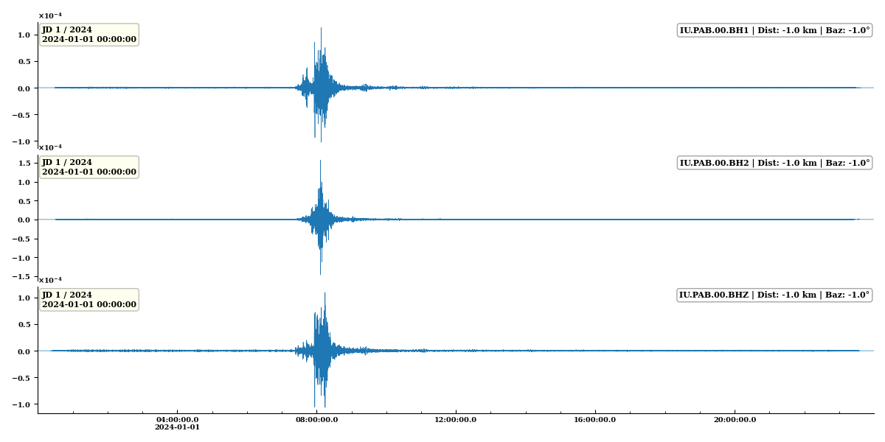

# <span style="color:darkcyan;"> **Basic Signal Processing Tutorial 3: Continuous Data, Instrument Response and Decimation** </span>

In the previous tutorials we processed short files or windows around earthquakes. Many studies, however, start with **days or months of continuous data**: ambient noise, detection of small events, monitoring of a volcano or a fault. Before any analysis, these data are usually prepared in the same way: the **instrument response** is removed, so that all the stations are in the same physical units, and the data are **decimated** to the sampling rate that the study needs, to reduce the volume of data and the computation time.

In this tutorial, we will learn how to work with a Python download script and the commands `project`, `processing_daily` and `quick` to:

1. **Download** three days of continuous data of the Global Seismographic Network (network **IU**) in **daily files**, together with the metadata.
2. Understand the **instrument response** and how to remove it to obtain **ground velocity**.
3. **Decimate** the data from 40 Hz to **5 Hz** without aliasing.
4. Process the data **day by day** with `processing_daily`, first interactively and then automatically.
5. Check the result.

We will download data from five stations of the IU network, some of the best broadband stations in the world:

| Station | Location |
|---------|----------|
| ANMO | Albuquerque, New Mexico, USA |
| HRV | Harvard, Massachusetts, USA |
| KONO | Kongsberg, Norway |
| PAB | San Pablo, Spain |
| TATO | Taipei, Taiwan |

We will download the first three days of 2024, from **1 to 3 January**. On 1 January, at 07:10 UTC, the **Mw 7.5 Noto Peninsula earthquake** (Japan) was recorded by all the stations of the world, so the data contain a large teleseismic event besides three days of seismic noise.

In this tutorial we will follow this structure:

- *Download script:* tutorial_daily/scripts
- *Seismic files:* tutorial_daily/data, created by the download script
- *Metadata:* tutorial_daily/metadata, created by the download script
- *Config Files:* tutorial_daily/configs
- *Project:* tutorial_daily/project
- *Processed files:* tutorial_daily/processed, created by surfquake

```
--tutorial_daily
    --scripts
        --download_iu.py
    --data
        --IU.ANMO.00.BH1.D.2024.001
        --IU.ANMO.00.BH2.D.2024.001
        --IU.ANMO.00.BHZ.D.2024.001
        ......
        --IU.TATO.00.BHZ.D.2024.003
    --metadata
        --IU_stations.xml
    --configs
        --response_config.yaml
        --plotting_config.yaml
    --project
    --processed
```

All the commands of this tutorial are run from the folder that contains `tutorial_daily`.

---

## Step 1: Download the data

The data of the IU network are freely available from the EarthScope data center (formerly IRIS), through the **FDSN web services**, a standard way of requesting seismic data and metadata over the internet. ObsPy, which is installed with surfquake, includes a client for these services.

Create the file `./tutorial_daily/scripts/download_iu.py`:

```python linenums="1"
"""
download_iu.py - Download continuous data of IU stations in daily MiniSEED files,
together with the StationXML metadata (including the instrument response).

Usage:
    python download_iu.py

Edit the parameters below to change the stations, the channels or the days.
"""

import os
from obspy import UTCDateTime
from obspy.clients.fdsn import Client
from obspy.clients.fdsn.header import FDSNNoDataException

# ---------------------------------------------------------------- parameters
DATA_CENTER = "IRIS"          # FDSN data center (with recent ObsPy you can also use "EARTHSCOPE")
NETWORK = "IU"                # Global Seismographic Network (IRIS/USGS)
STATIONS = ["ANMO", "HRV", "KONO", "PAB", "TATO"]
LOCATION = "00"               # primary broadband sensor
CHANNEL = "BH?"               # broadband, high gain, three components (use "BHZ" for a faster download)
START = UTCDateTime("2024-01-01")   # first day (00:00:00 UTC)
NDAYS = 3                     # number of days

OUT_DATA = "./tutorial_daily/data"
OUT_META = "./tutorial_daily/metadata"
# ---------------------------------------------------------------------------


def main():
    os.makedirs(OUT_DATA, exist_ok=True)
    os.makedirs(OUT_META, exist_ok=True)
    client = Client(DATA_CENTER, timeout=180)
    end = START + NDAYS * 86400

    # 1. Metadata with the instrument response
    print(f"[INFO] Downloading metadata of {NETWORK}: {', '.join(STATIONS)}")
    inv = client.get_stations(network=NETWORK, station=",".join(STATIONS), location=LOCATION,
                              channel=CHANNEL, starttime=START, endtime=end, level="response")
    meta_file = os.path.join(OUT_META, f"{NETWORK}_stations.xml")
    inv.write(meta_file, format="STATIONXML")
    print(f"[INFO] Metadata saved to {meta_file}")

    # 2. One file per channel and day: NET.STA.LOC.CHA.D.YEAR.JDAY
    for day in range(NDAYS):
        t1 = START + day * 86400
        t2 = t1 + 86400
        for sta in STATIONS:
            try:
                st = client.get_waveforms(NETWORK, sta, LOCATION, CHANNEL, t1, t2)
            except FDSNNoDataException:
                print(f"[WARN] No data for {NETWORK}.{sta} on {t1.date}")
                continue
            except Exception as e:
                print(f"[WARN] Download failed for {NETWORK}.{sta} on {t1.date}: {e}")
                continue

            gaps = st.get_gaps()
            if gaps:
                print(f"[INFO] {NETWORK}.{sta} {t1.date}: {len(gaps)} gap(s), filled by interpolation")
            st.merge(method=1, fill_value="interpolate")
            st.trim(t1, t2 - 1e-6, nearest_sample=False)   # exactly one day: [00:00, 24:00)

            for tr in st:
                name = f"{tr.id}.D.{t1.year}.{t1.julday:03d}"
                tr.write(os.path.join(OUT_DATA, name), format="MSEED")
                print(f"[INFO] {name}: {tr.stats.npts} samples at {tr.stats.sampling_rate} Hz")

    print("[INFO] Download complete")


if __name__ == "__main__":
    main()
```

What does it do?

- **The request.** `NETWORK`, `STATIONS`, `LOCATION` and `CHANNEL` are the four parts of a seismic channel code. The location `00` is the primary sensor of the IU stations. The channel `BH?` means **B**roadband, **H**igh-gain seismometer, and `?` any component.
- **The metadata** (`get_stations` with `level="response"`) is saved in one StationXML file. It contains the coordinates, the orientation of the components and, most important for this tutorial, the **instrument response** of every channel.
- **The waveforms** are requested day by day. Each day is merged (small gaps are filled by linear interpolation), trimmed to exactly 00:00–24:00 UTC, and written as **one MiniSEED file per channel and day**, with the name `NET.STA.LOC.CHA.D.YEAR.JDAY`, where `JDAY` is the day of the year (001, 002, 003).
- If a station has no data for one day, a warning is printed and the script continues with the next one.

Run it:

```bash
python ./tutorial_daily/scripts/download_iu.py
```

The terminal shows each file as it is written:

    [INFO] IU.ANMO.00.BH1.D.2024.001: 3456000 samples at 40.0 Hz
    ......

The IU broadband channels are usually recorded at **40 samples per second**: one day is 86400 × 40 = 3 456 000 samples per channel. The full download is up to 45 files (5 stations × 3 components × 3 days) and can take a few minutes. To make it faster, change `CHANNEL` to `"BHZ"` and keep only the vertical components.

!!! note
    Some IU stations name their horizontal components **1** and **2** instead of N and E, because the sensor is not exactly aligned with the north. Their real orientation is in the metadata. See the [Rotation and Polarization Tutorial](polarization_tutorial.md).

---

## Step 2: Create the project

```bash
surfquake project -d ./tutorial_daily/data -s ./tutorial_daily/project -n iu_raw
```

The summary shows the network, the 5 stations, and the time span of the project, from 2024-01-01 00:00:00 to 2024-01-03 23:59:59.

---

## Step 3: The instrument response

A seismometer does not record the ground motion directly. The ground moves the mass of the sensor, the sensor produces a voltage, and the digitizer converts the voltage into integer **counts**. Each of these stages amplifies some frequencies more than others. Together, they form the **instrument response** $I(f)$:

$$
C(f) = I(f)\, V(f)
$$

where $C(f)$ is the spectrum of the recorded counts and $V(f)$ the spectrum of the ground velocity. A broadband sensor like those of the IU network has an almost flat response in velocity over a wide band (typically from about 120 s to more than 10 Hz), and a response that decreases rapidly outside it.

**Removing the response** means dividing by it, in the frequency domain:

$$
V(f) = \frac{C(f)}{I(f)}
$$

This gives the ground velocity in **m/s**. Now, stations with different sensors and digitizers can be compared, their amplitudes have a physical meaning, and they can be used for magnitudes, spectral studies or ambient noise.

The division is dangerous where $I(f)$ is very small (very long periods, and frequencies close to the Nyquist frequency): there, the noise is divided by an almost zero number and explodes. Two tools stabilise it:

- **`pre_filt`**: four frequencies $[f_1, f_2, f_3, f_4]$ of a band-pass filter applied in the frequency domain. It is flat between $f_2$ and $f_3$ and goes smoothly to zero below $f_1$ and above $f_4$, so the unstable frequencies are removed.
- **`water_level`**: a floor for the response, in dB below its maximum. Where the response is weaker than this level, the division uses the level instead.

---

## Step 4: Decimation

Our data are at 40 Hz, so they contain frequencies up to 20 Hz (the **Nyquist frequency**, half of the sampling rate). Many studies need much less: teleseismic body and surface waves, the microseisms and the ambient noise are below 1–2 Hz. Decimating to **5 Hz** keeps the frequencies up to 2.5 Hz, and the data have **8 times fewer samples**: every later step is faster and needs less memory.

Decimating is not just keeping one sample out of eight. Frequencies above the new Nyquist frequency (2.5 Hz) would fold back into the band and contaminate it: this is **aliasing** (see [Tutorial 4](synthetic_tutorial.md)). So the method `resample` with `pre_filter: True`:

1. Applies an **anti-alias low-pass filter** at 90 % of the new Nyquist frequency (2.25 Hz).
2. Changes the sampling rate (from 40 to 5 Hz, a factor of 8). Factors larger than 10 are done in several steps.

---

## Step 5: The config file

Create the file `./tutorial_daily/configs/response_config.yaml`:

```yaml
Analysis:
  process_1:
    name: 'rmean'
    method: 'linear'
  process_2:
    name: 'taper'
    method: 'cosine'
    max_percentage: 0.05
  process_3:
    name: 'remove_response'
    units: 'VEL'
    water_level: 60
    pre_filt: [0.002, 0.004, 8.0, 10.0]
  process_4:
    name: 'resample'
    sampling_rate: 5.0
    pre_filter: True
```

Please review the following documentation:

[Processing Individual Traces Options](https://projectisp.github.io/surfquaketutorial.github.io/processing_config/){: target="_blank" rel="noopener noreferrer" }

Step by step:

- **`rmean` and `taper`**: remove the trend and bring the ends of each day to zero, as always before an FFT-based method. With one day of data, the 5 % taper affects the first and last 72 minutes of each day.
- **`remove_response`** to velocity (`VEL`):
    - `pre_filt: [0.002, 0.004, 8.0, 10.0]`: the band is flat between 0.004 Hz (250 s) and 8 Hz. At long periods, it removes the frequencies where the response of the sensor falls. At high frequencies, it stays well below the Nyquist frequency of the raw data (20 Hz). The decimation will remove everything above 2.25 Hz anyway.
    - `water_level: 60`: a floor 60 dB below the maximum of the response.
- **`resample`** to 5 Hz, with the anti-alias filter.

The order matters: first the response is removed at the original sampling rate, where the metadata describe the data exactly, and then the data are decimated.

!!! warning
    The response is removed with the metadata given with `-i`. If the response of a channel is not found (for example, if the metadata file does not include that station), its data are removed and a message is printed.

---

## Step 6: Process one day interactively

`processing_daily` is designed for continuous data: it divides the project into **time spans** (one day by default, `--span_seconds 86400`), and for each span reads the files of all the stations, processes them and, optionally, plots and saves them. Only one day is in memory at a time.

Create the plotting configuration:

```bash
surfquake make_config -c plotting_config -o "./tutorial_daily/configs"
```

and set `traces_per_fig: 3` in it, so each page shows the three components of one station.

Let's first check the processing on the first day:

```bash
surfquake processing_daily -p ./tutorial_daily/project/iu_raw -i ./tutorial_daily/metadata/IU_stations.xml -c ./tutorial_daily/configs/response_config.yaml --min_date "2024-01-01 00:00:00" --max_date "2024-01-02 00:00:00" --plot_config ./tutorial_daily/configs/plotting_config.yaml -f
```

- `-p`: the project.
- `-i`: the metadata, required to remove the response.
- `-c`: the config file.
- `--min_date`, `--max_date`: only the first day.
- `-f`: **fast plotting**. A day of data has hundreds of thousands of samples per trace; the fast mode draws a decimated envelope that looks the same and is much quicker.



The traces are now in **m/s**, at 5 Hz. Look at the Noto earthquake: the P wave arrives at about 07:14 UTC at TATO (18° from the earthquake), and between 07:22 and 07:24 UTC at KONO, ANMO, PAB and HRV (74° to 96°), and the large surface waves follow for more than an hour. The rest of the day is seismic noise, dominated by the **microseisms**, the waves generated by the ocean, with periods of 3 to 10 seconds.

Now, compare with the raw data. Open the prompt with `v`, and plot the spectrum of the vertical component:

```
>> sp 0
```

Then, in another terminal, open the raw file of the same channel and plot its spectrum too:

```bash
surfquake quick -w "./tutorial_daily/data/IU.PAB.00.BHZ.D.2024.001" -f
```

```
>> sp 0
```


- The raw spectrum is in **counts** and goes up to 20 Hz.
- The processed spectrum is in **m/s** and stops at 2.5 Hz, the new Nyquist frequency. Above 2.25 Hz it falls rapidly: this is the anti-alias filter.
- Between the corners of `pre_filt`, both spectra have the same shape, because the response of a broadband sensor is flat in velocity: removing it changes the units and the level, not the shape. The **microseism peak** (around 0.1–0.3 Hz) is clear in both.

When you close the figure, surfquake asks what to do next:

    [Prompt] Finished subproject 0. Type 'c' to continue, 'r' to reprocess this event, or 'e' to exit:

- `c`: continue with the next span.
- `r`: reload the config file and process the same day again. Use it to change a parameter (for example `water_level`) and see the effect without restarting.
- `e`: exit.

---

## Step 7: Process the three days automatically

Once the config is correct, process all the days without plots, and save the results:

```bash
surfquake processing_daily -p ./tutorial_daily/project/iu_raw -i ./tutorial_daily/metadata/IU_stations.xml -c ./tutorial_daily/configs/response_config.yaml -o ./tutorial_daily/processed --auto
```

- `-o`: output folder. It is created if it does not exist.
- `--auto`: no plots and no prompts. The files are written only in this mode (or when the plot is configured to be saved, not shown).

surfquake divides the project into three days and processes them one after the other:

    [INFO] Splitting into subprojects every 86400 seconds
    [0] 2024-01-01 00:00:00 → 2024-01-01 23:59:59 | 15 files | Event: span
    [1] 2024-01-02 00:00:00 → 2024-01-02 23:59:59 | 15 files | Event: span
    [2] 2024-01-03 00:00:00 → 2024-01-03 23:59:59 | 15 files | Event: span
    [INFO] Processing subproject 0 (daily stream)
    ......
    IU.ANMO.00.BHZ - Writing processed data to ./tutorial_daily/processed/IU.ANMO.00.BHZ.D.2024.001.h5

The processed files are written in **HDF5** format (`.h5`), which keeps the surfquake header of the traces, with the same naming convention as the raw files.

!!! tip
    - To process only some stations or components, use the filters `-n`, `-s` and `-ch`, for example `-ch "BHZ"`.
    - To process the whole time window as **a single stream** (for example, to obtain one continuous trace per channel for the three days), add `--time_segment` with `--min_date` and `--max_date`. Keep in mind that all the data are then in memory at the same time.
    - With `--span_seconds` you can use other spans, for example `--span_seconds 3600` for one-hour windows.

---

## Step 8: Check the result

Create a project with the processed data:

```bash
surfquake project -d ./tutorial_daily/processed -s ./tutorial_daily/project -n iu_vel_5hz
```

and look at the vertical components of the first day, now from the processed files:

```bash
surfquake quick -w "./tutorial_daily/processed/*BHZ.D.2024.001.h5" --plot_config ./tutorial_daily/configs/plotting_config.yaml -f
```

Check that:

- the sampling rate is **5 Hz** (the trace header shows `sampling_rate: 5.0` and 432 000 samples per day);
- the amplitudes are in **m/s**: very small numbers for the noise (ground velocities are tiny), and much larger ones for the surface waves of the Noto earthquake;
- the five stations, with different sensors, now have **comparable amplitudes**: TATO, the closest station to Japan, records the largest earthquake signal.

The new project `iu_vel_5hz` is now ready for the next steps of a study: ambient noise cross-correlation, spectral analysis, detection, etc.

---

## Using Bash script

Finally, the whole workflow in a [bash script file](https://projectisp.github.io/surfquaketutorial.github.io/bash_script/){: target="_blank" rel="noopener noreferrer" }. Create a file named `run_daily.sh`:

```bash
#!/bin/bash
# Activate your conda environment
eval "$(conda shell.bash hook)"
conda activate surfquake  # Replace with the name of your environment

BASE=./tutorial_daily

# 1. Download three days of IU data and the metadata
python $BASE/scripts/download_iu.py

# 2. Project with the raw data
surfquake project -d $BASE/data -s $BASE/project -n iu_raw

# 3. Remove the response and decimate to 5 Hz, day by day
surfquake processing_daily -p $BASE/project/iu_raw -i $BASE/metadata/IU_stations.xml -c $BASE/configs/response_config.yaml -o $BASE/processed --auto

# 4. Project with the processed data
surfquake project -d $BASE/processed -s $BASE/project -n iu_vel_5hz
```

```bash
chmod u+x run_daily.sh
./run_daily.sh
```

---

## Discussion

- Continuous data are usually organised in **daily files**, one per channel: `NET.STA.LOC.CHA.D.YEAR.JDAY`.
- The **FDSN web services** give free access to the data and metadata of many networks; ObsPy downloads them with a few lines of Python.
- Seismometers record **counts**. Removing the **instrument response** converts them to ground velocity (m/s), so stations with different instruments can be compared. `pre_filt` and `water_level` keep the deconvolution stable.
- **Decimation** reduces the volume of data. An anti-alias low-pass filter must be applied first, or high frequencies fold into the new band.
- **`processing_daily`** processes a project span by span (one day by default): check the processing interactively on one day, then run all the days with `--auto` and `-o`.

---

## References

Havskov, Jens, and Gerardo Alguacil. Instrumentation in Earthquake Seismology. 2nd ed. Springer (2016).

Scherbaum, Frank. Of Poles and Zeros: Fundamentals of Digital Seismology. 2nd ed. Springer (2001).
