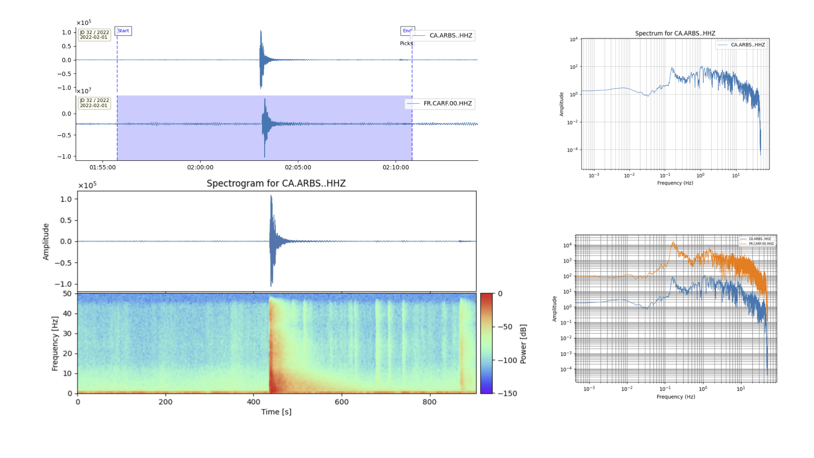

# <span style="color:darkcyan;"> **Time-Frequency Analysis** </span>

In this tutorial, we will learn how to work with the commands: `quick`, `specplot` to process your seismic waveforms.

In this tutorial we will follow this structure

- *Seismic files:* tutorial/data
- *Metadata:* tutorial/metadata
- *Config Files:* tutorial/configs
- *Folder for the tutorial output:* tutorial/time_freq, this must be created by the user.

For this tutorial you need to download the [seismic data here](https://github.com/rcabdia/test_surfquake/tree/main/Andorra/inputs/waveforms_cut){: target="_blank" rel="noopener noreferrer" }. Optionally, download the corresponding [metadata](https://github.com/rcabdia/test_surfquake/tree/main/Andorra/inputs/metadata){: target="_blank" rel="noopener noreferrer" }.

Please, first open a terminal, activate your enviroment and type the following command to overviewall surfquake capabilities:

```bash
surfquake -h
```

---


## Generate Config Files

When working with seismic waveforms it might be necessary to follow a signal processing workflow and plotting configuration. Let's prepare the necessary files.

```bash
surfquake make_config -h
surfquake make_config -c spectral_config -o "./tutorial/configs"
surfquake make_config -c typical_config -o "./tutorial/configs"
surfquake make_config -c plotting_config -o "./tutorial/configs"
```
The [plotting configuration](https://projectisp.github.io/surfquaketutorial.github.io/plotting_interaction_documentation/){: target="_blank" rel="noopener noreferrer" } is commented to explain the functionality. The parametrization for signal processing can be found [here for traces](https://projectisp.github.io/surfquaketutorial.github.io/processing_config/){: target="_blank" rel="noopener noreferrer" } and [here for streams](https://projectisp.github.io/surfquaketutorial.github.io/processing_stream_config/){: target="_blank" rel="noopener noreferrer" }.

---

## Process your waveform

Now that you have the set up done. Let's do a spectrogram interactively and then we will save it.

[Trace processing](https://projectisp.github.io/surfquaketutorial.github.io/processing_config/){: target="_blank" rel="noopener noreferrer" } and [plotting](https://projectisp.github.io/surfquaketutorial.github.io/plotting_interaction_documentation/){: target="_blank" rel="noopener noreferrer" }

```bash
surfquake quick -h
surfquake quick -w "./tutorial/data/*" -c "./configs/typical_config.yaml" --plot_config "./configs/plotting_config.yaml"
```

- Remember in this step you can select a time window press `i` starttime and `o` endtime.

---

## Interactive

We are going to compute the `spectrum`, `spectrogram` and the `Continouos Vavelet Transform`.

- Open an interactive propt pressing `v`. See the terminal, the directions for handle interactively the traces.


```bash
help spectrum
spectrum all loglog --mode fft

help spectrogram
spectrogram 0 5.0 50 --method fft --dates

help cwt
cwt 0 cm 6 0.5 10 -80 --dates
p
```



- Now before back to picking mode, let's save for example the spectrogram.

```bash
save_tf spectrogram 5.0 50 --method fft --folder_path ./time_freq
p #back to picking mode
```

---

## Automatic

- In this section we are going to compute Time-Frequency objects (just as the section above), but using a config file. The advantage is that we can automate big process and save this objects for later use. 

- Please review the section related to [Time-Frequency Objects](https://projectisp.github.io/surfquaketutorial.github.io/spectral_analysis_documentation/#understanding-and-accessing-spectral-result-objects-in-python){: target="_blank" rel="noopener noreferrer" } to understand the output files and take advange of the its design.

- Let's prepare the processing config file `spectral_config.yaml`. Below you will see that I concatenate the typical processing plus the computation of the speectrogram.

```bash
Analysis:
  process_1:
    name: 'rmean'
    method: 'linear'
  process_2:
    name: 'taper'
    method: 'cosine'
    max_percentage: 0.05
  process_3:
    name: 'filter'
    type: 'bandpass'
    fmin: 0.01
    fmax: 45.0
    corners: 4
    zerophase: True
  process_4:
      name: 'spectrogram'
      win: 5
      overlap: 75
      method: 'fft'
      output_path: absolute_path_to_your_output_folder
```

- In the terminal run the `quick` command. The command will filter the trace, compute the spectrogram and save the time_frequency opbject on your output folder.

```bash
surfquake quick -w "./tutorial/data/*" -c "./configs/spectral_config.yaml" -a
```

- Finally, we are going to open on of the files with the command `specplot`

```bash
surfquake specplot -h
surfquake specplot -f "./tutorial/time_freq/output_file.spec" -c "./configs/spectral_config.yaml" --plot_config "./configs/plotting_config.yaml" --split --smooth -a
```

I would like to tell you that, it might be possible to loop over your time-frequency objects to simply torage the image.

