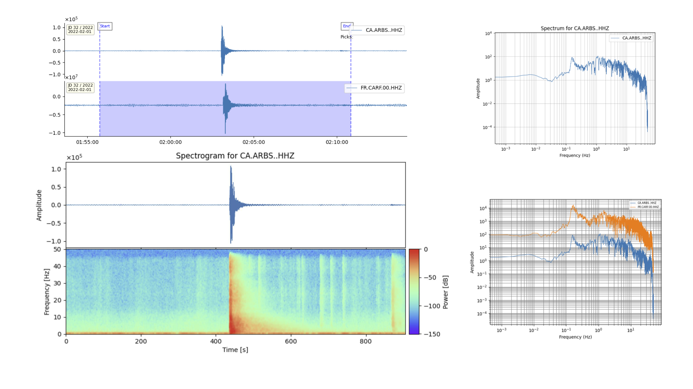

# <span style="color:darkcyan;"> **Time-Frequency Analysis Tutorial 2** </span>

In this tutorial, we will learn how to work with the commands: `quick` and `specplot` to compute, save and plot the spectrum, the spectrogram and the Continuous Wavelet Transform (CWT) of your seismic waveforms.

In this tutorial we will follow this structure:

- *Seismic files:* tutorial2/data
- *Metadata:* tutorial2/metadata
- *Config Files:* tutorial2/configs
- *Folder for the tutorial output:* tutorial2/time_freq, this will be created by surfquake.

```
--tutorial2
    --data
        --CA.ARBS..HH1.D.2022.32
        --CA.ARBS..HH2.D.2022.32
        --CA.ARBS..HHZ.D.2022.32
        ......
    --metadata
        --inv_all.xml
    --configs
        --typical_config.yaml
        --spectral_config.yaml
        --plotting_config.yaml
```

For this tutorial you need to download the [seismic data here](https://github.com/rcabdia/test_surfquake/tree/main/Andorra/inputs/waveforms_cut){: target="_blank" rel="noopener noreferrer" }. Optionally, download the corresponding [metadata](https://github.com/rcabdia/test_surfquake/tree/main/Andorra/inputs/metadata){: target="_blank" rel="noopener noreferrer" }.

All the commands of this tutorial are run from the folder that contains `tutorial2`.

Please, first open a terminal, activate your environment and type the following command to overview all surfquake capabilities:

```bash
surfquake -h
```

---

## Generate Config Files

As in the [Basic Signal Processing tutorial](tutorial1.md), let's prepare the necessary files. This time we also need the template for the spectral analysis.

```bash
surfquake make_config -h
surfquake make_config -c spectral_config -o "./tutorial2/configs"
surfquake make_config -c typical_config -o "./tutorial2/configs"
surfquake make_config -c plotting_config -o "./tutorial2/configs"
```

The [plotting configuration](https://projectisp.github.io/surfquaketutorial.github.io/plotting_interaction_documentation/){: target="_blank" rel="noopener noreferrer" } is commented to explain the functionality. The parametrization for signal processing can be found [here for traces](https://projectisp.github.io/surfquaketutorial.github.io/processing_config/){: target="_blank" rel="noopener noreferrer" } and [here for streams](https://projectisp.github.io/surfquaketutorial.github.io/processing_stream_config/){: target="_blank" rel="noopener noreferrer" }.

---

## Process your waveforms

Now that the set up is done, let's compute a spectrogram interactively and then save it.

Please review the following documentation:

[Trace processing](https://projectisp.github.io/surfquaketutorial.github.io/processing_config/){: target="_blank" rel="noopener noreferrer" } and [plotting](https://projectisp.github.io/surfquaketutorial.github.io/plotting_interaction_documentation/){: target="_blank" rel="noopener noreferrer" }

```bash
surfquake quick -h
surfquake quick -w "./tutorial2/data/*" -c "./tutorial2/configs/typical_config.yaml" --plot_config "./tutorial2/configs/plotting_config.yaml"
```

- In this step you can select a time window: place the mouse on a trace and press `u` (start time), then move it and press `i` (end time). The spectral analysis will be computed only inside this window. If you do not set a window, the full traces are used.

---

## Interactive

We are going to compute the `spectrum`, the `spectrogram` and the `Continuous Wavelet Transform`.

- Open an interactive prompt pressing `v`. The directions for interacting with the traces are printed in the terminal.
- The traces are referred to by their position on the current page: `0` is the first trace, `1` the second... and `all` means all the displayed traces.

```bash
help spectrum
spectrum all loglog --mode fft

help spectrogram
spectrogram 0 5.0 50 --method fft --dates

help cwt
cwt 0 cm 6 0.5 10 -80 --dates
```

- `spectrum all loglog --mode fft`: amplitude spectrum of all displayed traces, in log-log axes.
- `spectrogram 0 5.0 50 --method fft --dates`: spectrogram of the first trace, with windows of 5 s and 50 % overlap, and dates on the x axis.
- `cwt 0 cm 6 0.5 10 -80 --dates`: CWT of the first trace with a complex Morlet wavelet (`cm`) of 6 cycles, between 0.5 and 10 Hz, clipping the colour scale at -80 dB.



Before going back to picking mode, let's save the spectrogram. The command `save_tf` needs the product, the trace index (or `all`) and the output folder:

```bash
help save_tf
save_tf spectrogram 0 --win 5.0 --overlap 50 --method fft --folder_path ./tutorial2/time_freq
p
```

The file is saved as `<trace_id>.D.<year>.<julday>.spec`. If you selected a time window with `u` and `i`, only that window is saved. The plotted traces are not modified.

You can save the other products in the same way, for example `save_tf spectrum all --folder_path ./tutorial2/time_freq` or `save_tf cwt 0 --wavelet cm --param 6 --fmin 0.5 --fmax 10 --folder_path ./tutorial2/time_freq`.

---

## Automatic

In this section we compute the same Time-Frequency objects, but using a config file. The advantage is that we can automate big processes and save these objects for later use.

Please review the section related to [Time-Frequency Objects](https://projectisp.github.io/surfquaketutorial.github.io/spectral_analysis_documentation/#understanding-and-accessing-spectral-result-objects-in-python){: target="_blank" rel="noopener noreferrer" } to understand the output files and take advantage of their design.

Let's prepare the processing config file `spectral_config.yaml`. Below you can see that we chain the typical processing and the computation of the spectrogram:

```yaml
Analysis:
  process_1:
    name: 'rmean'
    method: 'linear'
  process_2:
    name: 'taper'
    method: 'cosine'
    max_percentage: 0.05
  process_3:
    name: 'filter'
    type: 'bandpass'
    fmin: 0.01
    fmax: 45.0
    corners: 4
    zerophase: True
  process_4:
    name: 'spectrogram'
    win: 5
    overlap: 75
    method: 'fft'
    output_path: './tutorial2/time_freq'
```

- `win`: window length in seconds. Longer windows give finer frequency resolution (about 1/win Hz) but coarser time resolution.
- `overlap`: overlap between consecutive windows, in percent.
- `method`: `fft` (fast) or `multitaper` (smoother, slower).
- `output_path`: folder where the results are written, it is created if missing.

The template `spectral_config.yaml` also contains commented examples for `spectrum`, `cwt`, `cross_spectrum`, `cepstrum` and `cepstrogram`.

In the terminal run the `quick` command in automatic mode (`-a`). The command will filter the traces, compute the spectrograms and save the time-frequency objects in your output folder:

```bash
surfquake quick -w "./tutorial2/data/*" -c "./tutorial2/configs/spectral_config.yaml" -a
```

---

## Plot your Time-Frequency objects

Finally, we are going to open one of the files with the command `specplot`. It recognises the type of object from the file extension (`.sp`, `.spec`, `.cwt`, `.coh`, `.cep`, `.ceps`).

```bash
surfquake specplot -h
surfquake specplot -f "./tutorial2/time_freq/CA.ARBS..HHZ.D.2022.32.spec" --split --smooth -d
```

- `--split`: split the plot into low and high frequency panels (default cutoff 1 Hz, for example `--split 0.5` to change it).
- `--smooth` (`-s`): smooth the time-frequency plane (slower, but prettier).
- `-d` (`--dates`): dates on the x axis instead of seconds.
- `-c` (`--clip`): minimum power displayed, in dB (for example `-c -100`).
- `--cmap`: Matplotlib colormap (default `rainbow`).

To save the figure instead of only showing it, add `--save_path`:

```bash
surfquake specplot -f "./tutorial2/time_freq/CA.ARBS..HHZ.D.2022.32.spec" --split --smooth -d --save_path "./tutorial2/time_freq"
```

---

## Using Bash script

Since every time-frequency object is a file, you can loop over them and save all the images at once. Create a file named `plot_spec.sh`:

```bash
#!/bin/bash

# Activate your conda environment
eval "$(conda shell.bash hook)"
conda activate surfquake  # Replace with the name of your environment

for file in ./tutorial2/time_freq/*.spec; do
    surfquake specplot -f "$file" --split --smooth -d --save_path "./tutorial2/time_freq"
done
```

Open a terminal in your working directory and run it:

```bash
chmod u+x plot_spec.sh
./plot_spec.sh
```
