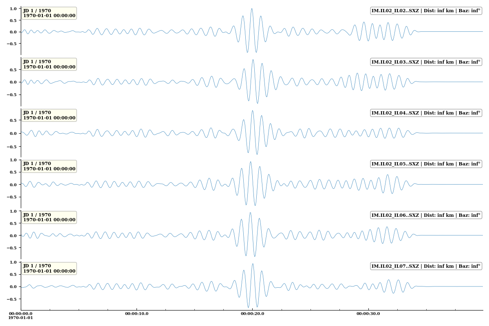
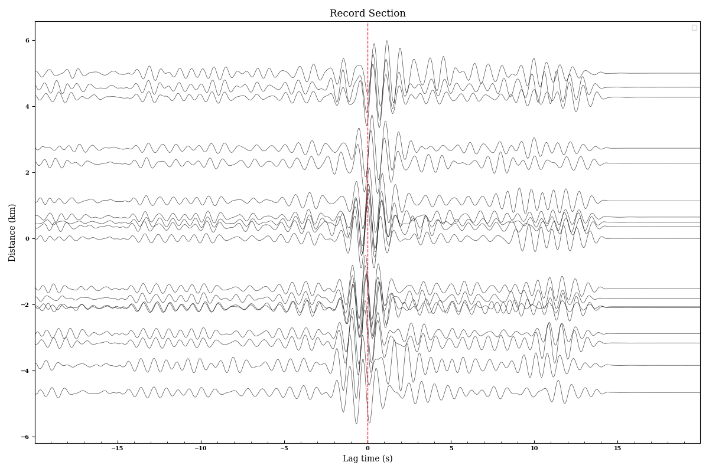
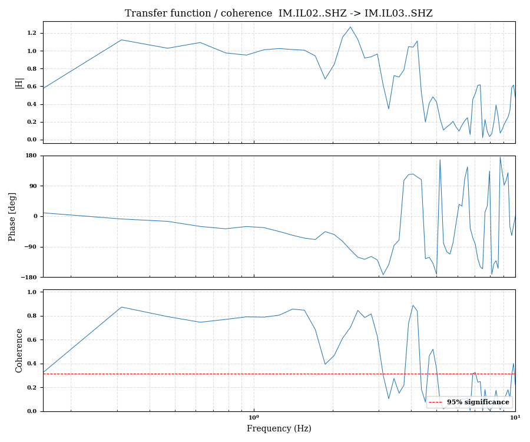

# <span style="color:darkcyan;"> **Array Processing: Cross-Correlation and Coherence Tutorial 4 (Part 2)** </span>

In the [Beamforming Tutorial](beamforming_tutorial.md), we found the direction and the slowness of the P wave of the North Korea nuclear test by testing all the possible plane waves on the ILAR array. In this tutorial, we will look at the same data from a different angle: we will **compare the stations two by two**. Because ILAR is a small array, the P wave looks almost the same at all its stations, and only arrives a little earlier or later. Measuring how similar two waveforms are, and how much one is delayed with respect to the other, is the job of the **cross-correlation** in the time domain, and of the **cross-spectrum** and the **coherence** in the frequency domain.

We will learn how to work with the commands `quick` and `specplot`, and the interactive commands `cut`, `xcorr`, `runpy` and `coh`, to:

1. Cross-correlate the P wave of every station with a reference station.
2. Measure the **delays** between stations, and fit a **plane wave** to them: a beamforming "by hand".
3. Recognise **cycle skipping**, the classic error of cross-correlation.
4. Compute the **coherence** and the **transfer function** between two stations, and see how the similarity changes with frequency and distance.
5. Repeat everything **automatically** with a config file and a post-script.

The data is the same as in the beamforming tutorial: the **North Korea nuclear test of 3 September 2017** (origin time 03:30:01 UTC), recorded at the 18 vertical short-period stations of the **ILAR array** (network IM, Alaska), at 20 samples per second. The P wave arrives at about 03:39:03.5 UTC.

In this tutorial we will follow this structure:

- *Seismic files:* tutorial3/data
- *Metadata:* tutorial3/metadata
- *Config Files:* tutorial3/configs
- *Scripts:* tutorial3/scripts
- *Folder for the coherence results:* tutorial3/coh, this will be created by surfquake.

```
--tutorial3
    --data
        --IM.IL02..SHZ
        --IM.IL03..SHZ
        ......
        --IM.IL19..SHZ
    --metadata
        --dataless.dlsv
    --configs
        --plotting_config.yaml
        --filter_config.yaml
        --xcorr_config.yaml
        --plotting_record.yaml
    --scripts
        --xcorr_lags.py
```

If you have not done the beamforming tutorial, download the [seismic data here](https://github.com/ProjectISP/ISP/tree/master/isp/examples/NuclearExplotionILAR_2017){: target="_blank" rel="noopener noreferrer" } and the [metadata here](https://github.com/ProjectISP/ISP/tree/master/isp/Metadata/dataless_LASA){: target="_blank" rel="noopener noreferrer" }, and create the plotting configuration:

```bash
surfquake make_config -c plotting_config -o "./tutorial3/configs"
```

All the commands of this tutorial are run from the folder that contains `tutorial3`.

---

## A bit of theory

### Cross-correlation

The cross-correlation of a reference trace $x(t)$ and a trace $y(t)$ measures their similarity when $y$ is shifted by a **lag** $\tau$:

$$
C(\tau) = \frac{\sum_t x(t)\, y(t+\tau)}{\sqrt{\sum_t x^2(t)\,\sum_t y^2(t+\tau)}}
$$

With this normalisation, $C$ is a **correlation coefficient** between −1 and 1: 1 means that the two waveforms are identical (except for a scale factor), 0 that they have nothing in common, and −1 that they are identical but with opposite polarity. The lag of the maximum is the **delay** of $y$ with respect to $x$: a positive lag means that the wave arrives **later** at $y$ than at the reference.

The correlation of a trace with itself is the **autocorrelation**: its maximum is always 1, at lag 0.

### Plane wave

A teleseismic P wave crosses a small array as a **plane wave**. If the station $i$ is at position $(x_i, y_i)$ (east and north, in km) from the reference, its delay is:

$$
\tau_i = s_x\, x_i + s_y\, y_i
$$

where $(s_x, s_y)$ is the **slowness vector** (s/km). Its length is the slowness $s$ (the inverse of the apparent velocity), and it points in the direction of propagation, opposite to the back-azimuth. With the delays of three or more stations, the slowness vector is found by least squares. This is the principle of the slowness vector estimation with arrays (Cabieces et al., 2020).

### Cross-spectrum, coherence and transfer function

In the frequency domain, the traces are cut into overlapping windows, and the spectra $X(f)$ and $Y(f)$ of the windows are averaged (Welch method) to build:

- the **cross-spectrum**: $G_{xy}(f) = \langle X^*(f)\, Y(f) \rangle$
- the **coherence**: $\gamma^2(f) = \dfrac{|G_{xy}(f)|^2}{G_{xx}(f)\, G_{yy}(f)}$, between 0 and 1
- the **transfer function**: $H(f) = G_{xy}(f) / G_{xx}(f)$, with an amplitude and a phase

The coherence is the "correlation coefficient" of each frequency: it is close to 1 when, window after window, the two traces have the same amplitude ratio and the same phase difference at that frequency. A delay $\tau$ produces a phase that changes linearly with frequency:

$$
\phi(f) = -360°\, f\, \tau
$$

Please review the following documentation:

[Processing Stream](https://projectisp.github.io/surfquaketutorial.github.io/processing_stream_config/){: target="_blank" rel="noopener noreferrer" }, [Time-Frequency Analysis](https://projectisp.github.io/surfquaketutorial.github.io/spectral_analysis_documentation/){: target="_blank" rel="noopener noreferrer" } and [Scripts](https://projectisp.github.io/surfquaketutorial.github.io/scripts/){: target="_blank" rel="noopener noreferrer" }

---

## Prepare the files

### Config files

Create the file `./tutorial3/configs/filter_config.yaml`. It prepares the traces and keeps the band where the P wave is clear, as in the beamforming tutorial:

```yaml
Analysis:
  process_1:
    name: 'rmean'
    method: 'linear'
  process_2:
    name: 'taper'
    method: 'cosine'
    max_percentage: 0.05
  process_3:
    name: 'filter'
    type: 'bandpass'
    fmin: 0.8
    fmax: 2.2
    corners: 4
    zerophase: True
```

Open `./tutorial3/configs/plotting_config.yaml` and set these keys. They are used later to plot the correlations as a record section:

```yaml
  traces_per_fig: 6
  record_option: egf
  scale_factor: 0.3
```

`record_option: egf` draws the record section against the **lag time**, with a red line at lag 0.

### The post-script

surfquake computes the correlations, and a short Python script reads their maxima. Create the file `./tutorial3/scripts/xcorr_lags.py` with this content:

```python linenums="1"
"""
xcorr_lags.py - Lag times of the cross-correlations and plane-wave fit.

Use it after the stream method 'cross_correlate' (mode 'full', trim True):

  - Automatic (quick / processing):  --post_script xcorr_lags.py --post_script_stage before
  - Interactive (command prompt):     runpy xcorr_lags.py

For every cross-correlation trace it prints the lag of the maximum and the
correlation coefficient. Then it fits a plane wave to the reliable lags,
t = sx * x + sy * y, and prints the slowness and the back-azimuth.
Finally, it stores in the header of each trace its distance along the
direction of propagation, so the correlations can be plotted as a record
section (plot_type: record, record_option: egf).
"""

import numpy as np
from obspy import read_inventory
from obspy.geodetics import gps2dist_azimuth

INVENTORY = "./tutorial3/metadata/dataless.dlsv"  # used when the script runs with runpy
MIN_CC = 0.7      # minimum correlation coefficient of a reliable lag
MAX_SLOW = 0.10   # s/km. A lag longer than MAX_SLOW * distance is not physical (cycle skip)


def _peak(data):
    """Index of the maximum, refined with a parabola through the three samples around it."""
    k = int(np.argmax(data))
    if 0 < k < len(data) - 1:
        a, b, c = data[k - 1], data[k], data[k + 1]
        den = a - 2 * b + c
        if den != 0:
            return k + 0.5 * (a - c) / den, data[k]
    return float(k), data[k]


def _coords(inventory, trace_id):
    net, sta = trace_id.split(".")[:2]
    station = inventory.select(network=net, station=sta)[0][0]
    return station.latitude, station.longitude


def run(stream, inventory=None, event=None):
    if inventory is None:
        inventory = read_inventory(INVENTORY)

    rows = []
    for tr in stream:
        ref_id = tr.stats.get("correlation_with")
        sta_id = tr.stats.get("original_trace")
        if ref_id is None or sta_id is None:
            continue  # not a cross-correlation trace
        zero_lag = (tr.stats.npts - 1) // 2
        k, cc = _peak(tr.data)
        lag = (k - zero_lag) * tr.stats.delta
        lat0, lon0 = _coords(inventory, ref_id)
        lat1, lon1 = _coords(inventory, sta_id)
        dist_m, az, _ = gps2dist_azimuth(lat0, lon0, lat1, lon1)
        dist = dist_m / 1000.0
        x, y = dist * np.sin(np.radians(az)), dist * np.cos(np.radians(az))
        ok = (cc >= MIN_CC) and (abs(lag) <= MAX_SLOW * dist + tr.stats.delta)
        rows.append((tr, sta_id, dist, x, y, lag, cc, ok))

    if not rows:
        print("[xcorr_lags] No cross-correlation traces found.")
        return stream

    print(f"\n[xcorr_lags] Reference: {rows[0][0].stats.correlation_with}")
    print(f"{'Station':<16}{'Dist (km)':>10}{'Lag (s)':>10}{'CC':>7}  Used")
    for _, sta_id, dist, x, y, lag, cc, ok in rows:
        print(f"{sta_id:<16}{dist:>10.2f}{lag:>+10.3f}{cc:>7.2f}  {'yes' if ok else 'NO'}")

    good = [r for r in rows if r[7] and r[2] > 0]
    if len(good) < 3:
        print("[xcorr_lags] Not enough reliable lags for a plane-wave fit.")
        return stream

    A = np.array([[r[3], r[4]] for r in good])
    t = np.array([r[5] for r in good])
    (sx, sy), *_ = np.linalg.lstsq(A, t, rcond=None)
    slowness = np.hypot(sx, sy)
    baz = (np.degrees(np.arctan2(sx, sy)) + 180.0) % 360.0
    rms = np.sqrt(np.mean((t - A @ np.array([sx, sy])) ** 2))
    print(f"\n[xcorr_lags] Plane wave from {len(good)} stations:")
    print(f"   Slowness      : {slowness:.4f} s/km  (apparent velocity {1 / slowness:.1f} km/s)")
    print(f"   Back-azimuth  : {baz:.1f} deg")
    print(f"   RMS residual  : {rms:.3f} s\n")

    # Distance along the direction of propagation, for the record section
    ux, uy = sx / slowness, sy / slowness
    for tr, _, _, x, y, *_ in rows:
        tr.stats.geodetic = {"geodetic": [x * ux + y * uy, 0.0, 0.0, 0.0]}

    return stream


def process(stream):
    """Entry point of the interactive command runpy."""
    return run(stream)
```

What does it do?

- **Lag of the maximum** (`_peak`): the correlation is sampled every 0.05 s. A parabola through the maximum and its two neighbours gives the lag with a precision better than one sample.
- **Reliable lags**: a lag is used only if the correlation coefficient is at least `MIN_CC` (0.7), and if it is physically possible: no P wave crosses the array slower than `MAX_SLOW` (0.1 s/km), so the lag cannot be longer than 0.1 s per km of distance between the stations.
- **Plane-wave fit**: the least-squares solution of $\tau_i = s_x x_i + s_y y_i$.
- **Record section**: the distance of each station along the direction of propagation is stored in the header (`geodetic`), so the correlations can be ordered in a record section.

The script has a function `run(stream, inventory, event)` for the automatic mode and a function `process(stream)` for the interactive command `runpy`, so the same file works in both.

---

## Step 1: Cross-correlate the P wave interactively

Open the array with the filter:

```bash
surfquake quick -w "./tutorial3/data/*" -c "./tutorial3/configs/filter_config.yaml" --plot_config "./tutorial3/configs/plotting_config.yaml"
```

Zoom around the P wave, at 03:39. The correlation must be computed on the **P wave only**, not on the two hours of data, where the noise would dominate. Select the window: place the mouse at **03:39:00** and press `u`, then at **03:39:20** and press `i`. This window starts 3.5 s before the P onset and contains the first and strongest cycles of the P wave.

Open the prompt with `v`, and cut the traces to the window:

```
>> cut
```

Then cross-correlate all the traces with the first one:

```
>> help xcorr
>> xcorr --ref 0 --mode full --normalize full
```

- `--ref 0`: the reference is the first trace, IM.IL02..SHZ.
- `--mode full`: all the possible lags are computed, from −20 to +20 s.
- `--normalize full`: the correlation coefficient of the equation above, between −1 and 1.

The traces are replaced by 18 correlations, named after the two stations: `IM.IL02_IL03..SXZ` is the correlation of IL03 with the reference IL02, and `IM.IL02_IL02..SXZ` is the autocorrelation of IL02.



!!! warning
    `--ref` is the position of the trace in the list of loaded traces. Check the name of the correlations: the station before the underscore is the reference.

!!! note
    The horizontal axis of a correlation is a **lag**, not a date: surfquake draws the correlations starting at 1970-01-01 00:00:00, which is the default start time of a new trace. In Step 2 we will plot them against the lag time.

---

## Step 2: Delays and plane wave

Open the prompt again with `v`, and run the post-script on the correlations:

```
>> runpy ./tutorial3/scripts/xcorr_lags.py
```

The script prints a table with the lag and the correlation coefficient of every station, and the plane wave:

    [xcorr_lags] Reference: IM.IL02..SHZ
    Station          Dist (km)   Lag (s)     CC  Used
    IM.IL02..SHZ          0.00    -0.000   1.00  yes
    IM.IL03..SHZ          1.61    +0.105   0.89  yes
    IM.IL04..SHZ          3.14    +0.065   0.86  yes
    IM.IL05..SHZ          3.07    -0.104   0.92  yes
    IM.IL06..SHZ          1.99    -0.126   0.93  yes
    IM.IL07..SHZ          2.02    +0.081   0.93  yes
    IM.IL08..SHZ          3.27    +0.268   0.88  yes
    IM.IL09..SHZ          4.28    +0.321   0.83  yes
    IM.IL10..SHZ          3.69    +0.201   0.84  yes
    IM.IL11..SHZ          5.07    +0.033   0.84  yes
    IM.IL12..SHZ          5.84    -0.145   0.91  yes
    IM.IL13..SHZ          7.12    -1.065   0.64  NO
    IM.IL14..SHZ          5.58    -0.274   0.89  yes
    IM.IL15..SHZ          3.81    -0.172   0.89  yes
    IM.IL16..SHZ          2.88    -0.141   0.91  yes
    IM.IL17..SHZ          2.79    -0.055   0.93  yes
    IM.IL18..SHZ          5.15    +1.170   0.66  NO
    IM.IL19..SHZ          5.35    +0.335   0.69  NO

    [xcorr_lags] Plane wave from 14 stations:
       Slowness      : 0.0663 s/km  (apparent velocity 15.1 km/s)
       Back-azimuth  : 292.2 deg
       RMS residual  : 0.046 s

What can we learn from this table?

- **The waveforms are very similar.** Most correlation coefficients are between 0.83 and 0.93: the P wave is almost the same signal at stations up to 6 km apart.
- **The delays are small**, less than ±0.35 s for the reliable stations. The P wave crosses the 10 km of ILAR in less than a second. The stations to the east (IL08, IL09, IL10) have positive lags, and the stations to the west (IL12, IL14, IL15) negative lags: the wave comes from the west.
- **The plane wave explains the delays** with an RMS residual of 0.046 s, less than one sample (0.05 s), thanks to the parabolic interpolation of the maximum.
- **The solution agrees with the beamforming.** A slowness of 0.066 s/km and a back-azimuth of 292° are close to the theoretical values of the P wave from North Korea (0.068 s/km and 286°). As with the beamforming, the difference of a few degrees in back-azimuth comes from the structure under the array and along the path.

Now, let's see the correlations as a record section against the lag time:

```
>> plot_type record
```



Each correlation is drawn at the distance of its station **along the direction of propagation** (negative: the station is reached before the reference). The maxima of the correlations line up along a straight line through lag 0: its slope is the slowness. This is exactly the plane wave that the beamforming searches for. Zoom between −2 and 2 s to see it.

### Cycle skipping

Look at IL13 and IL18 in the table. The plane wave predicts a lag of −0.26 s for IL13 and +0.33 s for IL18, but the maxima of their correlations are at −1.07 and +1.17 s, about **0.8 s** away. The P wave is a band-limited signal, almost periodic, with a dominant period of about 0.8 s: its correlation has several maxima separated by one period. When the waveforms are less similar (IL13 and IL18 are the most distant stations from IL02, 7.1 and 5.2 km), the wrong maximum can become the highest one. This is **cycle skipping**, the classic error of cross-correlation with narrow-band signals.

The two checks of the script remove these lags: their correlation coefficient is low (0.64 and 0.66), and the lags are not physically possible (1.07 s over 7.1 km would be a slowness of 0.15 s/km).

!!! tip
    Try a shorter window, 03:39:02–03:39:12. The correlation coefficients become higher (above 0.7 for all the stations), but IL13 and IL18 still skip a cycle: a high coefficient does not guarantee the right lag. The physical limit `MAX_SLOW` still catches them, and the solution is the same (0.068 s/km, 293°). To reduce cycle skipping: use a window long enough to contain the whole P wave, a broader frequency band, or a reference station in the centre of the array.

To close the interactive session:

```
>> exit
```

---

## Step 3: Coherence between two stations

The cross-correlation gives one number for the whole band. The coherence tells us **at which frequencies** two stations record the same signal.

Open four stations, without filtering: the reference IL02, the closest station IL03 (1.6 km), and IL09 (4.3 km) and IL13 (7.1 km). A list of files separated by commas keeps this order:

```bash
surfquake quick -w "./tutorial3/data/IM.IL02..SHZ,./tutorial3/data/IM.IL03..SHZ,./tutorial3/data/IM.IL09..SHZ,./tutorial3/data/IM.IL13..SHZ" --plot_config "./tutorial3/configs/plotting_config.yaml"
```

Select the same window of the P wave (03:39:00–03:39:20) with `u` and `i`, open the prompt with `v`, and type:

```
>> help coh
>> coh --ref IM.IL02..SHZ --win 4 --axis xlog
```

- `--ref`: the reference trace, by its index on the page or by its id.
- `--win 4`: the length of the Welch windows, in seconds. The 20 s window is divided into 9 windows of 4 s overlapping 50 %, and their spectra are averaged.
- `--axis xlog`: logarithmic frequency axis.

A figure is opened for each station, with three panels: the amplitude $|H(f)|$ and the phase of the transfer function, and the coherence. The red dashed line is the **95 % significance level**: a coherence below it cannot be distinguished from the coherence of two unrelated noises.



These are the mean coherences in three frequency bands:

| Window | Station | 0.8–2.2 Hz | 3–5 Hz | 6–9 Hz | Significance (95 %) |
|--------|---------|------------|--------|--------|---------------------|
| P wave (03:39:00–03:39:20) | IL03 (1.6 km) | 0.71 | 0.37 | 0.10 | 0.31 |
| P wave (03:39:00–03:39:20) | IL13 (7.1 km) | 0.46 | 0.21 | 0.10 | 0.31 |
| Noise (03:36:00–03:38:30) | IL03 (1.6 km) | 0.10 | 0.14 | 0.02 | 0.04 |
| Noise (03:36:00–03:38:30) | IL13 (7.1 km) | 0.02 | 0.04 | 0.02 | 0.04 |

To obtain the noise rows, select a window before the P wave, from 03:36:00 to 03:38:30, and repeat the command.

- **The P wave is coherent in its band.** Between 0.8 and 2.2 Hz the coherence of the P wave is well above the significance level, while the noise in the same band is almost incoherent. This is why the beamforming and the correlations work in this band.
- **The coherence decreases with frequency.** At 3–5 Hz it is lower, and above 6 Hz it is at the level of the noise: the teleseismic P wave has lost its high frequencies along its path of more than 5000 km, and what remains at the stations is local noise.
- **The coherence decreases with distance.** IL13 is less coherent than IL03 at all frequencies: the farther the stations, the more the structure under each one changes the waveform. This is the reason why IL13 skipped a cycle in Step 2.

### The phase gives the delay

Look at the phase panel of IL09. Between 0.8 and 2.2 Hz, where the coherence is high, the phase decreases almost linearly with frequency: from about −115° at 0.8 Hz to about −235° at 2.2 Hz (drawn as +125°, because the phase is wrapped between −180° and 180°). The slope is about −85° per Hz, so the delay is $\tau \approx 85 / 360 \approx 0.24$ s. The correlation gave 0.32 s: the phase is noisier, but it confirms that IL09 receives the wave later than IL02. For IL13 the phase increases with frequency: IL13 receives the wave **before** IL02.

!!! warning "Never use a single window"
    Repeat the command with `--win 20`: the Welch window is now as long as the data, so there is nothing to average, and the coherence is exactly **1 at all frequencies**, also for pure noise. The coherence is only meaningful when it is averaged over several windows. The more windows, the lower the significance level (here 0.31 with 9 windows, 0.04 with the 74 windows of the noise). Keep in mind that overlapping windows are not fully independent, so the real significance level is a bit higher than the one drawn.

To save the coherences and transfer functions to disk:

```
>> save_tf coh all --ref 0 --win 4 --folder_path ./tutorial3/coh
```

---

## Step 4: Automatic

Now, the whole workflow in a config file. Create `./tutorial3/configs/xcorr_config.yaml`:

```yaml
Analysis:
  process_1:
    name: 'rmean'
    method: 'linear'
  process_2:
    name: 'taper'
    method: 'cosine'
    max_percentage: 0.05
  process_3:
    name: 'filter'
    type: 'bandpass'
    fmin: 0.8
    fmax: 2.2
    corners: 4
    zerophase: True
  process_4:
    name: 'cut_stream'
    method: 'absolute'
    start: 2017-09-03T03:39:00
    end: 2017-09-03T03:39:20
  process_5:
    name: 'cross_spectrum'
    method: 'welch'
    win: 4.0
    overlap_percent: 50.0
    reference_idx: 0
    output_path: './tutorial3/coh'
  process_6:
    name: 'cross_correlate'
    mode: 'full'
    normalize: 'full'
    reference_idx: 0
    trim: True
```

- The trace methods (`rmean`, `taper`, `filter`) are applied first to the two hours of data, and then the stream methods, in order. This is important: filtering before cutting avoids the edge effects of filtering a short window.
- `cut_stream` keeps the 20 s of the P wave at all the stations.
- `cross_spectrum` computes the coherence and the transfer function of every station with respect to the reference, and saves them in `output_path`. It does not change the traces. Since the traces are already filtered, look at the results only between 0.8 and 2.2 Hz.
- `cross_correlate` replaces the traces by their correlations with the reference. It must be the **last** step, because the following steps would receive correlations instead of waveforms.

Create also a small plotting configuration, `./tutorial3/configs/plotting_record.yaml`, for the record section:

```yaml
plotting:
  plot_type: record
  record_option: egf
  scale_factor: 0.3
```

And run it, passing the metadata (needed by the post-script) and the post-script, which runs before the plot:

```bash
surfquake quick -w "./tutorial3/data/*" -i "./tutorial3/metadata/dataless.dlsv" -c "./tutorial3/configs/xcorr_config.yaml" --plot_config "./tutorial3/configs/plotting_record.yaml" --post_script "./tutorial3/scripts/xcorr_lags.py" --post_script_stage before
```

The terminal shows the files written by `cross_spectrum`, one per station:

    [INFO] IM.IL02..SHZ -> IM.IL03..SHZ - Writing cross-spectral result to ./tutorial3/coh/IM.IL02..SHZ__IM.IL03..SHZ.D.2017.246.coh

then the table and the plane wave of Step 2, and finally the record section of the correlations.

Open any of the coherence files with `specplot`:

```bash
surfquake specplot -f "./tutorial3/coh/IM.IL02..SHZ__IM.IL13..SHZ.D.2017.246.coh" -a xlog
```

!!! tip
    `reference_idx` is the position of the trace in the stream. Check the names of the output files and of the correlations to confirm which station is the reference.

---

## Using Bash script

Finally, the automatic workflow in a [bash script file](https://projectisp.github.io/surfquaketutorial.github.io/bash_script/){: target="_blank" rel="noopener noreferrer" }. Create a file named `run_xcorr.sh`:

```bash
#!/bin/bash
# Activate your conda environment
eval "$(conda shell.bash hook)"
conda activate surfquake  # Replace with the name of your environment

BASE=./tutorial3

surfquake quick -w "$BASE/data/*" -i "$BASE/metadata/dataless.dlsv" -c "$BASE/configs/xcorr_config.yaml" --plot_config "$BASE/configs/plotting_record.yaml" --post_script "$BASE/scripts/xcorr_lags.py" --post_script_stage before
surfquake specplot -f "$BASE/coh/IM.IL02..SHZ__IM.IL13..SHZ.D.2017.246.coh" -a xlog --save_path "$BASE/coh"
```

```bash
chmod u+x run_xcorr.sh
./run_xcorr.sh
```

---

## Discussion

- The **cross-correlation** measures the similarity of two waveforms and the **delay** between them. On a small array, the P wave of a teleseism is very similar at all the stations (coefficients of 0.83–0.93 at ILAR).
- The delays of a plane wave depend linearly on the position of the stations. A least-squares fit gives the **slowness** and the **back-azimuth**, in agreement with the beamforming.
- **Cycle skipping**: with narrow-band signals, the correlation has maxima separated by one period, and the highest one is not always the right one. Check the correlation coefficient **and** that the lag is physically possible.
- The **coherence** shows at which frequencies two stations record the same signal. At ILAR, the P wave is coherent between 0.8 and 2.2 Hz, and the coherence decreases with frequency and with the distance between the stations.
- The **phase** of the transfer function changes linearly with frequency: its slope is the delay.
- The coherence needs **averaging**: with a single window it is always 1.
- Correlate and compute the coherence on a window that contains the **signal**; on long windows of noise, the result describes the noise.

---

## References

Bendat, Julius S., and Allan G. Piersol. Random Data: Analysis and Measurement Procedures. 4th ed. John Wiley & Sons (2010).

Cabieces, Roberto, et al. "Slowness vector estimation over large-aperture sparse arrays with the Continuous Wavelet Transform (CWT): application to Ocean Bottom Seismometers." Geophysical Journal International 223.3 (2020): 1919-1934.
